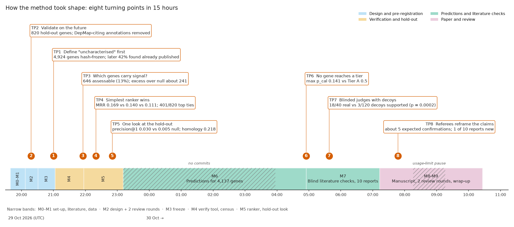

# How we got here

**The main point:** the method in [METHOD.md](METHOD.md) looks the way it does because one rule was applied again and
again: *fix the rule before seeing the answer, then test it on genes whose function was discovered after 2018*. Each of
its seven steps exists because a check showed that a looser version would have overstated what co-essentiality can do.
Three consequences shaped the final result:

1. **The gene list came first.** "Uncharacterised" was defined from annotation databases and the 4,924-gene list was
   frozen by a hash before any gene–gene score was computed ([TP1](#tp-1)). This kept the study honest. A later audit
   showed that the definition also admitted many genes whose function is already published, which became a finding of
   its own ("curation lag").
2. **Confidence was measured on the future.** Accuracy and calibration come from 809 genes that were uncharacterised in
   2018 and gained experimental annotation since ([TP2](#tp-2), [TP5](#tp-5)). Co-essentiality's top GO term was right
   for 3.0% of them, which is above chance (0.5%), no better than an older co-essentiality method (GLS), and far below
   the gene's own 2018 electronic annotations (21.8%).
3. **Every count was cut down by its control.** Only a few hundred genes carry a usable signal ([TP3](#tp-3)), no gene
   reached the pre-set confidence tiers ([TP6](#tp-6)), and blinded literature judges mostly confirmed functions that
   were already published or already predicted ([TP7](#tp-7)). Referee agents forced the final framing, an honest
   evaluation rather than a discovery list, at the very end ([TP8](#tp-8)).

[Step 2](METHOD.md#step-2) (scoring co-essentiality) has no turning point of its own. The brief fixed the tool, and the
agents only checked that it ran correctly on DepMap (it reproduced its published benchmark, 0.3451 against 0.345).

The project ran from 19:39 on 29 October to 10:26 on 30 October 2026 (UTC; publication clean-up followed at 11:39–11:52).
A principal-investigator agent ("the PI", Claude Opus 5.5) designed the study and made the decisions. Sub-agents (Claude
Opus 5.5 and Sonnet 5.5) did the literature work, data handling, code, reviews, blinded roles, reports and red-teams.
The PI estimates that it used about 60 of them; this cannot be checked, because the run log meant to record every agent
(`results/agent_runs.tsv`) has one row. A human wrote the brief and supplied the DepMap files. All times below are git
commit times. They show when work was recorded, not when it started, and several commits bundle work done earlier.

<!-- widget:timeline -->

*Milestones (bands) and the eight turning points (numbered circles, at the commit that settled each one). Hatched: no
commits for 4.8 h during the prediction milestone (by the PI's account the machine was asleep, which the run manifest's timer is consistent with; see [DISCREPANCIES C1](DISCREPANCIES.md#c1)), and a one-hour usage-limit pause. Data:
[journey_data.json](journey_data.json); script: [journey_figure.py](journey_figure.py).*

## Words used below

- **DepMap, Chronos gene effect.** DepMap (release 26Q3: 1,361 cancer cell lines, 18,434 genes) screens cell lines with genome-wide CRISPR knockout
  libraries. For each gene and line, the Chronos model (Dempster 2021, doi:10.1186/s13059-021-02540-7) estimates how
  much knocking the gene out slows growth: 0 means no effect, −1 is the median effect of common essential genes.
- **Co-essentiality.** Two genes are co-essential when their gene-effect profiles across cell lines rise and fall
  together, which often means they work in the same complex or pathway (Wainberg 2021, doi:10.1038/s41588-021-00840-z;
  Pan 2018, doi:10.1016/j.cels.2018.04.011). A gene's *neighbours* are its 25 most co-essential partners.
- **zavg_BEF, GLS.** zavg_BEF is the co-essentiality score this project had to use: an AI-built, label-free score that
  averages three similarity views of whitened profiles (the tool: github.com/cancergenetics/ai-hackathon-Coessentiality,
  commit 3c684c9; its own explainer is in that repository's `docs/explainer/`). GLS is the earlier method of Wainberg
  2021, which "whitens" the profiles (removes the correlation between related cell lines) before correlating them.
- **GO term, BP/MF/CC.** Gene Ontology terms describe a gene's biological process (BP), molecular function (MF) or
  cellular component (CC). Terms form a hierarchy, so a gene annotated to a specific term also counts for its ancestors.
- **Evidence codes.** Each GO annotation records how it was obtained: experimental (EXP, IDA, IPI, IMP, IGI, IEP),
  curator or author statements (TAS, IC), high-throughput (HTP and relatives), phylogenetic (IBA), similarity (ISS) or
  purely electronic (IEA). "Experimental annotation" below means the first two groups.
- **Temporal hold-out.** Freeze the annotations at an earlier date (here GO of 2 July 2018), predict, and score against
  annotations added later. This is the design of the CAFA function-prediction challenges (Radivojac 2013,
  doi:10.1038/nmeth.2340). Here the hold-out set has 820 genes (809 after the circularity filter).
- **Precision@1.** The fraction of genes whose single top-ranked GO term is one they later received.
- **Calibration, p_cal.** A score is calibrated if, among predictions given probability 0.1, about 10% turn out right.
  p_cal is the calibrated probability that a gene's top term will be confirmed, from a logistic model fitted on the
  hold-out.
- **Assessable, split-half.** The cell lines are split into two halves (balanced by lineage and screening library). A
  gene is assessable when its neighbour list from one half overlaps its list from the other half more than expected by
  chance, and the gene is expressed. Otherwise its prediction is still written but flagged, and it cannot enter the
  shortlist.
- **Decoy.** A plausible but wrong statement (another gene's prediction of similar type and size) shown to literature
  judges alongside the real one, so that their support rate on decoys measures how easily they say "supported".
- **Curation lag.** A gene's function is published, but the databases have not recorded it yet (or do not record it in
  the fields our definition used).
- **N1/N2/N3.** A blind literature agent's verdict on a gene: N1 function established, N2 partial or indirect evidence,
  N3 nothing functional published.

## 1. Defining "uncharacterised" before looking (20:06–21:00, revisited 21:16 and 08:15)

**Situation.** The brief required a pre-registered list of uncharacterised genes before any analysis of the
co-essentiality network. Nothing in the brief said what "uncharacterised" means.

**Options considered.** The literature review ([LITERATURE.md §3](../../LITERATURE.md)) compared five measures of how
well a gene is known:
- experimental GO process/function annotations;
- the UniProt annotation score (a 1–5 measure of how much an entry contains; Wainberg 2021 called genes with score ≤ 2
  uncharacterised);
- PubMed paper counts, after Stoeger 2018 (doi:10.1371/journal.pbio.2006643), who showed that research attention is
  concentrated and self-reinforcing;
- IDG "Tdark" status, the Illuminating the Druggable Genome class for proteins with almost no literature or
  annotation (Oprea 2018, doi:10.1038/nrd.2018.14);
- Unknome "knownness" (Rocha 2023, doi:10.1371/journal.pbio.3002222), a family-level evidence-weighted GO score.

It also flagged that annotation is unequal and biased (Haynes 2018, doi:10.1038/s41598-018-19333-x).

**What decided it.** The review recommended combining them: no experimental GO process/function annotation, *and*
either a low UniProt score or low literature attention. The experimental-GO part could be computed for any archived GO
release, which the hold-out in [TP2](#tp-2) needed. The final rule ([DESIGN.md §1](../../DESIGN.md)) was:

> no experimental GO BP/MF annotation **and** (UniProt annotation score ≤ 2 **or** ≤ 10 "focused" PubMed papers —
> papers listing ≤ 10 human genes — **or** IDG Tdark).

The list (4,924 genes; 4,271 scorable in DepMap) was built from annotation files only, re-derived exactly by an
independent agent with its own code, and frozen with a SHA-256 hash and git tags (`afed1dd`, 21:00). Scripts that
compute gene pairs refuse to run unless the hash matches, and the tool's precomputed genome-wide predictions were hidden
until then ([preregistration/PROVENANCE.md](../../preregistration/PROVENANCE.md)).

**What happened next.** Sixteen minutes after the freeze, an audit agent with no access to network outputs searched the
literature for a random 50 of the genes (`b2b3a53`). It found that 21/50 (42%, 95% CI 29–56%) already had an
experimentally established function ([results/audit/curation_lag_audit.md](../../results/audit/curation_lag_audit.md)).
Thirteen of these were published since 2021, so GO had not yet caught up. Eight had evidence 7–17 years old that was
never turned into GO annotations. Following the pre-registration, no gene was removed from the list. Only after
manuscript review did an analysis split this by entry route (`b39691d`,
[results/revision/SUMMARY.md §A1](../../results/revision/SUMMARY.md)). Genes that entered through the literature-attention
route (D3: few focused papers or Tdark) without a low UniProt score (3,819 of 4,924) were N1 in 19/34 cases (56%), against 2/16 (13%) for genes with a low UniProt score. The reason
is mechanical: counting only "focused" papers makes complex subunits, which are usually characterised in multi-subunit
papers, look unstudied. 288 listed genes are curated Complex Portal subunits, and 1,261 have the maximum UniProt score
of 5.

**Outcome.** [Step 1](METHOD.md#step-1) as frozen, plus the census and the curation-lag caveat that every later result
carries.

*Where:* `f1cb5c3` (LITERATURE.md, DESIGN v1), `afed1dd` (freeze), `b2b3a53` (audit), `b39691d` (entry routes);
[DESIGN.md §1](../../DESIGN.md), [preregistration/](../../preregistration/).

## 2. How to validate a function prediction (20:06–21:00)

**Situation.** The usual way to test guilt-by-association predictors is leave-one-out: hide a known gene's annotations,
predict them from its neighbours, and score. Gillis & Pavlidis showed why this flatters predictors. Multifunctional,
well-annotated genes are easy to "predict" from network degree alone (2011, doi:10.1371/journal.pone.0017258), and
performance often rests on a handful of edges (2012, doi:10.1371/journal.pcbi.1002444). Leave-one-out also tests
well-studied genes, which are not like the uncharacterised genes the project cares about.

**Options considered.**
- leave-one-out on known genes;
- a set of literature "success stories", in which a function was first proposed from co-essentiality and later
  confirmed (SPRING1, SLC25A51, FIRRM, CCDC32, TEDC1/2 and others; [LITERATURE.md §2](../../LITERATURE.md));
- a CAFA-style temporal hold-out (Radivojac 2013; Zhou 2019, doi:10.1186/s13059-019-1835-8).

**What decided it.** The temporal hold-out was already the primary test in the first design, as recommended by the
literature review (`f1cb5c3`, [LITERATURE.md §4.1](../../LITERATURE.md)). The first review round (six role-specific
reviewer agents, `3e6b162`) made it stricter. The PI's own account credits that round with the hold-out itself; the
record shows that the review round hardened it (see DISCREPANCIES.md).
- **Hold-out genes:** genes that met the "uncharacterised" rule in GO 2018-07 with ≤ 10 focused papers by then, and
  gained experimental BP/MF terms since. That gives 820 genes and 5,965 new (gene, term) targets.
- **Two nulls to beat:** "prior-only" (always guess the most frequent terms) and a matched-gene null (the same predictor
  run from genes with similar essentiality profiles).
- **A circularity filter.** Every paper behind a target annotation was searched in Europe PMC full text for DepMap,
  co-essentiality or co-dependency terms. Flagged annotations were removed, because they may themselves come from
  co-essentiality.
- **Leave-one-out was kept** only to choose a ranker ([TP4](#tp-4)).

**Outcome.** The circularity filter removed only 1.8% of hold-out targets (106/5,965), and precision@1 changed from
0.032 to 0.030. But it removed most targets of exactly the celebrated success stories: SLC25A51 18/19, FIRRM 14/15,
CCDC32 4/5 ([results/holdout/circularity_summary.md](../../results/holdout/circularity_summary.md)). SPRING1, TEDC1/2
and POU2AF2/3 were not in the hold-out at all, because their new terms fell outside the 5–200-gene term window. Only
TMEM242 of 14 named controls ranked its true term first. So the success stories became a descriptive case series, not
evidence. In hindsight, the choice of hold-out mattered a great deal: leave-one-out gave precision@1 0.139, the hold-out
0.030 (part of this gap reflects different genes, not only leakage). This turning point produced
[Step 5](METHOD.md#step-5).

*Where:* `f1cb5c3`, `3e6b162`, [reviews/round1_statistics.md](../../reviews/round1_statistics.md) items 8–13,
[reviews/round1_disposition.md](../../reviews/round1_disposition.md), [DESIGN.md §3.2](../../DESIGN.md).

## 3. Which genes can the method say anything about? (20:18–21:55, revisited 08:15)

**Situation.** Many uncharacterised genes are barely expressed or never essential, so their CRISPR profiles are flat
noise and their "neighbours" are arbitrary; even among expressed genes, about half are never CRISPR hits, often because
a paralogue buffers them (LITERATURE.md §1.4, citing Dede 2020, doi:10.1186/s13059-020-02173-2). The design needed a
rule, fixed in advance, that flags such genes as having no usable signal rather than promoting a confident wrong
prediction.

**Options considered.** The first design called a gene assessable when the overlap of its neighbour lists between two
random halves of the cell lines reached the 95th percentile of overlaps for matched genes. Two round-1 reviewers
objected. The statistics reviewer wrote that matched genes' own reproducibility "includes real signal, so the current
rule keeps the top 5% of each essentiality stratum. That is a quantile, not a null"
([reviews/round1_statistics.md](../../reviews/round1_statistics.md) item 11). The external-PI reviewer proposed a
profile-informativeness filter or a permutation null.

**What decided it.** The adopted rule ([DESIGN.md §4.2](../../DESIGN.md)) compares a gene's split-half overlap with
its own list against the overlap between its list and those of 200 matched genes (a cross-gene null). It splits lines
five times, stratified by lineage × library with patients kept together, and also requires the gene to be expressed.
Non-expressed genes were scored anyway as a negative control. On a synthetic toy dataset the null genes passed 1.7% of
the time.

**Outcome.** At 21:55 (`0e76668`) 646 of 4,924 genes (13.1%) were assessable. Only 2 of 516 chemosensory/epidermal-family
genes and 43 of 742 tandem-cluster genes passed. The negative control showed the catch. Clean non-expressed genes
passed the reproducibility part 13% of the time, and 27% of those with any dependency, against the nominal 5%
([results/assessability/summary.md](../../results/assessability/summary.md)). Until manuscript review this was reported with the
sentence "the expression requirement carries the specificity". The statistics referee showed that this does not follow
([TP8](#tp-8)). Applying the control's false-call rates to the expressed genes leaves an excess of about 241 calls
(168–306) over the null expectation among the 646, which implies at least about 322 genes (6.5%) with real signal under
an untested assumption (243 and 324 on the 635 calls of the frozen expression column, the basis the manuscript quotes) (`b39691d`, [results/revision/SUMMARY.md §A6](../../results/revision/SUMMARY.md),
`results/revision/a10_assessability_excess_and_implied.tsv`). This turning point produced
[Step 3](METHOD.md#step-3) and its caveat.

*Where:* `3e6b162`, `0e76668`, `b39691d`; [reviews/round1_external_PI.md](../../reviews/round1_external_PI.md) item 2.

## 4. Turning neighbours into a function call (22:19; tie found 23:07)

**Situation.** Each gene has 25 neighbours, many of them annotated to many GO terms. Which single term should be the
prediction?

**Options considered.** The round-1 statistics reviewer worried that a raw sum would favour large, generic terms and
hub genes. The design therefore pre-declared three rankers ([DESIGN.md §3.1](../../DESIGN.md)):
- **R1 summed score:** for each term, add the positive co-essentiality z-scores of the neighbours annotated to it;
- **R2 hypergeometric p:** is the term over-represented among the neighbours?
- **R3 matched-gene empirical p:** does this gene's score for the term beat the scores of 500 matched genes?

A fixed rule chose between them: the highest mean reciprocal rank (MRR) of the first correct term on 3,000 sampled known genes
outside the uncharacterised list and the hold-out (2,519 kept a target after circular annotations were removed), with near-ties (|ΔMRR| < 0.005) going to R3, then R1. Only terms
with ≥ 2 supporting neighbours count.

**What decided it.** The simplest ranker won clearly. MRR was 0.169 for R1, 0.140 for R2, 0.111 for R3 and 0.073 for
prior-only. R1 also won in every circularity sensitivity analysis
([results/calibration/loo_ranker_choice.md](../../results/calibration/loo_ranker_choice.md), `47631ed`). Shuffling the
annotations among genes collapsed precision@1 from 0.139 to 0.015, so the signal comes from the network, not from term
frequencies ([results/calibration/label_shuffle.md](../../results/calibration/label_shuffle.md)). The reviewers' worry
was partly right: R1's top terms are broad (median 131 annotated genes, against 35 for R2).

**Outcome.** [Step 4](METHOD.md#step-4). The independent agent that re-derived the hold-out result (809/809 per-gene
agreement, `8e7e47f`) found a gap: R1's top score was tied in 401 of 820 hold-out genes, usually between a term and its
parent, which have the same supporting neighbours. The design had fixed ties only for R3. The implementation broke ties
by ascending GO identifier. Reversing that order changes 393 top-term labels but leaves precision@1 almost unchanged
(0.032 instead of 0.030). The tie rule is now logged ([DEVIATIONS.md](../../DEVIATIONS.md)), and the reports also give
the most specific term among the top five.

*Where:* `47631ed`, `8e7e47f`, [verify/holdout_verification.md](../../verify/holdout_verification.md).

## 5. The single look at the hold-out (22:19 → 22:50)

**Situation.** With the ranker chosen, the hold-out could be opened. Any design choice made after seeing its outcome
would contaminate it.

**What was done.** The PI wrote the ranker and the full calibration specification into
[LOOKS.md](../../LOOKS.md) (`fa21808`, 22:19). The calibration model is a sign-constrained logistic regression of "top
term correct" on the neighbours' mean score, split-half reproducibility, the share of annotated neighbours, term size
and term family, cross-fitted over clusters. Because neighbour-sharing linked 63.5% of hold-out genes into one cluster,
a fallback to clustering by shared papers was also logged before the look. Thirty-one minutes later an agent opened the
hold-out once (`aa381fc`). A further agent re-derived the primary result independently (`8e7e47f`).

**What it showed** ([results/holdout_eval/SUMMARY.md](../../results/holdout_eval/SUMMARY.md)):
- **The primary test passed, modestly.** Precision@1 was 0.030 (95% CI 0.018–0.043), against 0.000 for prior-only and
  0.005 for the matched-gene null. That is 24 correct genes out of 809. The result held in all 10 split-half networks and
  every circularity sensitivity. The freeze-time power simulation had assumed null precision of 0.05–0.15, far above
  the 0.000–0.005 observed.
- **No better than GLS.** zavg_BEF − GLS was +0.006 (−0.005 to +0.017), and Pearson correlation was within 0.002. The
  tool's large lead over GLS on its own co-complex benchmark did not carry over to function prediction.
- **Far below homology.** Simply ranking the gene's own 2018 electronic and phylogenetic (IEA/ISS/IBA) terms gave 0.218.
  Protein-interaction transfer from hu.MAP 3.0 gave 0.049.
- **Signal only where dependency is strong.** Precision@1 was 0.117 in the strongest-signal fifth of genes and 0 in the
  two weakest. For complex membership (GO CC complexes, 77 genes) it reached 0.182. Reweighted to resemble the
  uncharacterised genes, it fell to 0.012.
- **Calibration not detectably off.** The out-of-fold slope was 0.82 (0.51–1.13) and the c-statistic 0.86 (the chance that a correct call is ranked above a wrong one), so p_cal was
  permitted under the pre-registered branch. The model rests on only 24 correct calls, a point the referees later made
  central ([TP8](#tp-8)). A calibration fitted on leave-one-out genes would have predicted 0.089 on the hold-out against
  0.031 observed.

**Outcome.** [Step 5](METHOD.md#step-5) and the paper's framing: co-essentiality is a calibrated, specific but weak
signal for a minority of strongly dependent genes, not a general annotator. A logged exploratory look (`70864b2`)
showed it is complementary to homology: 15 of its 24 hits were missed by homology. As a deployable rule ("homology if
it predicts, else co-essentiality") it adds +0.006 (0.218 → 0.224; post-review, `b39691d`).

*Where:* `fa21808`, `aa381fc`, `8e7e47f`, `70864b2`; [LOOKS.md](../../LOOKS.md).

## 6. Nobody reaches the confidence tiers (04:55)

**Situation.** The design ([DESIGN.md §6.1](../../DESIGN.md)) promised tiers. Tier A needed p_cal ≥ 0.5 plus
orthogonal support, Tier B p_cal ≥ 0.3. If fewer than 10 genes reached Tier A, a pre-written "low-yield branch" applied:
lead the paper with the census and accuracy results, and fill the top 40 by tier, then p_cal.

**What the predictions showed** (`c4eadf5`, [results/ledger/M6_SUMMARY.md](../../results/ledger/M6_SUMMARY.md)).
4,137 genes received a top term. The highest p_cal among the 2,583 genes inside the calibration's support was 0.141, so
no gene reached either tier and the low-yield branch applied. Two further problems surfaced:
- **Robustness checks failed almost everything.** The top-40-only checks (lineage leave-out, RNAi replication in
  DEMETER2, TP53 dependence) failed 221 of 269 candidates. RNAi non-replication alone accounted for 182/204. The checks
  had never been tried on known positives.
- **Orthogonal support barely separated anything.** Physical, co-abundance, localisation and perturbation data passed
  32% of real predictions, 28% of matched-gene predictions and 22% of decoys (n = 247 each).

**Options considered and decision.** The implementing agent filled the top 40 "clean first": genes passing every check,
even with p_cal near 0, ranked above flagged genes with p_cal ≥ 0.06. It also kept two genes that carried built-in
exclusions. The PI overrode this. Without tiers, the demotions are inert (they only cap a gene at Tier B), so the frozen
fill key reduces to p_cal, and the clean-first list became a sensitivity analysis
([DEVIATIONS.md](../../DEVIATIONS.md), row "§6.1 top-40 fill"). The PI also saw that the calibration's support rule
excluded every prediction in five "machinery" families (mitochondria, DNA repair, ribosome, nuclear RNA, centrosome),
each with fewer than 30 hold-out genes. It also excluded the strongest signals, which lay beyond the hold-out's 95th
percentile. Those are where co-essentiality is best established (Rahman 2021, doi:10.15252/msb.202010013, documents
the dominance of mitochondrial modules). Thirty seconds after the predictions were committed, and before any literature
step, the PI defined a separate, uncalibrated list of 20 strong-signal genes (`6a95b71`), judged and reported apart from
the primary 40.

**Outcome.** [Step 6](METHOD.md#step-6) as it now stands: rank by p_cal, show failed checks as labels rather than
demotions, and keep the uncalibrated strong-signal list separate.

*Where:* `c4eadf5`, `6a95b71`; [reviews/retro_M7.md](../../reviews/retro_M7.md) §1 items 2–3.

## 7. Blinded literature judging with decoys (05:05–05:38; caveat logged 07:47)

**Situation.** The brief asked for a literature check of the best predictions. An agent that knows the prediction and
then searches the literature will tend to find support. A language model may also simply remember gene functions: a
closed-book probe "recognised" 52 of 90 candidate genes.

**What was done** (pre-specified in [DESIGN.md §6.2–6.4](../../DESIGN.md), prompts in
[docs/AGENT_PROMPTS.md](../AGENT_PROMPTS.md)):
1. **Blind literature agents** (Sonnet) saw only gene identifiers. They wrote evidence tables with verbatim quotes
   from retrieved papers and assigned N1/N2/N3, for 100 genes (`10c3219`).
2. **Script-templated statements.** Each gene got its real predicted term and module label plus three decoys (other
   genes' predictions from the same family and similar size, with no ancestor or descendant overlap), in random order.
   Gene names were redacted from the evidence. A leak check found zero leaks (`991c5f1`).
3. **Judge validation first.** On 10 hold-out genes, where the "real" statement was a known true term, the judges
   supported 9/10 real against 1/30 decoys, which passed the pre-set bar of ≥ 7/10 and ≤ 3/30 (`1eb08ea`, adjudicated
   in `020b0ed`).
4. **Main judging.** Two judges and an adjudicator; agreement κ = 0.975.

**Outcome** (`020b0ed`, [results/m7/judge/analysis_main.md](../../results/m7/judge/analysis_main.md)):
- **Primary top 40:** 18/40 real predictions supported against 3/120 decoys (exact sign-flip p = 0.0002).
- **The 20 uncalibrated strong-signal genes:** 19/20.
- **30 lower-p_cal genes:** 1/30. Support tracks p_cal.

But 16 of the 18 supported genes were N1, already published. Manuscript review then found that the judge instructions
credited a match to "the stated process *or module*". That operational choice existed only in the agents' prompt and
had not been logged before judging. Counting term matches only gives 16/40 (p = 7×10⁻⁴); the change was logged
retrospectively (`acdad5a`). The referee also noted that κ near 1 between two instances of one model measures
reproducibility, not validity; validity rests on the decoys and the validation set. This turning point produced
[Step 7](METHOD.md#step-7).

*Where:* `3776d47` → `020b0ed`, `acdad5a`; [reviews/ms_round1_referee_stats.md](../../reviews/ms_round1_referee_stats.md)
referee items M4 and S1.

## 8. Review-driven reframing (07:47–10:26)

**Situation.** Manuscript v1 (07:36) said co-essentiality "recovers function for curation-lag genes" and gave about
30.5 expected confirmations among calibrated predictions. Two referee agents (domain and statistics), plus number,
reference and reproducibility auditors, reviewed it (`3f3a65b`). Both referees recommended major revision.

**What the referees found** ([reviews/ms_round1_referee_domain.md](../../reviews/ms_round1_referee_domain.md),
[reviews/ms_round1_referee_stats.md](../../reviews/ms_round1_referee_stats.md)):
- **p_cal is conditional.** The hold-out contains only genes that *did* gain annotation (820 of 5,051 eligible, 16%).
  So p_cal estimates P(top term confirmed | the gene is annotated later), not the chance of confirmation. Rescaled by
  the 2018 cohort's annotation rate, the expected number of confirmations drops from 30.5 to about 4.9 (2.2–8.1).
- **The census counted null calls.** See [TP3](#tp-3): the 646 assessable genes include roughly 400 expected false
  calls.
- **The definition admits known complex subunits.** 20 of the top 40 had the maximum UniProt score and 13 were Complex
  Portal subunits. This led to the entry-route analysis in [TP1](#tp-1).
- **Novelty was never checked against earlier catalogues.** After the review, 34/40 top genes had a link with at least
  one of their top-10 partners in earlier co-essentiality or interaction resources. For the ten deep-dive reports, 9/10
  genes already had a published co-essential relationship with their partners (Wainberg 2021 modules or pairs; Kim
  2019, doi:10.26508/lsa.201800278). Three of them, INAFM1, CCDC71L and C5orf34, were explicit function predictions in
  Wainberg 2021's Supplementary Data 3 (`2e2e9c2`,
  [results/revision/report_novelty_corrections.md](../../results/revision/report_novelty_corrections.md)). Only PLEKHH3,
  a proposed brake on PI3K/AKT signalling, has no prior in any resource checked.
- **"Calibration was adequate"** overstated a model fitted on 24 events, with one family coefficient at −11.9 because
  that family had 0 hits in 111 genes.

**What changed.** Post-review analyses were run as logged, exploratory looks (`b39691d`). The manuscript was rewritten
(v2, `0cde51b`) and reviewed again: both referees recommended minor revision, and every post-review number was
independently recomputed (`ed9a54b`). The final version came at 10:26 (`a739f06`). No pre-specified result changed; the
interpretation did. The title now reads "modest accuracy, narrow reach and many already-published functions". This
turning point produced no new step, but it fixed the caveats on Steps [1](METHOD.md#step-1), [3](METHOD.md#step-3),
[5](METHOD.md#step-5) and [7](METHOD.md#step-7).

*Where:* `3f3a65b`, `b39691d`, `2e2e9c2`, `0cde51b`, `ed9a54b`, `a739f06`;
[reviews/ms_round1_response.md](../../reviews/ms_round1_response.md),
[reviews/ms_round2_response.md](../../reviews/ms_round2_response.md).

## The research process

**Who did what.**
- **The PI agent** (Claude Opus 5.5) wrote the design from the literature review, all decision notes in
  [RESEARCH_TREE.md](../../RESEARCH_TREE.md), the hold-out specification and the low-yield interpretations ([TP6](#tp-6)),
  and committed everything with explicit paths. Agents did not commit.
- **Sub-agents** did the literature review, data download and checksums, the pipeline code (160 tests), 11 design
  reviews in two rounds plus two disposition checks, independent re-derivations (the gene list, the hold-out and the
  hold-out result), three chronology audits, the curation-lag audit, recall probes, blind literature agents, judges and
  an adjudicator, ten report writers with red-team reviewers, manuscript referees, number and reference checkers, and
  three retrospectives. Model assignments for the blinded roles are in [docs/AGENT_PROMPTS.md](../AGENT_PROMPTS.md).
  The total (about 60 by the PI's estimate) is not logged.
- **The human** wrote the brief ([PROMPT.md](../../PROMPT.md)) and had the DepMap 26Q3 files on the machine; the PI
  found them, and their checksums matched the tool's own data list, so the tool ran on exactly the release it was built
  for. According to the PI's account, the human otherwise asked status questions, resumed the run after a usage-limit
  pause (08:16–09:16, `379827f`), and gave publication instructions (`16de609` onwards). The record contains no
  human scientific direction; this account cannot be checked against a transcript.

**Where exploration was productive.**
- **Mechanisms instead of promises.** The hash gate, hidden tool predictions, the single logged look and chronology
  audits meant that the central results could be checked after the fact ([reviews/audit_order_M9.md](../../reviews/audit_order_M9.md)).
- **Independent re-derivation** caught the 401/820 tie problem and the 646/635 expressed-gene definition gap.
- **Pre-written branches** turned disappointing results into reported ones. No gene in a tier and GLS parity were
  stated plainly, not worked around.
- **Role-specific referees** found the problems every earlier check missed. These were all definition or denominator
  issues ("per what?"): the conditional p_cal, the null-inflated census, the definition artefact and the missing
  novelty baseline ([reviews/retro_M9.md](../../reviews/retro_M9.md) §3).

**Where it went in circles.**
- **Design review produced many small fixes and missed the big ones.** Two review rounds and two disposition checks
  found 7 and then 32 gaps, all fixed within about an hour. They did not catch the conditional meaning of p_cal or the
  route by which complex subunits entered the list. Both were found only at manuscript review.
- **Operational details left open at the freeze** (tie-breaks, fill order, file definitions, bootstrap mechanics)
  generated 22 post-freeze deviation entries. About 13 of them filled details the design had not specified, and some
  were committed together with the results they governed (see DISCREPANCIES.md).
- **Unvalidated checks decided nothing.** The top-40 robustness checks consumed a 55-minute run and an iterative fill
  procedure, failed 221/269 genes, and ended as labels. The orthogonal-evidence rule (32% vs 28% vs 22%) could not
  rank predictions either.
- **Novelty was assessed late.** Ten reports were written, red-teamed and revised (about 300 cited spans checked, none
  fabricated) before anyone checked earlier catalogues. Nine then needed novelty corrections.

**Where human input changed direction.** It did not. Every change of direction came from agents: the literature review
(definition, temporal hold-out), round-1 reviewers (assessability null, ranker options, circularity), the independent
verifier (ties), the PI (fill rule, strong-signal list) and the manuscript referees (reframing).

## Appendix: dead ends not covered above

| Tried | Result | Lesson |
|---|---|---|
| Confidence tiers at p_cal ≥ 0.5 / 0.3 | Empty (max 0.141) | Set thresholds from the achievable range, not round numbers |
| Top-40 robustness checks as demotions (lineage leave-out, DEMETER2 RNAi, TP53) | Failed 221/269; DEMETER2 non-replication 182/204 | Validate a check on known positives before it can demote |
| Orthogonal support rule (physical, co-abundance, localisation, perturbation) | 0.32 real vs 0.28 matched vs 0.22 decoy | Weak separation; reported, not used for ranking |
| Clustering hold-out genes by shared papers + shared neighbours for the bootstrap | One cluster held 63.5% of genes | Fallback to paper-only clusters (logged before the look) |
| Named success stories as positive controls | Most lost targets to circularity or the term window; only TMEM242 ranked 1 | Case series only |
| Calibration fitted on leave-one-out genes | Predicted 0.089 vs 0.031 observed on the hold-out | Calibrate on the hold-out |
| Relationship types (subunit, assembly factor, supplier, pathway, lineage programme) in judged statements | Dropped: decoys had no types, so including them would unblind | Types assessed only in the reports |
| Simpler calibration models (post-review) | Similar calibration, but share only 7–14 of the top 40 with the frozen model | The top-40 composition is model-dependent |
| Chemogenomic profiles (Olivieri 2020) as orthogonal evidence | Failed admission (odds ratio 1.87, lower CI 1.58 < 2) | Dropped |
| Localisation sources other than HPA | Failed admission on coverage (< 200 hold-out genes) | Used only for contradiction calls |
| HuRI, CORUM, HPA tissue data | Not obtained (host down, TLS failure, not downloaded) | Not used |
| RBO instead of overlap for split-half reproducibility | 704 vs 635 assessable | Sensitivity only |

Full tables: [DEVIATIONS.md](../../DEVIATIONS.md), [results/revision/SUMMARY.md](../../results/revision/SUMMARY.md),
[manuscript/supplementary/](../../manuscript/supplementary/).
