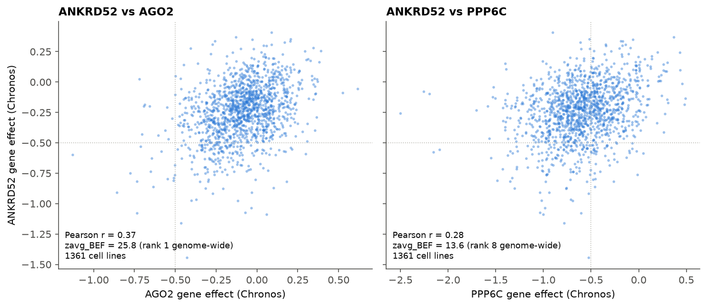
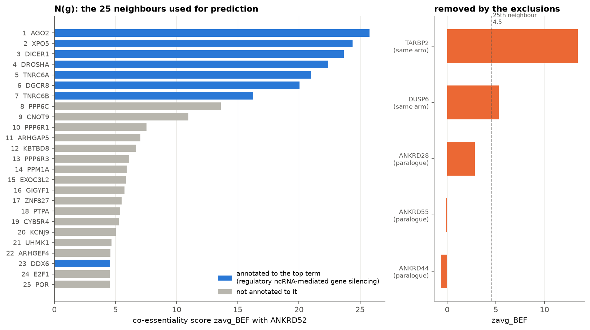
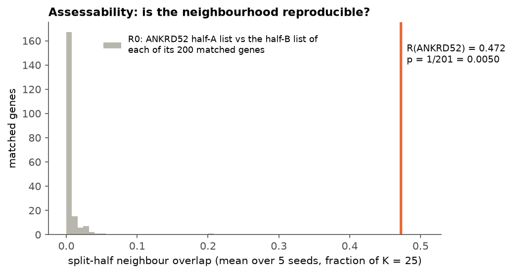
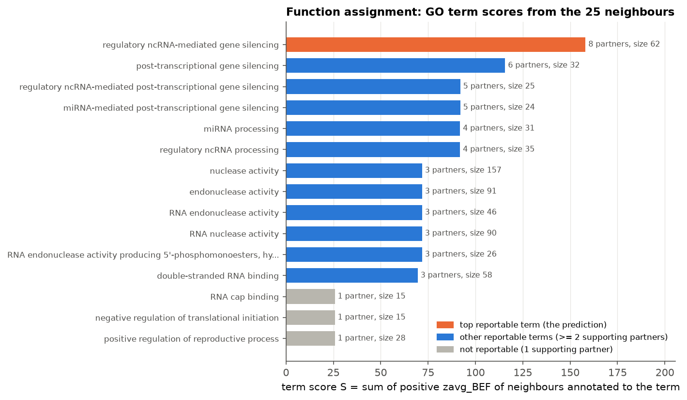
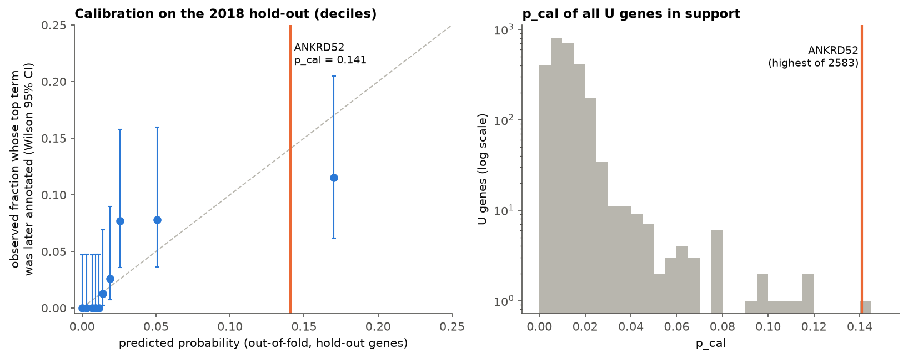
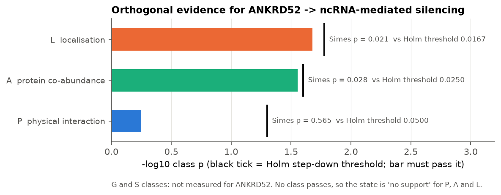
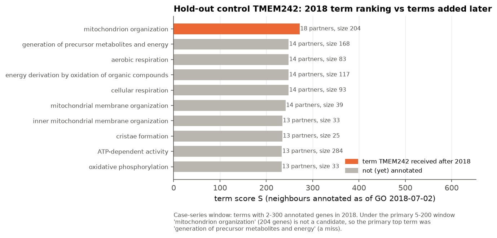

# Worked example: one gene through the whole pipeline (ANKRD52), plus one hold-out control (TMEM242)

This page follows a single pre-registered "uncharacterised" gene, **ANKRD52**, through every step of the final
pipeline and shows the real numbers at each step. ANKRD52 was chosen because it came out **rank 1 of the primary top
40**, and its predicted function (microRNA-mediated gene silencing, with AGO2, XPO5 and DICER1 as its strongest
partners) **had already been published**. So the reader can watch the method recover an answer that is known to be
right. A second gene, **TMEM242**, shows how the method was validated: we predict from annotations frozen in 2018 and
then check what the gene was annotated with later.

Everything below was produced by re-running the project's own code, not by copying numbers from the ledger:

```
./.env/bin/python -I docs/explainer/worked_example.py      # ~3.5 min, ~6 GB RAM; needs the local data/ folder
```

The script calls the same functions the pipeline scripts use (`scripts/m4_common.py`, `m5_common.py`,
`m5b_common.py`, `m6_common.py`, `src/*.py`, and `load_scores` from `scripts/52_judge_analysis.py`). It calls
`gate.check()` before it reads anything pairwise. It writes only under `docs/explainer/`:
`worked_example_output/` (one TSV per intermediate table plus `worked_example.json`) and `figures/we_*.png`. At the
end it compares **159** of its values with the committed ledger. **All 159 match** (see the
[reproduction check](#reproduction-check)).

Section numbers here follow the pipeline stages. In the seven-step method ([METHOD.md](METHOD.md#steps)) they map as:
section 0 → Step 1; sections 1–2 → Step 2 (the neighbour list N(g) and its exclusions belong to Step 4); 3 → Step 3;
4 → Step 4; 5 → Step 5; 6 → Step 6; 7 → Step 7.

> This project is AI-generated and has not been verified by a human. The numbers below are re-runs of
> unverified code. They show what the pipeline does. They do not show that it is right.

---

## Step 0: Pre-registration (why ANKRD52 counts as "uncharacterised")

Before any gene-to-gene DepMap value was computed, the project froze a list **U** of 4,924 uncharacterised human
protein-coding genes (git tag `preregistration-v1`). A gene is in U if **D1 and (D2 or D3)**:

| criterion | definition | ANKRD52 | why |
|---|---|---|---|
| **D1** | no *informative* GO biological-process or molecular-function term backed by experimental or curator evidence (EXP, IDA, IPI, IMP, IGI, IEP, TAS, IC). Generic terms such as "protein binding" do not count | **True** | it has 3 such GO rows, and all three are "protein binding" (GO:0005515, evidence IPI; PMIDs 18186651, 24255178, 35271311). That term is generic, so 0 informative terms |
| **D2** | UniProt annotation score ≤ 2 (out of 5) | False | its score is 3 |
| **D3** | ≤ 10 "focused" PubMed records (papers linked to ≤ 10 human genes in gene2pubmed) **or** IDG target class Tdark | **True** | 6 focused PMIDs (62 PMIDs in total). Target class Tbio, not Tdark |

So ANKRD52 entered U through D1 + D3 (`step0_d1_rows.tsv`; `knownness.d1()` re-run gives the same 3 rows and
D1 = True as the frozen table).

**This is a curation-lag case.** The literature agent (step 7) classed ANKRD52 as **N1 (function established)**. A
2017 study (PMID 28114302) showed that the ANKRD52–PPP6C phosphatase removes phosphates from AGO2, and that this
cycle is needed for miRNA silencing. GO never captured this with an experimental code, so D1 stays True. The
project's candidate report adds that co-essentiality catalogues had already linked ANKRD52 to the miRNA machinery
(Kim 2019; Wainberg 2021; see `reports/ANKRD52.md`). An LLM recall probe also recognised the gene, as the "PP6
ankyrin-repeat subunit C". The entry criterion therefore admitted a gene that is "uncharacterised" in the databases
but not in the literature. The project reports this as validation of the method, not as a discovery.

## Step 1: The input profile

**DepMap gene effect** (Chronos score, CRISPRGeneEffect 26Q3): for each cancer cell line, how much knocking out the
gene slows growth. 0 means no effect. About −1 is the typical effect of knocking out a common essential gene.

| quantity | ANKRD52 |
|---|---|
| cell lines with a value | 1,361 of 1,361 (no missing values) |
| mean / SD / median | −0.243 / 0.231 / −0.227 |
| minimum | −1.445 |
| lines with effect < −0.5 | 169 (12.4%) |
| in the tool's background (NaN fraction < 0.10) | yes |
| expression, log2(TPM+1) ≥ 1 | in 99.86% of 2,130 profiled models; median 3.94 → **expressed**, not a clean negative |

ANKRD52 is a weak, selective dependency: no line needs it absolutely, but some lines need it more than others. What
the method uses is the *pattern* of these 1,361 values, not their size. `figures/we_profile.png` plots ANKRD52
against AGO2 (Pearson r = 0.37, the top co-essentiality partner) and against PPP6C (r = 0.28, its known biochemical
partner, rank 8).



## Step 2: Co-essentiality scoring and the neighbour list N(g)

The published tool scores every gene pair. Its score, **zavg_BEF**, is the average of three z-scored similarity
measures:

- **F**: first-order similarity, the cosine of the two cleaned knockout profiles. Cleaning removes the 20 strongest
  screen-wide patterns.
- **B**: shared neighbours. The overlap of the two genes' top-44 partner lists, row z-scored.
- **E**: graph embedding. The closeness of the two genes in a 512-dimensional map of the partner network.

Each view is put on a common scale against random gene pairs, and the three are averaged. Higher means the two genes
are needed by the same cell lines, beyond what screen-wide patterns explain. The project refits the tool at its published settings
on all 1,361 lines (17,525 background genes). The worked example rebuilds ANKRD52's row of the stored 18k × 18k matrix
and refits the tool's pair scorer for the B, E and F components (as script 40 does).

Across all genes, ANKRD52's scores have median −0.09 and 99.9th percentile 5.4. Its strongest partners score far
above that:

| rank | partner | zavg_BEF | z_B | z_E | z_F | annotated to the predicted term? |
|---|---|---|---|---|---|---|
| 1 | AGO2 | 25.76 | 43.28 | 20.59 | 13.41 | yes |
| 2 | XPO5 | 24.40 | 42.90 | 20.19 | 10.11 | yes |
| 3 | DICER1 | 23.69 | 41.51 | 19.84 | 9.70 | yes |
| 4 | DROSHA | 22.37 | 40.08 | 19.99 | 7.05 | yes |
| 5 | TNRC6A | 21.00 | 36.59 | 19.84 | 6.56 | yes |
| 6 | DGCR8 | 20.05 | 34.50 | 19.25 | 6.41 | yes |
| 7 | TNRC6B | 16.27 | 28.06 | 17.10 | 3.67 | yes |
| 8 | PPP6C | 13.62 | 20.85 | 11.76 | 8.25 | no |
| 9 | CNOT9 | 10.96 | 14.58 | 13.75 | 4.56 | no |
| 10 | PPP6R1 | 7.54 | 8.88 | 8.52 | 5.24 | no |
| … | (ranks 11–25, `step2_neighbours_top25.tsv`) | 7.03 … 4.52 | | | | DDX6 (rank 23) yes |

**N(g)**, the neighbour list used for prediction, is the top **K = 25** genes. Before taking the top 25, three groups
are removed:

- genes outside the tool background;
- genes on the **same chromosome arm** (ANKRD52 is on 12q). Neighbouring genes can look co-essential because of
  copy-number or CRISPR-cutting artefacts.
- **Ensembl paralogues**, which can share sgRNAs or compensate for each other.

For ANKRD52, the exclusions removed (`step2_excluded_genes.tsv`, right panel of the figure):

| removed gene | zavg_BEF | rank without exclusions | reason |
|---|---|---|---|
| TARBP2 | 13.42 | 9 | same arm (12q). TARBP2 is a Dicer cofactor, so this exclusion throws away a true miRNA-machinery partner. That is the price of the artefact guard |
| DUSP6 | 5.31 | 20 | same arm (12q) |
| ANKRD28 | 2.87 | 84 | paralogue (would not have entered the top 25 anyway) |
| ANKRD55, ANKRD44 | −0.12, −0.62 | — | paralogues (far below the cut-off) |

No non-background gene scored above the cut-off. The 25th neighbour (POR) scores 4.52. The mean over the 25
neighbours, the **top-K mean zavg = 10.68**, is used again in step 5.



## Step 3: Assessability (is the neighbourhood reproducible?)

A neighbour list is only worth reading if it is stable. The cell lines are split into two halves five times (seeds
0–4). The split is stratified by lineage × screen library, and lines from the same patient stay together. The tool
is refitted on each half, and each half gives its own top-25 list.

- **R(g)**: split-half reproducibility. The overlap between the two half-lists, divided by 25 and averaged over the
  five seeds. ANKRD52 shares 10, 10, 13, 13 and 13 neighbours, so **R = 0.472**. AGO2, XPO5, DICER1, DROSHA, DGCR8,
  TNRC6A/B, CNOT9 and PPP6R1 are shared in every seed (`step3_splithalf_overlap_by_seed.tsv`).
- **Null R0**: for each of the gene's **200 matched genes**, the same overlap is computed between ANKRD52's half-A
  list and the matched gene's half-B list. Matched genes have similar mean effect, SD and missingness, and are not
  in N(g), not on the same arm and not paralogues. For ANKRD52, mean R0 = 0.0037 and max R0 = 0.20.
- **Empirical p** = (1 + #{R0 ≥ R}) / 201 = (1 + 0) / 201 = **0.00498**, below 0.05.
- **Assessable** = p < 0.05 **and** expressed → **yes**.

Context: only 646 of 4,924 U genes pass this rule. Even 13% of clean-negative (non-expressed) U genes pass the
p-value part, so passing it does not prove a real signal (REPORT §2).



## Step 4: Function assignment (GO term scores)

**Vocabulary V2**: GO biological-process and molecular-function terms in the current release. A gene counts as a
member of a term only through experimental or curator evidence (the D1 codes), propagated up the GO graph.
Candidate terms have 5–200 annotated scorable genes (6,920 terms; 12,867 genes have at least one annotation). One
special rule applies: an IPI row of a neighbour whose with/from field names the query gene is dropped (for ANKRD52,
no rows were affected).

For each candidate term t, the **term score** is

  **S(g, t) = Σ max(zavg_BEF(g, j), 0) over neighbours j in N(g) that are annotated to t.**

A neighbour that contributes to S is a **supporting partner**. A term is **reportable** only if it has **≥ 2
supporting partners**. Reportable terms are ranked by S (ranker R1, chosen before the hold-out was opened). The
**top reportable term** is the prediction.

For ANKRD52:

- 22 of its 25 neighbours carry at least one V2 annotation (coverage 0.88).
- 238 candidate terms get S > 0, and 45 of those are reportable.

| rank | GO term | S | supporting partners | term size | hypergeometric p (descriptive) |
|---|---|---|---|---|---|
| **1** | **GO:0031047 regulatory ncRNA-mediated gene silencing** | **158.11** | **8**: AGO2, XPO5, DICER1, DROSHA, TNRC6A, DGCR8, TNRC6B, DDX6 | 62 | 5.5e−14 |
| 2 | GO:0016441 post-transcriptional gene silencing | 115.69 | 6 | 32 | 1.0e−11 |
| 3 | GO:0035194 regulatory ncRNA-mediated post-transcriptional gene silencing | 92.00 | 5 | 25 | 4.7e−10 |
| 4 | GO:0035195 miRNA-mediated post-transcriptional gene silencing | 92.00 | 5 | 24 | 3.7e−10 |
| 5 | GO:0035196 miRNA processing | 91.87 | 4 | 31 | 2.0e−7 |

Worked sum for the top term: 25.76 + 24.40 + 23.69 + 22.37 + 21.00 + 20.05 + 16.27 + 4.57 = 158.11.

Other labels attached to the prediction:

- The most specific term among the top 5 is *miRNA-mediated post-transcriptional gene silencing*. This is
  descriptive only.
- **Module family**: "other".
- **Module labels** (descriptive): GO cellular-component complexes (V1) and V1′ (V1 plus Complex Portal and
  MitoCarta) both give **RISC complex** (5 supporting partners).

ANKRD52's biochemical home, the PP6 phosphatase (PPP6C, PPP6R1, PPP6R3 and PTPA are all in N(g)), scores much lower.
The best phosphatase term, *phosphoprotein phosphatase activity*, has S = 24.9 (3 partners) and ranks 37th;
*protein phosphatase regulator activity* has S = 19.0 and ranks 42nd. Few PP6 members carry
experimental GO annotations, so the GO-based vote is dominated by the well-annotated miRNA machinery.



## Step 5: Calibration (turning the score into a probability)

**p_cal** is a calibrated probability. It estimates the chance that **the top GO term will later be confirmed by an
experimental-evidence GO annotation** (horizon about 8 years). It was learned on the temporal hold-out **H**:

- 809 genes that were uncharacterised in GO on 2018-07-02 and gained annotations afterwards;
- 775 of them had a prediction;
- 24 top terms were later confirmed (3.1%).

So p_cal is **conditional on the gene being annotated later**, as every H gene was. It is not the probability that
the biology is right.

The model is a logistic regression with sign constraints. These are its inputs for ANKRD52 (`step5_pcal_contributions.tsv`):

| covariate | meaning | ANKRD52 | hold-out 5th–95th percentile | coefficient |
|---|---|---|---|---|
| top-K mean zavg | mean zavg_BEF of the 25 neighbours | 10.68 | 3.33–10.99 | +0.285 |
| R(g) | split-half reproducibility | 0.472 | 0–0.546 | 0 (shrunk to its sign bound) |
| coverage percentile | fraction of N(g) with a GO annotation (0.88), as a percentile among all scorable genes | 0.859 | 0.075–0.894 | +1.704 |
| term-size percentile | log size of the top term (62 genes), as a percentile | 0.172 | 0.049–0.950 | 0 (shrunk) |
| family | module family of the top term | other (reference) | kept families: other, ER/Golgi, signalling | dummies 0 |

logit = −6.3155 + 0.28504 × 10.682 + 1.70378 × 0.8591 = **−1.807**, so **p_cal = 1 / (1 + e^1.807) = 0.141**.

All covariates lie inside the hold-out 5th–95th percentile range ("in support"), so p_cal is reported, not just an
upper bound.

- 0.141 is the **highest p_cal of the 2,583 U genes in support**.
- It is below the pre-registered Tier B threshold (0.30; Tier A is 0.50), so ANKRD52 has **no tier**. The project
  took its pre-registered "low-yield" branch: the primary top 40 is the p_cal order among expressed, assessable,
  in-support genes without artefact exclusions. ANKRD52 is **rank 1 of 245 eligible genes**.
- On the hold-out, genes in the top decile of predicted probability (mean 0.170) were confirmed 11.5% of the time
  (95% CI 6.2–20.5%). That decile is the bin ANKRD52's p_cal falls in.



(Top-40-only checks, read from the ledger and not re-run here because script 44 takes about an hour: the top term
survives leaving out the most dependent lineage, cervix (neighbour overlap 0.92). No dependency–expression coupling
was found (ρ = 0.02). No TP53 effect (p = 0.24). The DEMETER2 replication could not be measured.)

## Step 6: Orthogonal evidence (data that never saw DepMap)

The question is whether independent data link ANKRD52 to the **62 genes annotated to the predicted term**. Each
evidence class gets one state: *supports*, *no support*, *not measured* or *contradicts*.

- **Per source**: a statistic for ANKRD52 against the members, compared with 1,000 degree-matched random member sets
  to give an empirical p.
- **Within a class**: the source p-values are combined by Simes.
- **Across classes**: Holm at α = 0.05.

For family "other", every class is diagnostic.

| class | sources (empirical p) | class p (Simes) | state | what was actually seen |
|---|---|---|---|---|
| P, physical interaction | BioPlex/OpenCell/BioGRID-LTP/STRING-exp union (0.28); Human Cell Map SAINT (1.0) | 0.565 | no support | 1 edge to a member (TNRC6B) vs 0.33 expected. ANKRD52's physical edges to its co-essential neighbours go to **PPP6C, PPP6R1, PPP6R3** (PP6) and TNRC6B |
| A, protein co-abundance | ProteomeHD (0.014); CCLE proteomics (0.33) | 0.028 | no support | members' mean percentile in ANKRD52's ProteomeHD row 0.62 vs 0.52 null (top: MOV10, ZC3H7A, DICER1) |
| L, localisation | HPA (0.021) | 0.021 | no support | 71% of localised members share a compartment with ANKRD52 (mitochondrion + nucleus) vs 57% null |
| G, Perturb-seq | none measure ANKRD52 | — | not measured | |
| S, structure (AF2 pairs) | no member covered | — | not measured | |

Holm step-down: the smallest class p (L, 0.021) must be ≤ 0.05/3 = 0.0167. It is not, so no class is called.

There is also **no contradiction**. The term's compartments are cytosol and nucleus. Only one high-reliability source
(Human Cell Map NMF) disagrees, two are required, and ANKRD52 is multi-localised. The Tier-A support condition is
therefore **not met** (`diag_ok = False`). With no tiers in play, this does not change the rank.

Controls run with the same test (`step6_support_real_matched_decoy.tsv`):

- A **matched gene** (MTA2, tested with the same term) got A and L support.
- A **decoy term** for ANKRD52 (*response to purine-containing compound*) got none.

Across the 40 top predictions, the support rule passed for 62.5% of real predictions, 47.5% of matched-gene
predictions and 25% of decoys (`results/ledger/support_summary.json`). The test separates real predictions from
controls only weakly.



## Step 7: Literature check (blinded judging)

1. **Literature screen.** A literature agent with no access to co-essentiality outputs collected 11 items for
   ANKRD52 (7 functional, 4 mentions; `step7_literature_items.tsv`) and classed it **N1** (function established).
2. **Packet.** Its evidence table, with the gene name redacted to GENE_X, went into packet **J071** with four
   statements: the real prediction and three **decoys**. Each decoy is the top term of another U gene with the same
   family, a similar size (62–63 genes), unrelated in GO and with member overlap (Jaccard) < 0.1. Each statement
   also carries a module-context label.
3. **Judging.** Two judges, working independently, scored each statement +1 (evidence supports), 0 (not
   addressed) or −1 (contradicts):

| slot | statement | real? | judge 1 | judge 2 | final |
|---|---|---|---|---|---|
| A | modulation of chemical synaptic transmission; context: histone deacetylase complex | decoy | 0 | 0 | 0 |
| B | deacylase activity; context: telomere cap complex | decoy | 0 | 0 | 0 |
| **C** | **regulatory ncRNA-mediated gene silencing; context: RISC complex** | **real** | **+1** | **+1** | **+1** |
| D | dicarboxylic acid metabolic process; context: plasma membrane signaling receptor complex | decoy | 0 | 0 | 0 |

Both judges cited the AGO2-dephosphorylation evidence (evidence rows 4–5; judge 1 also cited the miR-155/SOCS1
paper). Real score 1, mean decoy score 0, so
**d = 1**. Over the primary top 40, real statements were supported for 18 of 40 genes against 3 of 120 decoys
(sign-flip p = 0.0002). Most supported genes, ANKRD52 included, were N1 rediscoveries.

---

## Hold-out example: TMEM242 (how the method was validated)

The **temporal hold-out** freezes GO at **2018-07-02 (t0)**. It takes genes that were uncharacterised then (D1 at
t0, ≤ 10 focused papers before mid-2018), predicts their function using only **t0 annotations of their
neighbours**, and checks the prediction against the terms they gained later. The neighbour network itself comes from
the current DepMap release, so only the annotations are rolled back.

TMEM242 is one of the pre-named positive controls. Its profile and annotation situation:

- strong neighbourhood: top-K mean zavg 13.05, R = 0.67;
- its 25 neighbours are dominated by ATP synthase subunits (ATP5F1A/B/C/D/E, ATP5PB/PD/PF/PO, ATP5ME/MF/MG) plus
  TMEM70, OXA1L, IMMT, MFN2, YME1L1 and STOML2 (`holdout_TMEM242_neighbours.tsv`);
- in 2018 it had no informative GO term;
- it later received five terms, all from one 2021 paper (PMID 33753518, evidence IMP): *mitochondrion organization*,
  *mitochondrial respiratory chain complex assembly*, and three ATP-synthase-assembly terms. That paper was not
  flagged by the DepMap-circularity check (a full-text search for DepMap or co-essentiality terms and citations).

| analysis | candidate window | top term with 2018 annotations | later received? |
|---|---|---|---|
| **named-control case series** (descriptive) | 2–300 genes | **mitochondrion organization** (S = 272, 18 partners, 204 genes in 2018) | **yes: rank 1 of 77 reportable terms** |
| primary hold-out endpoint (pre-registered) | 5–200 genes | generation of precursor metabolites and energy (168 genes) | no. The two in-window later terms (respiratory chain complex assembly; proton-transporting two-sector ATPase complex assembly) ranked 49 and 50 |

TMEM242 is a hit in the case series (the "true term ranked 1" in `controls_case_series.tsv`) but a **miss on the
pre-registered primary endpoint**. The term it received sits just above the 200-gene ceiling, and the specific
assembly terms carry too few 2018-annotated neighbours. Its out-of-fold p_cal was 0.28 (`calibration_oof.tsv`). Over
all hold-out genes, precision@1 was 0.030 (0.018–0.043), against 0.000 for the prior-only ranker and 0.005 for
matched genes.



---

## Glossary

- **U**: the pre-registered list of uncharacterised genes (step 0).
- **H**: the 2018 temporal hold-out.
- **zavg_BEF**: the tool's co-essentiality score.
- **N(g)**: the 25 top-scoring admissible neighbours of gene g.
- **BG**: tool background, genes with < 10% missing values.
- **R(g), R0**: split-half reproducibility of a gene and of its matched null genes.
- **V2**: GO BP + MF terms with experimental evidence.
- **S**: term score.
- **Supporting partner**: a neighbour annotated to the term with positive score.
- **Reportable**: ≥ 2 supporting partners.
- **p_cal**: calibrated probability that the top term is later confirmed, conditional on later annotation.
- **Tier A / B**: p_cal ≥ 0.5 / ≥ 0.3 plus conditions.
- **N1 / N2 / N3**: literature novelty classes (established / partial / none).
- **Decoy**: a size- and family-matched unrelated term used as a negative control in judging and support tests.

## Reproduction check

`worked_example_output/reproduction_check.tsv` lists all 159 comparisons (this run vs committed file). Ledger
floats are stored with 6 significant digits, so numeric values are compared with a relative tolerance of 1e-5 (1e-4
for the B/E/F pair-scorer components and the hypergeometric p). **Result: 159 / 159 match. No mismatches.** A first
run reported 4 false mismatches in step 1. Those came from a string-vs-number comparison in the checking helper (the
pre-registration table had been read as text), not from different values. The helper was fixed and the full script
re-run. Selected rows:

| step | quantity | this run | committed | source | match |
|---|---|---|---|---|---|
| 0 | D1 (no informative BP/MF term with experimental evidence) | True | True | `preregistration/uncharacterised_genes.tsv` | yes |
| 0 | n_d1_rows | 3 | 3 | `preregistration/uncharacterised_genes.tsv` | yes |
| 1 | cell lines with a value | 1361 | 1361 | `preregistration/uncharacterised_genes.tsv` | yes |
| 1 | mean gene effect | -0.242746 | -0.242746 | `preregistration/uncharacterised_genes.tsv` | yes |
| 1 | SD of gene effect | 0.231231 | 0.231231 | `preregistration/uncharacterised_genes.tsv` | yes |
| 1 | fraction of lines < -0.5 | 0.124173 | 0.124173 | `results/ledger/u_predictions.tsv` | yes |
| 1 | expression: fraction of models log2(TPM+1) >= 1 | 0.998592 | 0.998592 | `preregistration/uncharacterised_genes.tsv` | yes |
| 1 | expressed flag | True | True | `preregistration/uncharacterised_genes.tsv` | yes |
| 2 | N(g) (25 neighbours, order) recomputed from the matrix == stored full_top100.npz | identical | identical | `data/derived/neighbours/full_top100.npz` | yes |
| 2 | partner 1 (AGO2) zavg_BEF | 25.7635 | 25.7635 | `results/ledger/u_partners.tsv` | yes |
| 2 | partner 1 (AGO2) z_B | 43.2822 | 43.2822 | `results/ledger/u_partners.tsv` | yes |
| 2 | partner 2 (XPO5) zavg_BEF | 24.3977 | 24.3977 | `results/ledger/u_partners.tsv` | yes |
| 2 | partner 8 (PPP6C) zavg_BEF | 13.6197 | 13.6197 | `results/ledger/u_partners.tsv` | yes |
| 2 | partner 10 (PPP6R1) z_F | 5.23728 | 5.23728 | `results/ledger/u_partners.tsv` | yes |
| 3 | R(g) split-half reproducibility | 0.472 | 0.472 | `results/assessability/assessability_U.tsv` | yes |
| 3 | mean R0 over 200 matched genes | 0.00368 | 0.00368 | `results/assessability/assessability_U.tsv` | yes |
| 3 | #{R0 >= R} | 0 | 0 | `results/assessability/assessability_U.tsv` | yes |
| 3 | empirical p | 0.00497512 | 0.00497512 | `results/assessability/assessability_U.tsv` | yes |
| 3 | assessable | True | True | `results/assessability/assessability_U.tsv` | yes |
| 4 | top term | GO:0031047 | GO:0031047 | `results/ledger/u_predictions.tsv` | yes |
| 4 | top term S | 158.114 | 158.114 | `results/ledger/u_predictions.tsv` | yes |
| 4 | top term size (per query) | 62 | 62 | `results/ledger/u_predictions.tsv` | yes |
| 4 | number of reportable terms (>= 2 supporting partners) | 45 | 45 | `results/ledger/u_predictions.tsv` | yes |
| 4 | S = sum of positive z of supporting partners | 158.114 | 158.114 | `results/ledger/u_predictions.tsv` | yes |
| 4 | most specific term among the top 5 (descriptive) | GO:0035195 | GO:0035195 | `results/ledger/u_predictions.tsv` | yes |
| 4 | module family of the top term | other | other | `results/ledger/u_predictions.tsv` | yes |
| 4 | V1 module label | GO:0016442 | GO:0016442 | `results/ledger/u_predictions.tsv` | yes |
| 4 | V1' module label | GO:0016442 | GO:0016442 | `results/ledger/u_predictions.tsv` | yes |
| 4 | top-5 term 5 | GO:0035196 | GO:0035196 | `results/ledger/u_top5.tsv` | yes |
| 5 | coverage reference (all genes) == M5b current coverage | True | True | `data/derived/holdout_eval/core.pkl` | yes |
| 5 | top-term size reference (all scorable genes) == M5b reference | True | True | `data/derived/holdout_eval/core.pkl` | yes |
| 5 | covariate zmean | 10.6822 | 10.6822 | `results/ledger/u_predictions.tsv` | yes |
| 5 | covariate R | 0.472 | 0.472 | `results/ledger/u_predictions.tsv` | yes |
| 5 | covariate cov_pct | 0.859139 | 0.859139 | `results/ledger/u_predictions.tsv` | yes |
| 5 | covariate size_pct | 0.172247 | 0.172247 | `results/ledger/u_predictions.tsv` | yes |
| 5 | support category | in_support | in_support | `results/ledger/u_pcal.tsv` | yes |
| 5 | p_cal | 0.141025 | 0.141024 | `results/ledger/u_pcal.tsv` | yes |
| 5 | rank in primary top 40 | 1 | 1 | `results/ledger/top40_primary.tsv` | yes |
| 6 | real: class P state | no support | no support | `results/ledger/support.tsv` | yes |
| 6 | real: class A Simes p | 0.027972 | 0.027972 | `results/ledger/support.tsv` | yes |
| 6 | real: class L Simes p | 0.020979 | 0.020979 | `results/ledger/support.tsv` | yes |
| 6 | real: passes Tier-A support rule | False | False | `results/ledger/support.tsv` | yes |
| 6 | matched: tested gene | MTA2 | MTA2 | `results/ledger/support.tsv` | yes |
| 6 | matched: class A state | supports | supports | `results/ledger/support.tsv` | yes |
| 6 | decoy: term | GO:0014074 | GO:0014074 | `results/ledger/support.tsv` | yes |
| 7 | real statement score | 1 | 1 | `results/m7/judge/analysis_main_genes.tsv` | yes |
| 7 | mean decoy score | 0 | 0 | `results/m7/judge/analysis_main_genes.tsv` | yes |
| 7 | d = real - mean(decoys) | 1 | 1 | `results/m7/judge/analysis_main_genes.tsv` | yes |
| H | primary (5-200) top-1 term at t0 | GO:0006091 | GO:0006091 | `results/holdout_eval/per_gene_core.tsv` | yes |
| H | primary hit@1 | 0 | 0 | `results/holdout_eval/per_gene_core.tsv` | yes |
| H | case series: number of later terms (window 2-300) | 5 | 5 | `results/holdout_eval/controls_case_series.tsv` | yes |
| H | case series: reportable terms at t0 | 77 | 77 | `results/holdout_eval/controls_case_series.tsv` | yes |
| H | case series: rank of best later-annotated term | 1 | 1 | `results/holdout_eval/controls_case_series.tsv` | yes |
| H | case series: top-1 term at t0 | GO:0007005 mitochondrion organization | GO:0007005 mitochondrion organization | `results/holdout_eval/controls_case_series.tsv` | yes |

The only visible difference is p_cal at the 7th digit (this run 0.1410249, stored 0.141024). That is within the
tolerance and comes from rounding in the floats the ledger stores, not from the method.

All checks: **159 / 159 match**; per step: 0: 3/3, 1: 7/7, 2: 51/51, 3: 7/7, 4: 35/35, 5: 11/11, 6: 36/36, 7: 3/3, H: 6/6.

