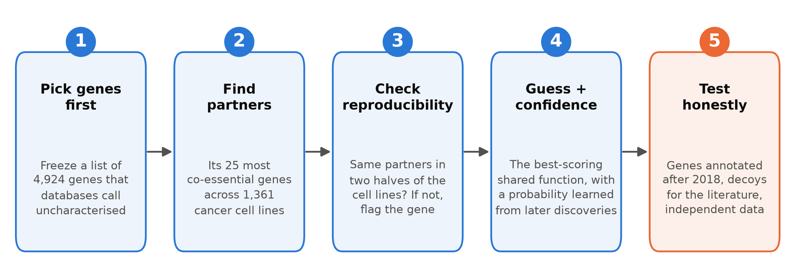
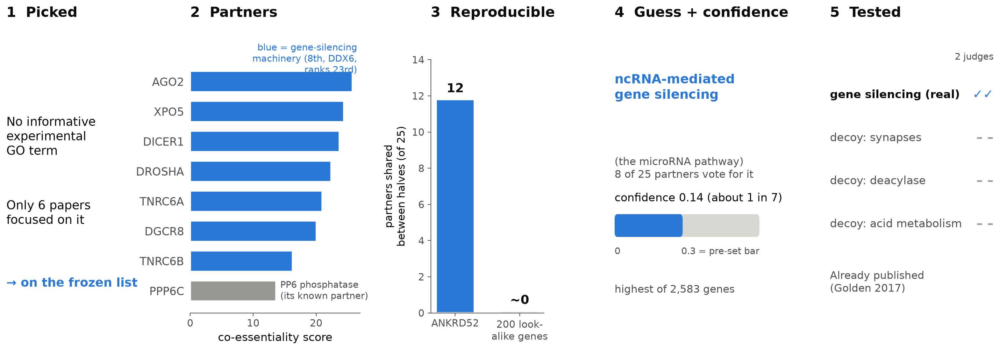

# Can CRISPR screens tell us what unknown human genes do? A pre-registered test

> This project, including this explainer, was produced by AI agents and has not been verified by a human.
> The longer, more detailed explainer is in [../explainer/](../explainer/README.md); the paper is
> [manuscript/manuscript.md](../../manuscript/manuscript.md).

**In one paragraph.** Thousands of human genes have no known function. This project took a published idea, that
genes whose loss harms the same cancer cell lines probably work together, and tested it strictly. The gene list was
fixed before any analysis. The method was scored on genes whose function was discovered *after* 2018. Literature
judges saw decoy statements next to the real ones. The answer: the method beats chance but rarely names the exact
function. It does far worse than reading the gene's existing computer-predicted annotations, and most of its best
predictions concern genes whose function was already published.

### Key numbers

| Question | Answer | Compared with |
|---|---|---|
| Human genes the databases call "uncharacterised" | 4,924 (about 1 in 4) | 19,296 protein-coding genes |
| ...that already had a published function (random sample of 50) | about 4 in 10 | (none expected) |
| ...with a real, reproducible CRISPR signal | at least about 1 in 15 | 646 pass the check, about half by chance |
| Top guess right, on genes annotated after 2018 | 3%, about 1 in 30 | 0.5% by chance; 22% from homology |
| The same, if tested on well-studied genes | 14% | about five times the realistic figure |
| Highest confidence given to any gene | 0.14 (about 1 in 7) | 0.3 = the bar set in advance for "confident" |
| Expected confirmed guesses within about 8 years | about 5, out of 2,583 genes | about 30 if every gene were later annotated |
| Top 40 guesses supported by blinded judges | 18 of 40 (16 already published) | 3 of 120 decoys |

---

## 1. The problem

**Thousands of human genes have no recorded function, and the databases lag behind the literature.**

About one human protein-coding gene in four (4,924 of 19,296) has no experimentally supported function in the Gene
Ontology (GO, the standard database of gene functions), and either a low score in the UniProt protein database or
little focused literature. Research attention is very unequal: known genes attract more papers, and unknown genes
stay unknown (Stoeger 2018; Haynes 2018).

Large CRISPR knockout screens could help. The Cancer Dependency Map (DepMap; Tsherniak 2017) switches off each gene,
one at a time, in over a thousand cancer cell lines and measures how much each loss slows growth (Dempster 2021).
This project used 1,361 cell lines. Every gene therefore has a *profile*, a list of which cell lines need it. That
profile is free information about every gene, studied or not.

## 2. The idea in 60 seconds

**Genes whose loss hurts the same cell lines probably work together. The hard part is not fooling yourself about how
often this is right.**

If knocking out gene A slows exactly the cell lines that need genes B, C and D, the four probably belong to the same
complex or pathway. This is *co-essentiality* (Pan 2018; Kim 2019; Wainberg 2021). If B, C and D process microRNAs,
A probably does too: *guilt by association*.

The trap is in the checking. The usual test hides a well-studied gene's annotations and sees if its partners recover
them ("leave-one-out"). Multifunctional, well-annotated genes are easy to predict this way, so the test flatters the
method (Gillis & Pavlidis 2011, 2012). And the famous success stories were often confirmed by papers that themselves
used DepMap.

**This project's twist is strict testing.** It fixed its rules before seeing the answer, as clinical trials do
(pre-registration; Nosek 2018). It tested on genes whose functions were discovered later, the design of the CAFA
function-prediction challenges (Radivojac 2013). And it checked whether a stated confidence of 10% comes true about
10% of the time. AI agents planned and ran all of it (section 7).

## 3. The method in five steps

We follow one gene throughout: **ANKRD52**, which came out top of the final shortlist.

### Step 1. Pick the genes before looking

**The list of "uncharacterised" genes was built from databases alone and locked before any two genes were compared.**

- **What.** A gene counts if it has no informative GO function backed by experiment ("protein binding" does not
  count), *and* either a low UniProt score, few "focused" papers (papers about 10 genes or fewer), or membership of
  the "dark protein" class of the Illuminating the Druggable Genome programme. This gave 4,924 genes. The list was
  locked with a digital fingerprint (a hash); every later script refused to run unless it matched. An independent
  agent rebuilt the list with its own code and got the same genes.
- **Why.** Choosing genes after seeing the data drifts towards genes where the method looks good.
- **ANKRD52.** Its only experimental GO entries say "protein binding", and only 6 of the 62 papers that mention it
  are focused, so it is on the list. In fact a 2017 paper had already worked out its function (Golden 2017); the
  database had never recorded it.

### Step 2. Find each gene's partners

**Each gene's 25 most co-essential partners come from an existing scoring tool, used unchanged.**

- **What.** The project brief required a co-essentiality scoring tool published in the cancergenetics GitHub
  organisation by the Ryan lab at University College Dublin (itself built by AI agents during a hackathon):
  [github.com/cancergenetics/ai-hackathon-Coessentiality](https://github.com/cancergenetics/ai-hackathon-Coessentiality).
  It scores every gene pair by combining three views: how similar the two profiles are once screen-wide patterns are
  removed, how much the genes' own partner lists overlap, and how close they sit in a map of the whole network. The
  agents first checked that it reproduced its published benchmark; it did. Partners on the same chromosome arm, and
  close relatives by gene duplication (*paralogues*), are removed: CRISPR cutting can make neighbouring genes look
  co-essential for reasons unrelated to function (Lazar 2024).
- **Why.** The partner list is the only evidence the method uses.
- **ANKRD52.** Its top partners are AGO2, XPO5, DICER1, DROSHA, TNRC6A, DGCR8 and TNRC6B: the core microRNA
  machinery. Eighth is PPP6C, the phosphatase ANKRD52 is known to bind. The exclusion also discarded one true partner
  (TARBP2, a Dicer helper on the same chromosome arm), so the guard has a cost.

### Step 3. Keep only genes whose partner list is reproducible

**If a gene's partners change when you use a different half of the cell lines, they are noise, and the gene is
flagged.**

- **What.** The cell lines are split into two halves, five times, and each half gives a top-25 list. The overlap is
  compared with what 200 *look-alike genes* achieve. Look-alikes are genes whose profiles have similar overall
  strength, spread and missing data; any overlap they show is chance. (The same idea is reused later as a chance
  baseline for accuracy.) A gene passes if it beats its look-alikes and is expressed in the cells. Genes that fail
  still get a prediction, but it is flagged and cannot enter the shortlist.
- **Why.** Many unknown genes are barely expressed or never needed, often because a paralogue covers for them (Dede
  2020). Their profiles are flat, and their "partners" arbitrary.
- **ANKRD52.** The halves shared about 12 of 25 partners; look-alikes shared almost none. It clearly passes.

Only 646 of 4,924 genes (13%) passed. The check leaks: genes that are not expressed at all, used as a negative
control, passed the reproducibility part 13% of the time, not the planned 5%. Allowing for this, **at least about
320 genes, roughly 1 in 15 of the list**, carry a real signal. That figure assumes the leak rate seen in
non-expressed genes also applies to expressed ones, which was not tested.

### Step 4. Guess a function and say how sure

**Partners vote for GO terms, weighted by link strength; a probability learned from later discoveries says how much
to trust the winner.**

- **The guess.** For each GO term, add up the scores of the partners annotated to it. The top term with at least two
  supporting partners wins. Of three rules declared in advance, the simplest won a fixed contest.
- **The confidence.** A simple statistical model (logistic regression) turns a few facts into a probability: mainly
  how strong the partners are, how many of them carry any annotation, and the kind of term. (Term size was also
  offered to the model but got zero weight.) It was fitted on the 2018 test set of Step 5, so it is *calibrated*:
  of guesses given 10%, about 10% should come true. Only genes that resemble the test set get one (2,583 genes).
- **Why.** Confidence learned the usual way, on well-studied genes, promised about three times more hits than were
  delivered (section 5).
- **ANKRD52.** Eight partners vote for **"regulatory ncRNA-mediated gene silencing"**, the microRNA pathway. Its
  confidence is **0.14, about 1 in 7**, the highest of all 2,583 genes. In plain words: *if* ANKRD52 gains any new
  experimental annotation in the next 8 years or so, there is about a 1 in 7 chance it will be exactly this term.
  The vote also missed something: ANKRD52's biochemical home, the PP6 phosphatase, ranks only 37th, because few PP6
  members have experimental GO terms. The vote follows the best-annotated partners.

> **Keeping the gene sets straight.** 4,271 of the 4,924 genes can be measured by the tool. **646** pass the
> reproducibility check. **2,583** resemble the 2018 test genes closely enough to get a confidence value. Only
> **269** are in both groups; the shortlist was drawn from these, and the top 40 are the 40 with the highest
> confidence. Genes that fail the reproducibility check still get a confidence value if they resemble the test genes,
> which is why most of the "expected confirmations" in section 5 come from flagged genes (Fine print).

### Step 5. Test the guesses honestly

**Three tests: genes annotated after 2018, blinded literature judges with decoys, and data that never saw DepMap.**

- **The 2018 test set.** GO was rolled back to 2 July 2018. The test genes were "uncharacterised" by the same rule
  then and have gained experimental annotations since: 809 genes. The method predicted from 2018 annotations and was
  scored against what curators added later. Annotations from papers that used DepMap were removed first, so the
  method could not be "confirmed" by its own data source. The test was written down half an hour before the data
  were opened, and that pre-registered look was taken once.
- **Blinded literature check.** One agent collected literature on each top gene without seeing any prediction. Two
  judge agents then saw that evidence, gene name hidden, next to four statements: the real prediction and three
  *decoys* (other genes' predictions from a similar family of terms and of similar size). The judges were first
  validated on genes with known answers.
- **Independent data.** Protein interaction, protein co-abundance, localisation, single-cell perturbation and
  predicted-structure data were checked for whether they place the gene near its predicted partners.
- **ANKRD52.** Both judges supported the real statement and none of the decoys. It is **correct but already
  published**: ANKRD52's phosphatase removes phosphates from AGO2 in a cycle needed for microRNA silencing (Golden
  2017), and earlier co-essentiality catalogues had linked it to this machinery (Kim 2019; Wainberg 2021).

### Where the genes went

## 4. Following one gene: ANKRD52 start to finish

**The method works as intended on ANKRD52, but the answer was already in the literature.**

This is the typical story of the method's best predictions. It is good at recognising genes inside well-defined
machinery. Those are exactly the genes experimentalists have often already characterised, even when the databases
have not caught up.

## 5. Did it work? A scorecard

**Better than chance but modest; the confidence numbers are not detectably off but rest on only 24 correct guesses;
the literature agrees far more than for decoys, mostly because many "unknown" genes were already known.**

**Test 1: predicting functions discovered after 2018.** *Verdict: passes, but weak.* All 809 test genes are, by
construction, genes that *did* gain an annotation. So the result reads: among unknown genes that later get
annotated, the top guess matches the new annotation for **3%, about 1 in 30**, against 0.5% for look-alike genes.
But:

- It is **no better than an older co-essentiality score** (GLS, a correlation corrected for related cell lines;
  Wainberg 2021), at 2.3%. The tool's lead at finding protein-complex partners did not carry over to function.
- It is **far below homology**: **22%, about 1 in 5**. Here "homology" means ranking the GO terms the gene already
  had in 2018 from computer predictions (based on sequence similarity, protein domains and evolutionary trees).
  These do not count as experimental evidence, which is why "uncharacterised" genes can have them. Homology makes a
  guess for only 57% of the test genes, yet still wins.
- Where the signal is strong it does better: **about 1 in 8** (12%) in the fifth of genes with the strongest
  partners, never in the weakest two-fifths, and 18% for membership of a protein complex.

**Test 2: are the confidence numbers honest?** *Verdict: not detectably off, but thin and low.* On the 2018 test set
the average predicted and observed hit rates agree (3.1% each), and the finer checks show no clear miscalibration.
But the model rests on only 24 correct guesses. A model learned on well-studied genes would have promised 8.9%. The
highest confidence for any gene is **0.14**; the bars set in advance for "confident" (0.3 and 0.5) were never
reached. Because confidence is conditional on later annotation, about 30 top guesses would be confirmed if every
calibrated gene were annotated. Only about 1 in 6 such genes gains annotation in 8 years, so the realistic
expectation is **about 5 confirmations out of 2,583 genes**.

**Test 3: does the literature agree?** *Verdict: far more than for decoys, but mostly with what was already known.*
Judges supported **18 of the top 40** predictions (45%) against **3 of 120 decoys** (2.5%), after passing a check on
known genes (9 of 10 real statements, 1 of 30 decoys). Support fell with rank: 12 of the top 20, 6 of the next 20,
and 1 of 30 lower-confidence genes. (A separate list of 20 strong-signal genes too unusual to calibrate scored 19 of
20.) The independent data barely separated real predictions from fake ones (32% versus 28% for look-alike genes and
22% for decoys), so they were reported but never used to rank.

> **Already known, three ways.** Of the top 40 genes, the blind literature agent found that **31 already had a
> published function**. The judges supported the prediction for **16 of those 31**, plus 2 others: the 18. For the
> other 15, the judges found the predicted term not addressed, or contradicted. Separately, **34 of 40**
> genes already had a published link to one of their top partners in earlier co-essentiality or protein-interaction
> catalogues, though not necessarily with the same function. Only **3 of 40** had been explicitly predicted before
> (Wainberg 2021).

> **What this does not show.**
> - It is not a discovery list: most top genes were already characterised, and only 2 of the 18 supported
>   predictions concern genes whose function was not already established.
> - The confidence applies only if a gene gets annotated at all, and rests on 24 correct guesses.
> - The 2018 test genes have stronger signals than today's unknown genes; reweighted to resemble them, accuracy
>   falls to about 1%.
> - The literature test is easy to pass (decoys are other genes' terms), and both judges were the same AI model.
> - Nothing was tested at the bench, and no human has checked any result.

## 6. Five things we learned

**Ranked by how much they should change what you do; the surprising ones first.**

1. **"Uncharacterised" in a database often means "not yet curated", not "unstudied".** In a random 50 of the list,
   an audit agent found that 42% already had an experimentally established function. Part of the cause is
   mechanical: counting only "focused" papers makes complex subunits look unstudied, because they are described in
   papers about the whole complex (288 listed genes are curated complex subunits). Check the literature, not just
   the databases.
2. **Most unknown genes are invisible to co-essentiality.** At least 1 in 15 carries a real signal. Olfactory and skin gene families are almost entirely silent (2 of 516 passed), mostly because they are
   not expressed in these cell lines. A method should say "no information" for most genes.
3. **Homology beats co-essentiality about seven to one** at predicting future annotations. They are partly
   complementary (15 of co-essentiality's 24 correct guesses were missed by homology), but using co-essentiality only
   where homology is silent adds just 0.6 percentage points. Use homology first.
4. **Testing on well-studied genes gives an accuracy about five times higher:** 14% with known genes' annotations
   hidden, 3% on genes annotated after 2018. Part of the gap is information leaking from the known answers; part is
   that well-studied genes differ (more essential, better connected). Read any leave-one-out-only claim with this
   in mind.
5. **Most top genes already had a published link to their predicted partners.** 34 of the top 40 did; only 3 of 40
   had been explicitly predicted before. Of ten genes chosen for detailed write-ups, only PLEKHH3 (a possible brake
   on PI3K/AKT signalling, linked to PTEN) had no precedent anywhere checked.

## 7. How the AI team got here

**One rule shaped the method: fix the rule before seeing the answer, then check it on genes discovered later. Each
time a claim met a stricter check, it shrank.**

The research took about 15 hours (29 to 30 October 2026, UTC). Six moments mattered most.

1. **Test on the future (20:06–20:18).** *Question:* how do we know a prediction is right? *Evidence:* the literature
   review flagged leave-one-out's bias and proposed a time-split test; reviewer agents then noted that success
   stories were confirmed by DepMap-based papers (18 of 19 later annotations for SLC25A51). *Decision:* score on
   genes annotated after 2018, minus DepMap-derived annotations.
2. **Freeze the list first (21:00).** *Question:* what does "uncharacterised" mean? *Evidence:* no single measure of
   "known-ness" suffices (Stoeger 2018; Oprea 2018; Rocha 2023). *Decision:* combine four measures and lock the list.
   Sixteen minutes later an audit found 42% of a sample already known; as pre-registered, no gene was removed.
3. **Flag silent genes (21:55).** *Question:* which genes can the method speak about? *Evidence:* a statistics
   reviewer agent said the first rule (keep the most reproducible 5%) was a cut-off, not a test against chance.
   *Decision:* compare each gene with 200 look-alikes, with non-expressed genes as a control. That control showed
   the 13% false-pass rate.
4. **One look at the test set (22:50).** *Question:* how good is it? *Evidence:* the simplest voting rule won on
   known genes; the single look at the 2018 test set gave 3%, tied with the older score, far behind homology. An
   independent agent re-derived it gene by gene. *Decision:* frame the method as a weak signal, not an annotator.
5. **Nobody clears the bar (04:55).** *Question:* which predictions make the shortlist? *Evidence:* no gene reached
   the confidence tiers; extra robustness checks (repeat without the most dependent cancer type, in RNA-interference
   screens, and test for TP53 dependence) failed 221 of 269 candidates and had never been tried on known positives.
   *Decision:* rank by confidence alone and show failed checks as labels. The principal-investigator (PI) agent also
   kept a separate list for "machinery" genes (mitochondria, ribosome, DNA repair, RNA processing, centrosome), which
   were too rare in the 2018 test set to calibrate; mitochondrial modules dominate co-essentiality (Rahman 2021).
6. **Referees reframe the claims (07:47–10:26).** *Question:* is the story right? *Evidence:* two referee agents
   found that confidence is conditional on later annotation, the signal count included chance passes, the gene
   definition admitted known complex subunits, and novelty had not been checked against earlier catalogues.
   *Decision:* report all four. No pre-specified result changed; the interpretation did.

**Who did what.** A PI agent (Claude Opus 5.5) designed the study and made every decision. Sub-agents (Claude Opus
5.5 and Sonnet 5.5; about 60 by the PI's estimate, as the run log was not kept) wrote code, reviewed the design,
re-derived results, did the blind literature work and judging, and refereed the manuscript. By the PI's account
(there is no transcript to check), the human wrote the brief, had the DepMap files on the machine, restarted the run
after a usage-limit pause and gave publishing instructions, with no scientific direction.

**Where it went in circles.** Design reviews produced dozens of quick fixes but missed the big problems that the
referees found. Ten candidate reports were written before anyone checked earlier catalogues; nine then needed
novelty corrections.

## 8. Fine print

**Exact values with 95% intervals; full detail and source files are in the old explainer and [NOTES.md](NOTES.md).**

| Quantity | Value |
|---|---|
| Already had a published function, random 50 | 21/50 = 42% (29–56%) |
| Pass the reproducibility check | 646 (13.1%); excess over chance 241 (168–306); implied real signal at least ~322 (242–388), 6.5% of the list. The paper quotes 243 and ~320 (6.6%) for a 635-gene variant of "expressed" |
| Non-expressed control genes passing the reproducibility test | 13% (27% of those with any dependency) |
| 2018 test set | 820 genes; 809 after removing DepMap-citing annotations (106 of 5,965 new annotations) |
| Top guess right: this method / look-alikes / older score (GLS) | 3.0% (1.8–4.3%), 24 genes / 0.5% (0.3–0.8%) / 2.3% (1.3–3.5%); method minus GLS +0.6 points (−0.5 to +1.7) |
| Homology / protein-complex transfer (hu.MAP 3.0) / plain correlation | 21.8% (18.4–25.3%) / 4.9% / 2.7% |
| Strongest-signal fifth / complex membership / reweighted to resemble the list | 11.7% (6.7–17.4%) / 18.2% (9.3–28.6%) / 1.2% (0.7–1.9%) |
| Homology, else co-essentiality | 22.4% (+0.6 points, +0.1 to +1.2) |
| Leave-one-out on 2,519 well-studied genes | 13.9% |
| Calibration slope (1 = perfect), out of fold | 0.82 (0.51–1.13); 24 correct guesses among 775 genes |
| Expected confirmations, 2,583 calibrated genes | 30.5 (13.8–49.7) if all annotated; ~4.9 (2.2–8.1) at the 16% annotation rate |
| Literature, top 40 | 18/40 vs 3/120 decoys, p = 0.0002; 16/40 counting the GO term alone (p = 7 × 10⁻⁴) |

**Further caveats.**
- About 82% of the expected confirmations come from genes that fail the reproducibility check. For the 269
  reproducible, calibrated genes, about one confirmation is expected (derived for the earlier explainer).
- Simpler confidence models calibrate equally well but share only 7 to 14 of the top 40 genes: the ranking is
  fragile.
- The network is from 2026; only annotations were rolled back to 2018. The tool was tuned on a protein-complex atlas
  built after 2018. An untuned plain correlation did as well, which limits but does not measure this leak.
- A judging rule crediting matches to a module label, not logged before judging, moved 16 to 18. Decoys from the
  same gene's lower-ranked guesses were not tried.
- Data sources for the independent check were admitted only after recovering known complexes, but the final support
  rule and the robustness checks were never validated on known positives.
- Homology's strength may partly reflect curators confirming terms that computer predictions had already suggested
  (untested).

**When not to use it.** As a general annotator (use homology or protein-interaction data first). For genes that fail
the reproducibility check, about 87% of the list. To claim novelty without checking earlier catalogues (Wainberg 2021;
Kim 2019). For machinery genes, which have no calibrated confidence.

Full detail: [../explainer/METHOD.md](../explainer/METHOD.md) (steps and code),
[../explainer/JOURNEY.md](../explainer/JOURNEY.md) (history),
[../explainer/DISCREPANCIES.md](../explainer/DISCREPANCIES.md) (where documents disagree). Figures:
[make_figures.py](make_figures.py).

## 9. Glossary

- **Calibrated confidence.** A probability that means what it says: of predictions given 10%, about 10% come true.
- **Co-essentiality.** Two genes are co-essential when knocking out either harms the same cell lines.
- **CRISPR knockout screen.** An experiment that disables genes one by one and measures the effect on cell growth.
- **Decoy.** A plausible but wrong statement shown to judges beside the real one, to measure how easily they say
  "supported".
- **DepMap.** The Cancer Dependency Map: genome-wide CRISPR screens in over a thousand cancer cell lines.
- **GLS.** An older co-essentiality score: a correlation corrected for related cell lines.
- **GO term.** An entry in the Gene Ontology describing a biological process, molecular function or location.
- **Homology baseline.** Ranking the computer-predicted GO terms a gene already had in 2018.
- **Leave-one-out.** Hiding a known gene's annotations and predicting them back.
- **Look-alike genes.** Genes with similar profile strength, spread and missing data, used to measure chance.
- **Machinery genes.** Genes predicted to work in core cell machinery (mitochondria, ribosome, DNA repair, RNA
  processing, centrosome).
- **Paralogue.** A related gene arising from gene duplication.
- **Pre-registration.** Writing down data, analyses and decision rules before seeing results.
- **Robustness checks.** Re-running a prediction without the most dependent cancer type, in RNA-interference screens,
  and testing for TP53 dependence.

## References

- Coessentiality tool: cancergenetics (Ryan lab, University College Dublin), ai-hackathon-Coessentiality, commit 3c684c9. https://github.com/cancergenetics/ai-hackathon-Coessentiality
- Dede M et al. 2020. *Genome Biology.* doi:10.1186/s13059-020-02173-2
- Dempster JM et al. 2021. *Genome Biology.* doi:10.1186/s13059-021-02540-7
- Gillis J, Pavlidis P. 2011. *PLoS ONE.* doi:10.1371/journal.pone.0017258
- Gillis J, Pavlidis P. 2012. *PLoS Computational Biology.* doi:10.1371/journal.pcbi.1002444
- Golden RJ et al. 2017. *Nature.* doi:10.1038/nature21025
- Haynes WA et al. 2018. *Scientific Reports.* doi:10.1038/s41598-018-19333-x
- Kim E et al. 2019. *Life Science Alliance.* doi:10.26508/lsa.201800278
- Lazar NH et al. 2024. *Nature Genetics.* doi:10.1038/s41588-024-01758-y
- Nosek BA et al. 2018. *PNAS.* doi:10.1073/pnas.1708274114
- Oprea TI et al. 2018. *Nature Reviews Drug Discovery.* doi:10.1038/nrd.2018.14
- Pan J et al. 2018. *Cell Systems.* doi:10.1016/j.cels.2018.04.011
- Radivojac P et al. 2013. *Nature Methods.* doi:10.1038/nmeth.2340
- Rahman M et al. 2021. *Molecular Systems Biology.* doi:10.15252/msb.202010013
- Rocha JJ et al. 2023. *PLOS Biology.* doi:10.1371/journal.pbio.3002222
- Stoeger T et al. 2018. *PLOS Biology.* doi:10.1371/journal.pbio.2006643
- Tsherniak A et al. 2017. *Cell.* doi:10.1016/j.cell.2017.06.010
- Wainberg M et al. 2021. *Nature Genetics.* doi:10.1038/s41588-021-00840-z
