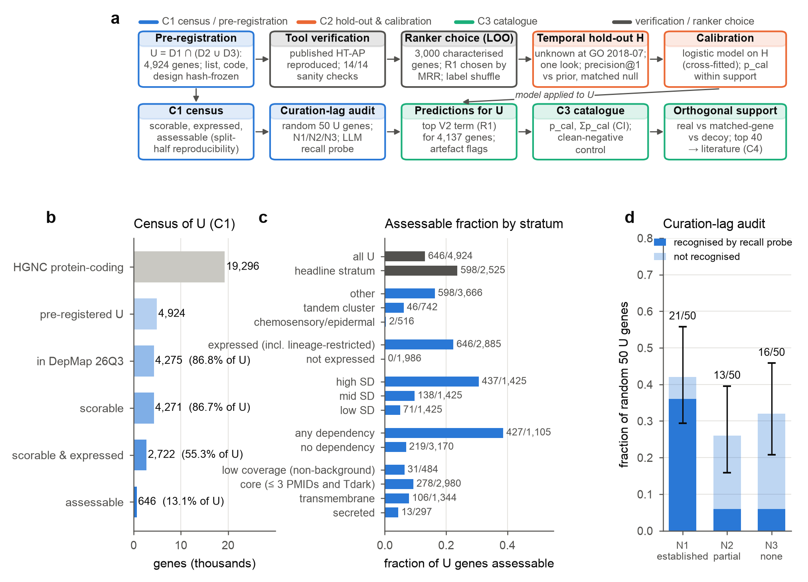
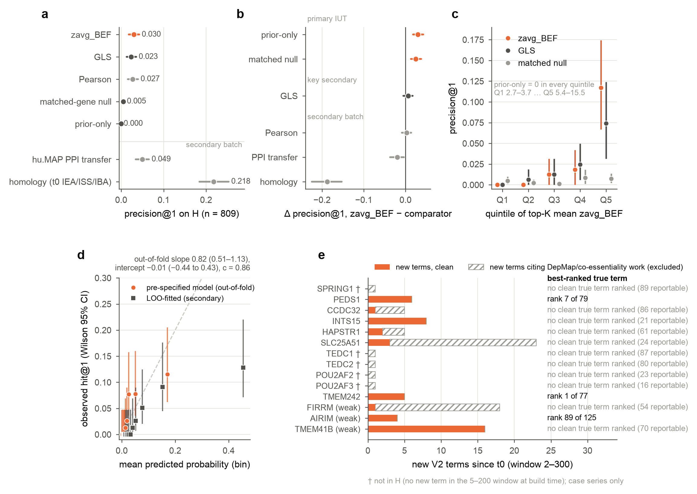
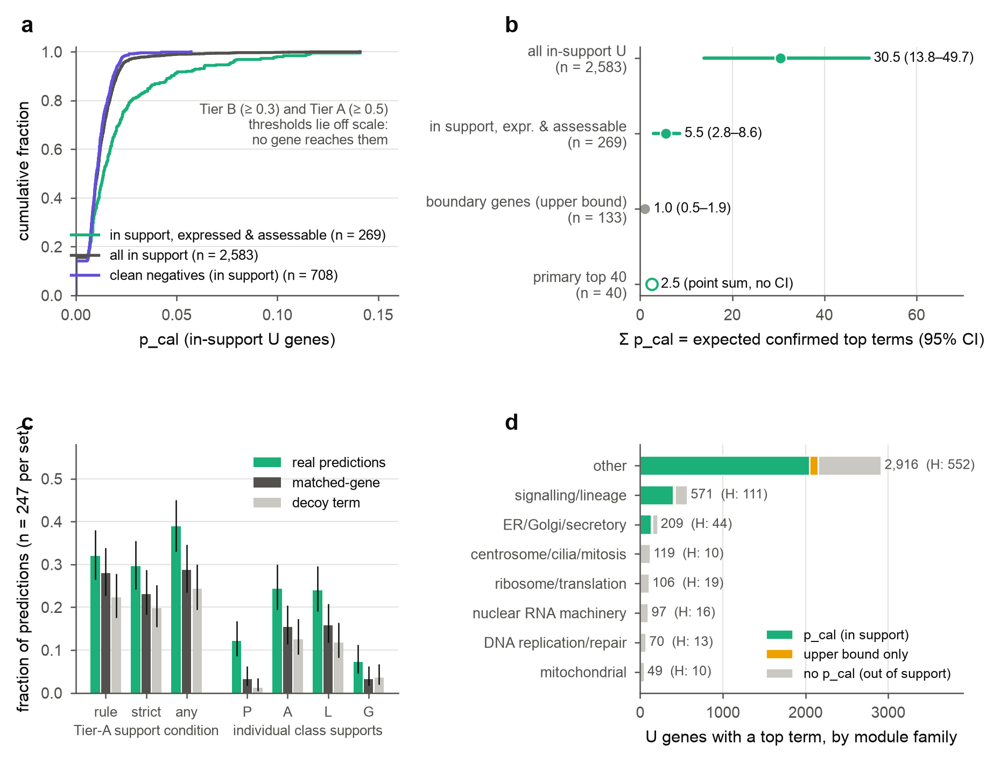
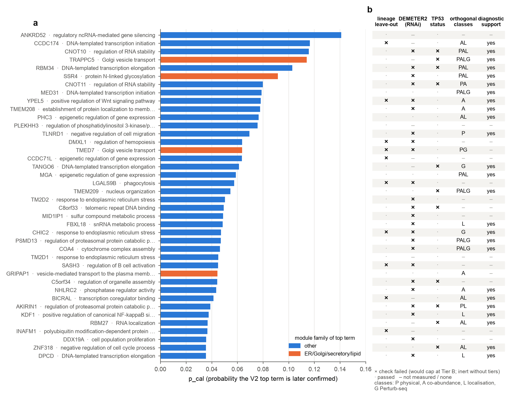
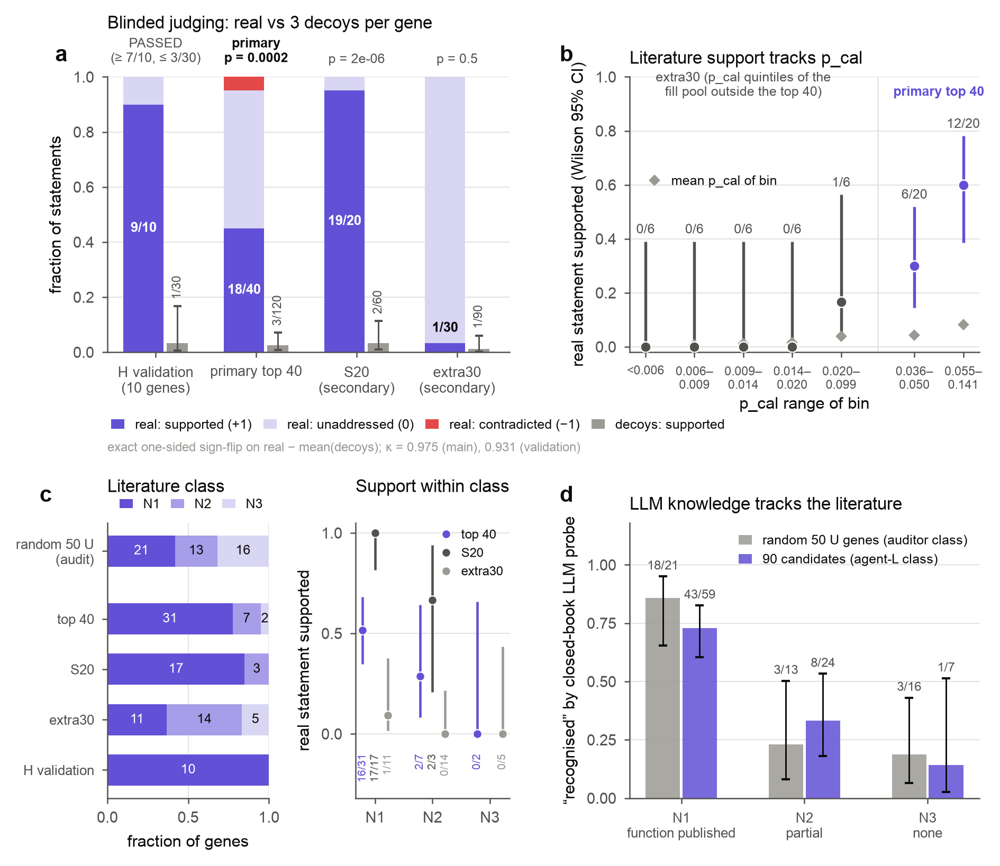
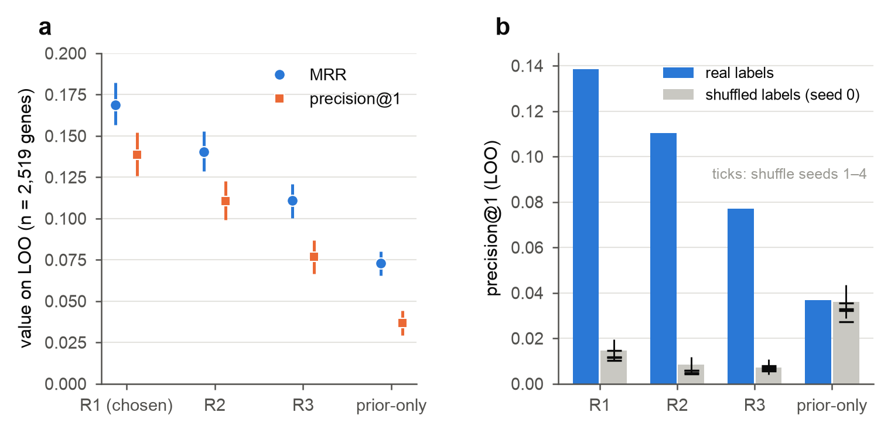
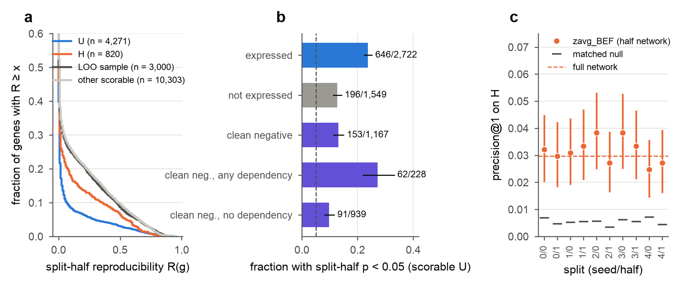
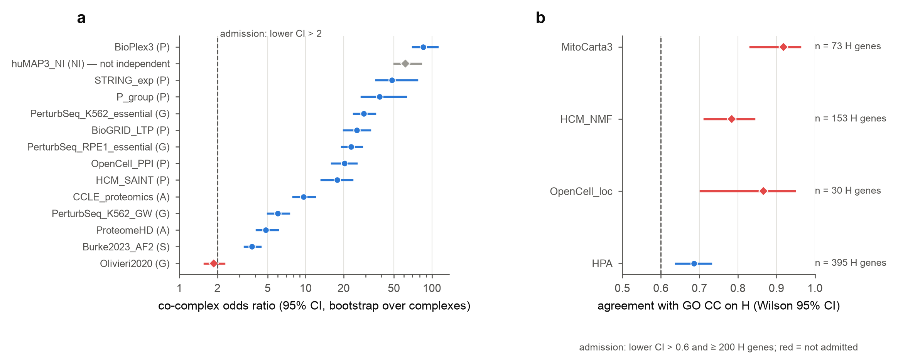

<!-- manuscript/manuscript.md — assembled from manuscript/drafts/01–04, reports/, results/m7/ and manuscript/figures/.
Every number carries a src comment naming the committed file it comes from; scripts/80_build_manuscript.sh strips these
comments in the rendered PDF/DOCX only. Labels in square brackets inside Results: [pre-specified] = DESIGN.md v2.3 at
tag design-frozen; [deviation] = logged in DEVIATIONS.md before the affected result was computed; [exploratory] = post
hoc, logged in LOOKS.md; [descriptive] = computed for presentation by scripts/60_figures.py or scripts/61_figure5.py
(manuscript/figures/source_data/), not a pre-specified test. Citations are numbered in order of first appearance;
keys were resolved against references/literature_refs.tsv (all rows verified). -->

**Short title:** Pre-registered co-essentiality function predictions

[Authors and affiliations to be completed]

AI-generated research project; human oversight: [to be completed by the human authors].

**Corresponding author:** [to be completed]

# Abstract

**Background.** Thousands of human protein-coding genes lack an experimentally established function. Co-essentiality
in CRISPR screens has suggested functions for several of them, but how often such predictions prove correct, and for
how many uncharacterised genes the approach can say anything, has not been measured prospectively.

**Methods.** We pre-registered 4,924 <!-- src: preregistration/CRITERIA.md --> uncharacterised genes from annotation data
alone and froze the list and analysis design under a cryptographic hash before computing any gene–gene quantity. We
then applied a co-essentiality method (zavg_BEF) to DepMap 26Q3 CRISPR screens, tested it on a temporal hold-out of 809
<!-- src: results/holdout_eval/core.md --> genes that were uncharacterised in 2018 and annotated since, converted scores
into calibrated probabilities (p_cal), and judged the top predictions against blindly retrieved literature, with decoy
statements as controls. A team of AI agents ran the study under explicit safeguards.

**Results.** Only 646 genes (13.1%) <!-- src: manuscript/figures/source_data/Fig1b_census_funnel.tsv --> were
assessable. On the hold-out, precision of the top-ranked term was 0.030 (95% CI 0.018–0.043), above prior-only (0.000)
and matched-gene (0.005) nulls <!-- src: results/holdout_eval/SUMMARY.md -->, but below transfer from homology (0.218)
and protein interactions (0.049) <!-- src: results/holdout_eval/SUMMARY.md -->. Calibration was adequate (slope 0.82)
<!-- src: results/holdout_eval/calibration.md -->. No pre-registered gene exceeded p_cal 0.141; about 30.5 (13.8–49.7)
of 2,583 calibrated top terms are expected to be confirmed <!-- src: results/ledger/pcal_summary.json -->. Judges
supported 18 of the 40 top predictions against 3 of 120 decoys (p = 0.0002), but 31 of the 40 genes already had
published functions <!-- src: results/m7/judge/analysis_main.md -->; 42% (29–56%) of random pre-registered genes were
in the same state <!-- src: results/audit/curation_lag_audit.md -->. Ten candidates received red-teamed reports,
including INAFM1 with the NRF1-activation axis, PLEKHH3 with PTEN and PLEKHA1, and a TP53-conditional centriole module
for C5orf34.

**Conclusions.** Co-essentiality gives specific and calibrated, but low-accuracy, function predictions that complement
homology and interaction data. Many "uncharacterised" genes are uncurated rather than unstudied.

# Author summary

By the definition we used, about one human protein-coding gene in four (4,924 of 19,296
<!-- src: preregistration/CRITERIA.md -->) has no experimentally established function in the main annotation database
and has been little studied. One way to find clues is to look for genes whose loss harms the same cancer cell lines. Such
"co-essential" genes often work together. Before looking at any
co-essentiality data, we fixed the list of genes and wrote down every analysis and decision rule. We then tested the method the way it would be used in practice: we predicted functions for genes that were unknown in
2018 and checked the predictions against what scientists have discovered since. The method beat chance, but rarely, and less often than transferring knowledge from related genes. Its confidence scores were
honest, showing how likely each prediction is to hold up. The strongest predictions mostly matched
functions that were already published but had not yet entered the databases, so many "unknown" genes are known but
uncurated. We offer ten detailed candidate reports with experiments that could confirm or refute them. The
study was run by AI agents, and we describe the checks that kept their work honest.

# Introduction

A large part of the human protein-coding genome still has no experimentally established function. Research attention
is concentrated and self-reinforcing: a small minority of genes accounts for half of all publications, and the genes
studied today are mostly those that were studied first [1–4].
Annotation resources inherit this imbalance [5], and even in well-studied organisms about 20%
<!-- src: LITERATURE.md --> of proteins lack an informative functional description [6]. Calls to close the gap
ask for agreed measures of what is "understudied" and for systematic data that link unknown proteins to known biology
[7–9]. No single measure is canonical. Experimental Gene Ontology (GO) evidence
[10], the UniProt annotation score [11,12] and literature-attention labels such
as the IDG "Tdark" class [8,13] each capture a different aspect of knownness, and each lags the
literature by a different amount. Any list of "uncharacterised" genes therefore contains some genes whose function is
already published [14–16].

Genome-scale CRISPR knockout screens offer one route to such links. The Cancer Dependency Map (DepMap) measures the
fitness effect of knocking out each gene in more than 1,000 <!-- src: results/assessability/splithalf_runs.md (1,361 lines in 26Q3) -->
cancer cell lines, with models that correct for copy number and screen dynamics [17–19]. Genes whose loss affects the same cell lines, that is co-essential genes, tend to act in the same complex
or pathway [20–23]. Co-essentiality has proposed or supported functions for several
genes that were uncharacterised a few years ago: SLC25A51 as a mitochondrial NAD⁺ transporter [24–26], C12orf49/SPRING1 in SREBP processing [22,27–29], TMEM189/PEDS1
as the plasmalogen desaturase and C15orf57/CCDC32 in AP-2-mediated endocytosis [23,30,31], C16orf72/HAPSTR1 in stress signalling [32], C14orf80 and C16orf59 (TEDC1/2) with δ/ε-tubulin
[20], and C7orf26/INTS15 as an Integrator subunit [33,34]. Network construction has also improved,
through covariance whitening and generalised least squares (GLS) [23,35], dimensionality reduction
and normalisation [33,36] and per-gene balancing [37]. The method used here, zavg_BEF, averages
three label-free views of the DepMap gene-effect matrix: whitened profile similarity, overlap of genome-wide partner
lists, and proximity in a graph embedding. On co-complex pairs held out from its development it ranked pairs better than
GLS [38].

Four things are missing before co-essentiality predictions for uncharacterised genes can be used with known confidence.

**Pre-registration.** In most studies the set of genes treated as uncharacterised, and the rules for accepting a
prediction, were chosen with the network in view. Undisclosed analytic flexibility inflates apparent effects, and
pre-registration is the standard guard against it [39,40]. We found no co-essentiality study that fixed
its list of target genes before computing any gene–gene quantity.

**Temporal validation.** Predictors are usually checked by leave-one-out recovery of current annotations or of known
complexes. These checks are vulnerable in three ways. First, current annotations can be circular: experimental GO
annotations for CCDC32 cite the co-essentiality paper that proposed its function [23], and integrated
networks used as "independent" support already contain DepMap data [41,42]. Second,
guilt-by-association performance often reflects node degree and multifunctionality rather than specific edges
[43,44]. Third, a few large complexes dominate the strongest DepMap correlations; ETC complex I and the
mitoribosome supplied about 76% <!-- src: LITERATURE.md --> of true-positive pairs at precision 0.5
<!-- src: LITERATURE.md --> in one benchmark [45]. The test that matches how predictions are used is
prospective in form: take genes that were uncharacterised at a past date, predict their function without the
annotations added since, and score the predictions against those later annotations. This is the design of the Critical
Assessment of Functional Annotation (CAFA) [46–48], made possible by archived GO releases
[49]. To our knowledge it has not been applied to co-essentiality function prediction.

**Calibration.** Co-essentiality scores are ranking scores, not probabilities [38]. An experimentalist
choosing which prediction to test needs to know how often a prediction of a given strength turns out to be right, and a
reader of a catalogue needs to know how many of its entries are expected to be correct. Neither can be read from a rank
or an enrichment p-value; both need a model fitted against an external outcome and checked out of sample.

**An honest census.** Many uncharacterised genes are poor subjects for co-essentiality. They are less often essential,
often not expressed in cancer cell lines, and often buffered by paralogues [50,51]. A flat knockout
profile carries no network information [52]. Genes in tandem clusters are exposed to proximity and
copy-number artefacts, because Cas9 cutting causes chromosome-arm truncations and amplified regions give correlated
effects [18,22,53]. The fraction of the uncharacterised genome to which co-essentiality can speak
at all is rarely reported, so the reach of the approach is hard to judge.

Here we apply zavg_BEF to DepMap CRISPR gene effects to predict functions for a pre-registered list of uncharacterised
human genes, and we address the four gaps directly. The list was built from annotation data alone and frozen, together
with the full analysis design, under a cryptographic hash and git tags before any pairwise DepMap quantity was computed.
The design fixed four claims, and the decision rule for each, before the analyses that test them; each claim is reported
whichever way it falls.

- **C1, census.** The fraction of the pre-registered genes that is scorable in DepMap, expressed in the screened cell
  lines, and assessable, meaning that its co-essentiality neighbourhood is reproducible across independent halves of the
  cell lines beyond what profile-matched genes achieve, reported by stratum.
- **C2, accuracy and calibration.** On a temporal hold-out of genes that were uncharacterised in the GO release of July
  2018 <!-- src: DESIGN.md --> and gained experimental annotations since, the precision of the top predicted term
  against a prior-only predictor and a matched-gene null (the primary test) and against GLS (key secondary), together
  with the calibration of a pre-specified probability model and the recovery of named positive controls.
- **C3, catalogue.** Calibrated predictions for every assessable pre-registered gene, headlined by the expected number of
  top-term predictions that later annotation would confirm, with false-call rates from non-expressed genes and from
  matched-gene and decoy predictions.
- **C4, candidates.** A short list of top candidates, each with a literature check, a blinded comparison against decoy
  statements, a stated relationship type and alternative explanations, and a tiered experimental plan.

Orthogonal datasets (physical interaction, co-abundance, localisation, perturbation and structure data) entered only
through a pre-specified support test, and only if they recovered known complexes on genes outside the uncharacterised
list. The study was planned and run by a team of AI agents under a human-specified goal; the safeguards this required
are part of the Methods and are assessed in the Discussion.

# Results

The study design is summarised in Fig 1A. Results are labelled [pre-specified] (frozen design, DESIGN.md v2.3),
[deviation] (a change logged in DEVIATIONS.md before the affected result was computed), [exploratory] (post hoc, logged
in LOOKS.md) or [descriptive] (computed for presentation only).

## The tool reproduces its published performance on DepMap 26Q3

Before any prediction for the pre-registered genes, we checked the tool on our data (Fig 1A). With the tool's own
command-line scripts, the internal-test average precision was 0.3451 for zavg_BEF, 0.2423 for GLS, 0.1463 for Spearman
and 0.1341 for Pearson <!-- src: results/verification/tool_reproduction.md -->. The published values are 0.345, 0.242,
0.146 and 0.134 <!-- src: results/verification/tool_reproduction.md -->, so every method fell inside the pre-specified
tolerance of ±0.005 <!-- src: results/verification/tool_reproduction.md -->. All 14
<!-- src: results/verification/sanity_checks.md --> sanity checks passed, including Chronos sign, exact symmetry and
median within-complex scores of 4.06–16.90 <!-- src: results/verification/sanity_checks.md --> for seven reference
complexes. Our GLS and Pearson rows matched the tool's to 2.96 × 10⁻⁷
<!-- src: results/verification/baseline_rows.md -->.

The ranker was then chosen once, on 2,519 <!-- src: results/calibration/loo_ranker_choice.md --> characterised
leave-one-out (LOO) genes, by the frozen mean-reciprocal-rank (MRR) rule [pre-specified]. Raw neighbour support (R1)
won with an MRR of 0.169, against 0.140 for the hypergeometric ranker (R2), 0.111 for the empirical ranker (R3) and
0.073 for prior-only <!-- src: results/calibration/loo_ranker_choice.md --> (S1A Fig). Every circularity variant gave
the same choice. When annotation rows were shuffled among genes of similar annotation count, R1 precision@1 fell from
0.139 to 0.015, below the prior-only level of 0.036 <!-- src: results/calibration/label_shuffle.md --> (S1B Fig). The
choice and the calibration specification were logged before the hold-out was opened (LOOKS.md, commit f0922e1).

## C1: about one in eight pre-registered genes is assessable

**Census.** Of the 4,924 <!-- src: results/assessability/assessability_U.tsv --> pre-registered genes, 4,275
<!-- src: manuscript/figures/source_data/Fig1b_census_funnel.tsv --> have a DepMap column and 4,271 (86.7%)
<!-- src: manuscript/figures/source_data/Fig1b_census_funnel.tsv --> are scorable (Fig 1B). Of these, 2,722
<!-- src: results/assessability/summary.md --> are expressed in DepMap lines, and 842 (19.7% of scorable)
<!-- src: results/assessability/summary.md --> have a split-half reproducibility p below 0.05 regardless of expression.
The pre-specified C1 count, genes that are scorable, expressed and assessable, is **646 (13.1% of U)**
<!-- src: manuscript/figures/source_data/Fig1b_census_funnel.tsv -->. This count applies the design's definition of
"expressed", which includes lineage-restricted genes; the frozen gene table predates that wording, and with its
expression column the count is 635 (12.9%) <!-- src: results/assessability/summary.md --> [deviation; both reported]. In
the headline stratum (expressed, not chemosensory or epidermal, not in a tandem cluster), 598 of 2,525
<!-- src: manuscript/figures/source_data/Fig1c_assessable_by_stratum.tsv --> genes are assessable (590 of 2,439
<!-- src: results/assessability/summary.md --> with the frozen column). A rank-biased-overlap version of the
reproducibility statistic gave 704 <!-- src: results/assessability/summary.md --> assessable genes; the two statistics
agree closely (Spearman 0.991 <!-- src: results/assessability/summary.md -->).

**Strata.** Assessability tracked the strength of a gene's dependency profile (Fig 1C). Only 2 of 516
<!-- src: manuscript/figures/source_data/Fig1c_assessable_by_stratum.tsv --> chemosensory and epidermal genes and 46 of
742 <!-- src: manuscript/figures/source_data/Fig1c_assessable_by_stratum.tsv --> tandem-cluster genes were assessable,
against 598 of 3,666 <!-- src: manuscript/figures/source_data/Fig1c_assessable_by_stratum.tsv --> other genes. Among
genes with any dependency (≥ 1% of lines below −0.5), 427 of 1,105
<!-- src: manuscript/figures/source_data/Fig1c_assessable_by_stratum.tsv --> were assessable, compared with 219 of
3,170 <!-- src: manuscript/figures/source_data/Fig1c_assessable_by_stratum.tsv --> without. By profile variability,
the counts were 437, 138 and 71 of 1,425 <!-- src: manuscript/figures/source_data/Fig1c_assessable_by_stratum.tsv -->
genes in the high, middle and low tertiles. Secreted proteins (13 of 297
<!-- src: manuscript/figures/source_data/Fig1c_assessable_by_stratum.tsv -->) and genes outside the tool background (31
of 484 <!-- src: manuscript/figures/source_data/Fig1c_assessable_by_stratum.tsv -->) were rarely assessable. Mean
R(g) was 0.041 in U against 0.078 in H and 0.112 in the LOO sample <!-- src: results/assessability/summary.md -->
(S2A Fig).

**The expression requirement carries the specificity.** Clean-negative genes, which are not expressed in at least 95%
of lines, reached split-half p < 0.05 in 153 of 1,167 <!-- src: results/assessability/summary.md --> cases (13.1%),
well above the nominal 5%. The rate was 27.2% <!-- src: results/assessability/summary.md --> among clean negatives
with some dependency and 9.7% <!-- src: results/assessability/summary.md --> among those without (S2B Fig). The
matched-gene null of the reproducibility test is therefore anti-conservative for genes with any dependency signal.
Because the call also requires expression, these genes cannot be assessable, but reproducibility alone is not evidence
of function.

**Curation lag.** An auditor with no access to co-essentiality output classed a pre-specified random sample of 50 U
genes (Fig 1D). For 21 genes (42%, Wilson 95% CI 29–56%) <!-- src: results/audit/curation_lag_audit.md --> the auditor
found direct functional evidence in a focused study (N1). Thirteen (26%) <!-- src: results/audit/curation_lag_audit.md -->
had partial evidence (N2) and 16 (32%) <!-- src: results/audit/curation_lag_audit.md --> had none (N3). Moving the
three borderline calls gave N1 rates between 38% and 46% <!-- src: results/audit/curation_lag_audit.md -->. For 13 of
the 21 <!-- src: results/audit/curation_lag_audit.md --> N1 genes the key evidence dates from 2021 or later. In a
closed-book recall probe, a language model without tools "recognised" 24 of the 50
<!-- src: results/audit/recall_probe_random50.tsv --> genes: 18 of 21 N1, 3 of 13 N2 and 3 of 16 N3 genes
<!-- src: manuscript/figures/source_data/Fig1d_curation_lag_audit.tsv -->. Roughly four in ten "uncharacterised" genes
thus already have published functions, so novelty must be checked against the literature (C4).

## C2: co-essentiality beats both nulls on a temporal hold-out, with low absolute accuracy

**Hold-out set.** H contained 820 genes that lacked experimental function at the July 2018 GO release, with 5,965
<!-- src: results/holdout_eval/core.md --> gene–target pairs. Removing 106 <!-- src: results/holdout_eval/core.md -->
pairs whose supporting papers cite DepMap or co-essentiality work left 809 <!-- src: results/holdout_eval/core.md -->
genes with a target. The PMID + N(g) cluster graph put 63.5% <!-- src: results/holdout_eval/core.md --> of H in one
component, so under the fallback rule set before H was opened [deviation] the primary confidence intervals use the
PMID-only clusters (703 <!-- src: results/holdout_eval/comparisons_core.tsv --> clusters among primary genes).
Effective sample sizes were 719 and 722 <!-- src: results/holdout_eval/core.md --> (underpowered threshold 300).

**Primary test [pre-specified].** zavg_BEF placed a later-confirmed term at rank 1 for 24
<!-- src: verify/holdout_verification.md --> of 809 genes: precision@1 0.030 (95% CI 0.018–0.043)
<!-- src: results/holdout_eval/SUMMARY.md -->. The prior-only ranking scored 0.000 and the matched-gene null 0.005
(0.003–0.008) <!-- src: results/holdout_eval/SUMMARY.md --> (Fig 2A). Both paired differences exclude zero: +0.030
(+0.018 to +0.043) versus prior-only and +0.025 (+0.013 to +0.038) versus the matched null
<!-- src: results/holdout_eval/SUMMARY.md --> (Fig 2B). The intersection–union test therefore passes, as it does with
BCa intervals and with the PMID + N(g) clusters <!-- src: results/holdout_eval/SUMMARY.md -->. Prior-only always
proposes the most frequent candidate terms (median size 200 genes <!-- src: results/holdout_eval/SUMMARY.md -->), none
of which was new for an H gene. An independent agent re-implemented the evaluation from the design documents and
reproduced hit@1 for 809 of 809 <!-- src: verify/holdout_verification.md --> genes, for all three methods.

The result held in every pre-specified robustness check. Precision@1 on the ten split-half networks ranged from 0.025 to
0.038 <!-- src: results/holdout_eval/SUMMARY.md -->, and both differences excluded zero in 10 of 10
<!-- src: results/holdout_eval/SUMMARY.md --> (S2C Fig). Across the circularity sensitivities precision@1 was
0.030–0.032 <!-- src: results/holdout_eval/SUMMARY.md -->, and the test passed in all five. The R1 tie-break was not
specified in the design; implemented as ascending GO identifier, it affects 401 of 820 <!-- src: DEVIATIONS.md --> H
genes, and the reverse order gives 0.032 <!-- src: DEVIATIONS.md --> with the primary still passing [deviation].
Restricting candidates and targets to terms with at most 50 genes gave 0.029 (0.017–0.044) on 649
<!-- src: results/holdout_eval/SUMMARY.md --> genes. Other pre-specified metrics were weaker. The MRR difference from
prior-only was +0.010 (−0.004 to +0.025) <!-- src: results/holdout_eval/SUMMARY.md --> and did not exclude zero;
prior-only often places a true term just below rank 1. Predicted terms were broad: the median top-1 term had 132
annotated genes (IQR 84–176), and only 13% <!-- src: results/holdout_eval/SUMMARY.md --> had 50 or fewer. For GO
complexes (V1; 77 <!-- src: results/holdout_eval/SUMMARY.md --> H genes with a complex target), precision@1 was 0.182
(0.093–0.286) against 0.013 for prior-only and 0.005 for the null <!-- src: results/holdout_eval/SUMMARY.md -->;
removing ETC complex I and the mitoribosome from targets and lists left this unchanged
<!-- src: results/holdout_eval/SUMMARY.md -->.

**GLS (key secondary) [pre-specified].** GLS reached 0.023 (0.013–0.035) <!-- src: results/holdout_eval/SUMMARY.md -->.
The two-sided difference, zavg_BEF minus GLS, was +0.006 (−0.005 to +0.017) <!-- src: results/holdout_eval/SUMMARY.md -->:
no detectable difference (Fig 2A and 2B). By the size of the gene's smallest target, the difference was +0.011 (−0.002
to +0.024) for targets of at most 50 genes and −0.013 (−0.032 to 0.000) for larger ones
<!-- src: results/holdout_eval/SUMMARY.md -->. Secondary metrics without multiplicity control favoured zavg_BEF modestly
(MRR +0.016, +0.005 to +0.027) <!-- src: results/holdout_eval/SUMMARY.md -->.

**Secondary batch [pre-specified, reported in full].** Pearson correlation matched zavg_BEF (0.027; difference +0.002,
−0.009 to +0.014) <!-- src: results/holdout_eval/SUMMARY.md -->. Two non-co-essentiality baselines did better (Fig 2A
and 2B). The homology baseline, which uses the gene's own t0 electronic, sequence-similarity and phylogenetic
annotations, made a prediction for 57% <!-- src: results/holdout_eval/SUMMARY.md --> of H genes, yet reached
precision@1 0.218 (0.184–0.253), exceeding zavg_BEF by 0.188 (0.153–0.225) <!-- src: results/holdout_eval/SUMMARY.md -->.
Module transfer from hu.MAP 3.0 interaction partners [54] reached 0.049 (0.034–0.066), 0.020 (0.004–0.037)
<!-- src: results/holdout_eval/SUMMARY.md --> above zavg_BEF; hu.MAP 3.0 was built after t0, which favours it, as the
design anticipated. The primary test also passed with t0 = 2019-07, with post-cut-off-dated targets, at K = 10 and 50,
and without same-arm and paralogue exclusions (precision@1 0.028–0.034) <!-- src: results/holdout_eval/SUMMARY.md -->.
H genes have stronger co-essentiality signal than U genes (standardised mean difference in top-K mean zavg_BEF +0.253,
in R(g) +0.228) <!-- src: results/holdout_eval/SUMMARY.md -->. Reweighted to the covariate distribution of U,
precision@1 fell to 0.012 (0.007–0.019), and both primary differences still excluded zero (+0.012 and +0.008, lower
bound 0.002) <!-- src: results/holdout_eval/SUMMARY.md -->.

**Accuracy is concentrated in the strongest signals [pre-specified core].** By quintile of top-K mean zavg_BEF,
precision@1 was 0 in the two lowest quintiles and 0.117 (0.067–0.174)
<!-- src: results/holdout_eval/fig_signal_quintiles.tsv --> in the highest (top-K mean 5.4–15.5) (Fig 2C). GLS showed
the same gradient, reaching 0.074 <!-- src: results/holdout_eval/fig_signal_quintiles.tsv --> in the top quintile.
Prior-only scored 0 in every quintile.

**Calibration [pre-specified].** The calibration model was fitted on the 775
<!-- src: results/holdout_eval/calibration.md --> H genes with a top term and evaluated by 10-fold cluster
cross-fitting. Out of fold, the calibration slope was 0.82 (Wald 95% CI 0.51–1.13) and the intercept −0.01 (−0.44 to
0.43) <!-- src: results/holdout_eval/calibration.md --> (Fig 2D). Neither crosses the pre-specified poor-calibration
bound, so p_cal is reported without that caveat. Discrimination was good (c-statistic 0.855
<!-- src: results/holdout_eval/calibration.md -->). However, with a 3.1% <!-- src: results/holdout_eval/calibration.md -->
base rate, the Brier score (0.0294) was barely below that of a constant-rate prediction (0.0300)
<!-- src: results/holdout_eval/calibration.md -->. In the five lowest deciles (p_cal ≤ 0.013) no prediction was
confirmed; in the top decile, a mean prediction of 0.170 compared with an observed rate of 0.115 (0.062–0.205)
<!-- src: results/holdout_eval/calibration.md -->. Two of the four sign-constrained coefficients, for R(g) and term
size, were fitted at their bound of 0 <!-- src: results/holdout_eval/calibration.md -->. The signalling/lineage family
had no hits in H and received a coefficient of −11.86 <!-- src: results/holdout_eval/calibration.md -->, which sets its
p_cal to about zero. Five families had only 10–19 H genes each <!-- src: results/holdout_eval/calibration.md --> and so
receive no p_cal under the support rule. A model fitted on LOO genes instead (secondary) predicted a mean of 0.089
against an observed 0.031 on H, with intercept −1.39 (−1.84 to −0.95) <!-- src: results/holdout_eval/SUMMARY.md -->.
Current annotations of characterised genes therefore overstate, roughly threefold, the chance that a prediction for a
newly studied gene will be confirmed.

**Named controls [pre-specified case series].** Of the 14 named controls, 9
<!-- src: results/holdout_eval/controls_case_series.tsv --> are in H (Fig 2E). TMEM242's true term ranked first of 77
reportable terms and PEDS1's seventh of 79; AIRIM's ranked 89th of 125
<!-- src: results/holdout_eval/controls_case_series.tsv -->. For the other controls no clean true term was ranked,
mostly because their new annotations cite DepMap or co-essentiality papers and were excluded. This applied to the single
new term of SPRING1, TEDC1, TEDC2, POU2AF2 and POU2AF3, to 4 of 5 for CCDC32, 20 of 23 for SLC25A51 and 17 of 18 for
FIRRM <!-- src: results/holdout_eval/controls_case_series.tsv -->. (The descriptive module label for SPRING1 was the
SREBP–SCAP complex <!-- src: results/holdout_eval/controls_case_series.tsv -->.) Much of the recent literature on these
controls depends on co-essentiality itself, so the case series cannot serve as independent validation.

**Complementarity [exploratory; post hoc, logged in LOOKS.md].** After seeing the primary results, we asked whether
co-essentiality adds to the stronger baselines. Both zavg_BEF and homology were right for 9
<!-- src: results/holdout_eval/exploratory_complementarity.md --> genes; zavg_BEF alone was right for 15 genes and
homology alone for 167 <!-- src: results/holdout_eval/exploratory_complementarity.md -->, so the union reached 0.236
(0.206–0.266), a gain of 0.019 <!-- src: results/holdout_eval/exploratory_complementarity.md --> over homology. In the
348 genes without a homology prediction, zavg_BEF reached 0.014 (0.003–0.029; 5 hits)
<!-- src: results/holdout_eval/exploratory_complementarity.md -->, and in the 81 genes without a hu.MAP partner, 0
<!-- src: results/holdout_eval/exploratory_complementarity.md -->. Within the top five terms, zavg_BEF found a true term
for 0.067 of genes and prior-only for 0.069 <!-- src: results/holdout_eval/exploratory_complementarity.md -->.
Co-essentiality thus adds a few distinct correct calls but does not replace homology- or interaction-based annotation.

## C3: calibrated predictions for U are uniformly low, and the low-yield branch applies

**Coverage of the catalogue.** All 4,271 <!-- src: results/ledger/pcal_summary.json --> scorable U genes were scored
with the hold-out code path, and 4,137 <!-- src: results/ledger/pcal_summary.json --> received a reportable top term.
Of these, 2,583 <!-- src: results/ledger/pcal_summary.json --> were inside calibration support, 133
<!-- src: results/ledger/pcal_summary.json --> received only a boundary upper bound and 1,421
<!-- src: results/ledger/pcal_summary.json --> were out of support (Fig 3D). Low neighbourhood annotation coverage was the
commonest reason (536 <!-- src: results/ledger/pcal_summary.json --> genes). The family rule removed every prediction in
the five under-represented families: 119 centrosome/cilia/mitosis, 106 ribosome/translation, 97 nuclear RNA machinery,
70 DNA replication/repair and 49 mitochondrial <!-- src: results/ledger/pcal_summary.json --> genes. Another 96
<!-- src: results/ledger/pcal_summary.json --> genes were excluded because their signal exceeded H's 95th percentile.
Calibration therefore leaves out the machinery modules and the strongest signals, where co-essentiality is best
established and, on H, most accurate (Fig 2C). Among the 646 assessable genes, 269
<!-- src: results/ledger/M6_SUMMARY.md --> are in support. A secondary, uncalibrated list (S20) of the strongest
predictions without p_cal was defined before any literature step [deviation] and is analysed under C4.

**Calibrated probabilities [pre-specified].** No U gene reached the Tier B threshold of 0.3, let alone the Tier A
threshold of 0.5. The largest in-support p_cal was 0.141 <!-- src: results/ledger/pcal_summary.json -->. Among
expressed, assessable genes in support the median was 0.014 and the 90th percentile 0.047
<!-- src: results/ledger/pcal_summary.json --> (Fig 3A). This ceiling follows from the model: with an H hit rate of 3%
<!-- src: results/holdout_eval/calibration.md --> and covariates bounded by H's 95th percentiles (top-K mean zavg_BEF ≤
10.99, coverage percentile ≤ 0.894 <!-- src: results/holdout_eval/calibration.md -->), the fitted model cannot reach
0.3 inside support <!-- src: results/ledger/M6_SUMMARY.md -->.

**Σp_cal [pre-specified headline].** Summed over the 2,583 in-support genes, the expected number of top terms that later
experimental annotation will confirm within about eight years is **30.5 (95% CI 13.8–49.7)**
<!-- src: results/ledger/pcal_summary.json -->, a mean of about 1.2% per gene (Fig 3B). Over the 269 expressed,
assessable genes in support it is 5.5 (2.8–8.6) <!-- src: results/ledger/pcal_summary.json -->. The 133 boundary genes
add an upper bound of 1.0 (0.5–1.9) <!-- src: results/ledger/pcal_summary.json -->, and Tier A contributes 0.

**Decision branch [pre-specified].** Tier A has 0 genes and Tier B has 0 <!-- src: results/ledger/M6_SUMMARY.md -->.
With fewer than 10 Tier A genes, the pre-specified low-yield branch applies: the paper leads with C1 and C2, the top 40
is filled by p_cal, and thresholds are not relaxed. Because C2 passed and 646 genes are assessable (≥ 100), the
catalogue remains calibrated rather than descriptive.

**False calls among clean negatives [pre-specified].** Of 1,167 <!-- src: results/ledger/negative_control.tsv -->
scorable clean-negative genes, 708 <!-- src: results/ledger/negative_control.tsv --> received an in-support p_cal. None
was Tier-A-like (rate 0, one-sided 95% upper bound 0.0026) <!-- src: results/ledger/negative_control.tsv -->, and none
was Tier-B-like, in every profile tertile. This zero rate is uninformative, because no expressed gene reached the
thresholds either. Clean negatives had a median p_cal of 0.010 and a maximum of 0.057
<!-- src: results/ledger/negative_control.tsv -->, against 0.014 and 0.141
<!-- src: results/ledger/negative_control.tsv --> for expressed, assessable genes (Fig 3A); p_cal separates the groups
mainly in the upper tail.

**Artefact flags [pre-specified].** Among the 4,137 predictions, locus flags touched 17, copy-number flags 1 and hub
partners 511 <!-- src: results/ledger/M6_SUMMARY.md -->; 218 <!-- src: results/ledger/M6_SUMMARY.md --> predictions were
hub-driven. In total 293 <!-- src: results/ledger/M6_SUMMARY.md --> carry a built-in exclusion from Tier A (a flag on
at least half of the supporting partners, or hub-driven). The locus flag was applied without strand information, as a
superset of the frozen rule [deviation].

**Orthogonal support separates real from control predictions only weakly [pre-specified].** The support test was run on
247 <!-- src: results/ledger/false_support.tsv --> anchor genes (all candidates evaluated during the top-40 fill),
together with one matched-gene prediction and one decoy-term prediction per anchor. The Tier-A support rule was met by
0.320 of real predictions, 0.279 of matched-gene predictions and 0.223 of decoy predictions
<!-- src: results/ledger/false_support.tsv --> (Fig 3C). In a paired comparison over the same anchors [descriptive],
real predictions passed the rule more often than decoys (+0.097; 54 vs 30 discordant pairs; exact McNemar p = 0.012)
<!-- src: manuscript/figures/source_data/derived_numbers.tsv --> but not detectably more often than matched-gene
predictions (+0.040; 47 vs 37; p = 0.33) <!-- src: manuscript/figures/source_data/derived_numbers.tsv -->.
Physical-interaction support showed the clearest contrast (0.12 real, 0.03 matched, 0.01 decoy), whereas co-abundance
and localisation support were common in all three sets <!-- src: results/ledger/false_support.tsv -->. Contradictions
were rare (0.004 of real predictions) and arose only through the four-source localisation reading [deviation]; the
HPA-only rule never fired <!-- src: results/ledger/false_support.tsv -->. At the gene level, orthogonal "support" under
this rule is weak evidence. It is reported for every candidate but upgrades no prediction.

**Top 40 [pre-specified fill; deviation in its reading].** The fill pool held 269
<!-- src: manuscript/figures/source_data/derived_numbers.tsv --> expressed, assessable, in-support genes, of which 24
<!-- src: manuscript/figures/source_data/derived_numbers.tsv --> were removed by a built-in artefact exclusion (23) or a
contradiction (1). With no tiered gene, the frozen order Tier A → Tier B → p_cal reduces to p_cal. The top-40-only
checks are tier caps ("Tier B at best"), so they are shown as labels, not demotions (PI ruling before any literature
step) [deviation]. The primary top 40 is therefore the 40 highest p_cal values after exclusions (Fig 4). The pool
contains no mitochondrial-family genes <!-- src: manuscript/figures/source_data/derived_numbers.tsv -->, so the
mitochondrial cap did not bind. p_cal in the top 40 ranges from 0.036 to 0.141
<!-- src: manuscript/figures/source_data/derived_numbers.tsv -->, and the sum is 2.50
<!-- src: manuscript/figures/source_data/derived_numbers.tsv --> (point estimate): about two to three of these 40 top
terms are expected to be confirmed. Thirty-six top terms fall in the "other" family and 4 in ER/Golgi/secretory
<!-- src: manuscript/figures/source_data/derived_numbers.tsv -->. The commonest terms are transcription elongation,
epigenetic regulation of gene expression and response to ER stress (3 genes each)
<!-- src: manuscript/figures/source_data/derived_numbers.tsv -->.

The top-40-only checks were strict. Thirty-three of the 40
<!-- src: manuscript/figures/source_data/derived_numbers.tsv --> genes fail at least one. The lineage leave-out changed
the top term for 10 <!-- src: manuscript/figures/source_data/derived_numbers.tsv --> genes. DEMETER2 RNAi
[55] did not replicate the partner correlations for 24 of the 30
<!-- src: manuscript/figures/source_data/derived_numbers.tsv --> genes in which it could be measured, and 11
<!-- src: manuscript/figures/source_data/derived_numbers.tsv --> genes carry a TP53 flag. Across the pool, DEMETER2 failed
to replicate for 182 of 204 <!-- src: results/ledger/M6_SUMMARY.md --> measured genes, a rate that may reflect the RNAi
data as much as the predictions; we report it without adjustment. Twenty-seven of the top 40 have support from at least
one orthogonal class, and 25 have diagnostic-class support
<!-- src: manuscript/figures/source_data/derived_numbers.tsv -->; given the false-support rates above, these counts
should not be read as validation. The "clean-first" list built by the implementing agent shares 20
<!-- src: manuscript/figures/source_data/derived_numbers.tsv --> genes with the primary top 40 and has Σp_cal 2.04
(1.05–3.24) <!-- src: results/ledger/M6_SUMMARY.md -->; it is reported as a sensitivity analysis (S3 Table).

## C4: blinded literature judging supports the top predictions, mostly as rediscovery of uncurated function

**Candidate sets.** Four gene sets entered the literature step (Fig 5A). The primary set is the top 40 by p_cal. Two
sets are secondary. S20 holds the 20 strongest predictions that have no p_cal, because their family has fewer than 30 H
genes or their signal exceeds H's 95th percentile <!-- src: results/m7/s20.tsv -->; it was defined after the U
predictions but before any literature step, and is analysed separately [deviation]. Extra30 holds 30 further genes from
the fill pool, six in each p_cal quintile (p_cal 6 × 10⁻⁸ to 0.099) <!-- src: results/m7/extra30.tsv -->
[pre-specified secondary]. The fourth set, 10 H genes whose "real" statement is a known current target term, served only
to validate the judges <!-- src: results/m7/hval10.tsv --> [pre-specified]. Judged statements contained the predicted GO
term and the descriptive module label only; the relationship type was dropped for every statement, because types
existed for none of the decoy donors and would have marked the real slot [deviation].

**Closed-book recall probe [pre-specified; extended to S20 and extra30].** Before any agent saw network output for
these genes, a fresh language model without tools stated what it knew of each gene from its symbol and aliases. It
"recognised" 52 of the 90 <!-- src: results/m7/recall_probe_90.tsv --> candidates: 22 of 40 in the top 40, 19 of 20 in
S20 and 11 of 30 in extra30 <!-- src: manuscript/figures/source_data/Fig5_derived_numbers.tsv -->. Recognition followed
the literature class assigned later by the literature agent L (Fig 5D): 43 of 59 N1, 8 of 24 N2 and 1 of 7 N3
candidates <!-- src: manuscript/figures/source_data/Fig5d_recall_probe.tsv -->, as in the random 50 U genes (18 of 21 N1,
3 of 13 N2 and 3 of 16 N3 <!-- src: manuscript/figures/source_data/Fig5d_recall_probe.tsv -->). A language model
therefore already knows most published-but-uncurated functions. This is why the judges saw only evidence that agent L
had retrieved, under a redacted gene name, and were told not to use their own knowledge.

**Blind literature screen: curation lag among candidates [pre-specified; extended].** Agent L had no access to
co-essentiality output or to our predictions. For the 100 genes it recorded 887 evidence items, each with a verbatim
span; 518 were focused functional studies and 4 were flagged as DepMap-derived
<!-- src: manuscript/figures/source_data/Fig5_derived_numbers.tsv -->. Among the 90 U candidates, 59 were N1 (direct
functional evidence), 24 N2 (partial) and 7 N3 (none) <!-- src: manuscript/figures/source_data/Fig5_derived_numbers.tsv -->.
In the primary top 40 the split was 31 N1, 7 N2 and 2 N3; in S20 17 N1 and 3 N2; and in extra30 11 N1, 14 N2 and 5 N3
<!-- src: manuscript/figures/source_data/Fig5c_novelty_class.tsv --> (Fig 5C). Including the 10 H validation genes, all
N1 as expected <!-- src: results/m7/judge/analysis_hval_genes.tsv -->, agent L classed 69 of 100 genes as N1
<!-- src: manuscript/figures/source_data/Fig5_derived_numbers.tsv -->. For comparison, the random 50 U genes had 21 N1,
13 N2 and 16 N3 <!-- src: results/audit/curation_lag_audit.md --> (a different auditor; descriptive comparison). Our
highest-ranked predictions are thus concentrated in genes whose function is already published but not yet in GO
experimental annotation: 78% of the top 40 and 85% of S20 <!-- src: manuscript/figures/source_data/Fig5c_novelty_class.tsv -->.

**Judge validation [pre-specified].** On the 10 H genes, adjudicated scores supported 9 of 10 real statements and 1 of
30 decoys <!-- src: results/m7/judge/analysis_hval.md -->, meeting the acceptance rule (at least 7 of 10 real, at most 3
of 30 decoys) at the first attempt. Agreement between the two judges was κ = 0.931 over 40 statements, with one
disagreement <!-- src: results/m7/judge/analysis_hval.md -->, which the adjudicator resolved as supported; it is the
single supported decoy <!-- src: results/m7/judge/scores/ADJ_hval.tsv -->.

**Primary blinded test: top 40 [pre-specified].** Each gene's packet held the real statement and three decoys in random
order; the decoys were top terms of other U genes, matched on family and term size
<!-- src: results/m7/answer_key_slots.tsv -->. Judges supported 18 of 40 real statements (45%, Wilson 95% CI 31–60%),
left 20 unaddressed and scored 2 as contradicted <!-- src: results/m7/judge/analysis_main.md -->
<!-- src: manuscript/figures/source_data/Fig5_derived_numbers.tsv -->. They supported 3 of 120 decoys (2.5%)
<!-- src: results/m7/judge/analysis_main.md -->. The mean of real minus mean decoy score was 0.375; with 20 non-zero
differences, the exact one-sided sign-flip p was 2.2 × 10⁻⁴ <!-- src: results/m7/judge/analysis_main.md -->, so the
primary test passes (Fig 5A). The two contradicted statements, for the N1 genes TLNRD1 and KDF1
<!-- src: results/m7/judge/analysis_main_genes.tsv -->, failed on direction: TLNRD1 promotes rather than inhibits cell
migration, and KDF1 inhibits rather than activates NF-κB signalling
<!-- src: results/m7/judge/scores/J1_main2.tsv, J1_main3.tsv (packets J045, J048, J088, J098, J040, J095) -->. Support
fell with rank: 12 of 20 for ranks 1–20 (p_cal 0.055–0.141) and 6 of 20 for ranks 21–40 (p_cal 0.036–0.050)
<!-- src: manuscript/figures/source_data/Fig5b_support_vs_pcal.tsv --> (Fig 5B).

**Secondary sets [S20: deviation; extra30: pre-specified].** These sets were analysed separately and never pooled with
the primary test. In S20, judges supported 19 of 20 real statements and 2 of 60 decoys (sign-flip p = 1.9 × 10⁻⁶)
<!-- src: results/m7/judge/analysis_main.md -->; 15 of the 20 carry a Commander, complex I/OXPHOS or Elongator module
label <!-- src: results/m7/s20.tsv --> (Table 2), the well-established machinery modules that the calibration support
rule excludes. In extra30, judges supported 1 of 30 real statements and 1 of 90 decoys (p = 0.5)
<!-- src: results/m7/judge/analysis_main.md -->; support was 0 of 6 in each of the four lowest p_cal quintiles and 1 of 6
in the highest <!-- src: manuscript/figures/source_data/Fig5b_support_vs_pcal.tsv -->. Literature support therefore rose
with p_cal across the fill pool (Fig 5B): 18 of 40 in the top 40 against 1 of 30 in extra30 (one-sided Fisher p = 5.6 ×
10⁻⁵) [descriptive] <!-- src: manuscript/figures/source_data/Fig5_derived_numbers.tsv -->. Literature support is a
different endpoint from p_cal, which estimates future GO experimental annotation, so the summed p_cal of the top 40
(2.50) <!-- src: manuscript/figures/source_data/Fig5_derived_numbers.tsv --> should not be compared directly with the
18 supported statements.

**Support by novelty class [pre-specified reporting].** The support is mostly rediscovery. In the top 40, judges
supported 16 of 31 N1, 2 of 7 N2 and 0 of 2 N3 genes <!-- src: results/m7/judge/analysis_main.md --> (Fig 5C); in S20,
17 of 17 N1 and 2 of 3 N2 genes <!-- src: results/m7/judge/analysis_main.md -->. Of the 37 supported top-40 and S20
genes, 33 are N1, and the recall probe recognised 35 <!-- src: manuscript/figures/source_data/Table2_rediscovery.tsv -->.
Being known is not enough, however. Among N1 genes only, support was 16 of 31 in the top 40 and 1 of 11 in extra30
(one-sided Fisher p = 0.014) [descriptive] <!-- src: manuscript/figures/source_data/Fig5_derived_numbers.tsv -->:
higher-ranked predictions match the published function more often, not merely more-studied genes. Only four supported
genes are N2: TRAPPC5 and BICRAL in the top 40, NDUFB2 and MED9 in S20
<!-- src: manuscript/figures/source_data/Table2_rediscovery.tsv -->. No N3 prediction could be checked against the
literature by construction, and the top 40 contains only 2 N3 genes.

**Agreement and adjudication [pre-specified].** Over the 360 main statements the judges agreed with κ = 0.975, with 2
disagreements and none left unresolved <!-- src: results/m7/judge/analysis_main.md -->. Both disagreements involved real
statements, for WDR7 (S20) and DPCD (top 40); the adjudicator resolved both as supported because the evidence matched
the module label, not the GO term <!-- src: results/m7/judge/scores/ADJ_main2.tsv -->
<!-- src: results/m7/judge/scores/ADJ_main3.tsv -->. The judging rule credits a match to "the stated process or module"
<!-- src: scripts/51_judge_packets.py --> and applied equally to decoys. Still, three supported real statements rest on
the module label alone: YPEL5 (GID/CTLH complex; Wnt not shown), DPCD (R2TP/PAQosome; transcription elongation not
shown) and WDR7 (V-ATPase/RAVE; iron homeostasis not shown)
<!-- src: results/m7/judge/scores/J1_main2.tsv, J1_main3.tsv (packets J045, J048, J088, J098, J040, J095) -->, and for
DDX19A, support for "cell population proliferation" came from cancer cell-line proliferation studies. Counting only
term-level support, the top 40 has 16 supported real statements
<!-- src: manuscript/figures/source_data/Table2_rediscovery.tsv --> [descriptive]. The judges' packets contained no
gene-symbol or partner-name leaks <!-- src: results/m7/judge/leak_check.tsv -->.

**Table 2. Top-40 and S20 predictions judged supported by the literature (blinded, adjudicated).**

| Set, rank | Gene | Predicted GO term | Module label | p_cal / zavg | L class | Probe | Basis |
|---|---|---|---|---|---|---|---|
| top 40, 1 | ANKRD52 | regulatory ncRNA-mediated gene silencing | RISC complex | 0.141 | N1 | yes | term |
| top 40, 3 | CNOT10 | regulation of RNA stability | CCR4-NOT deadenylase complex | 0.116 | N1 | yes | term |
| top 40, 4 | TRAPPC5 | Golgi vesicle transport | TRAPP III complex | 0.114 | N2 | yes | term |
| top 40, 6 | SSR4 | protein N-linked glycosylation | ER protein-containing complex | 0.091 | N1 | yes | term |
| top 40, 7 | CNOT11 | regulation of RNA stability | CCR4-NOT deadenylase complex | 0.080 | N1 | yes | term |
| top 40, 8 | MED31 | DNA-templated transcription initiation | RNA Pol II transcription regulator complex | 0.079 | N1 | yes | term |
| top 40, 9 | YPEL5 | positive regulation of Wnt signaling pathway | GID E3 ubiquitin ligase complex | 0.078 | N1 | yes | module |
| top 40, 10 | TMEM208 | establishment of protein localization to membrane | ER protein-containing complex | 0.078 | N1 | yes | term |
| top 40, 11 | PHC3 | epigenetic regulation of gene expression | PcG protein complex | 0.077 | N1 | yes | term |
| top 40, 15 | TMED7 | Golgi vesicle transport | cytoplasmic ubiquitin ligase complex | 0.064 | N1 | yes | term |
| top 40, 18 | MGA | epigenetic regulation of gene expression | chromatin silencing complex | 0.059 | N1 | yes | term |
| top 40, 20 | TMEM209 | nucleus organization | nuclear pore complex | 0.055 | N1 | no | term |
| top 40, 26 | PSMD13 | regulation of proteasomal protein catabolic process | proteasome complex | 0.047 | N1 | yes | term |
| top 40, 27 | COA4 | cytochrome complex assembly | MitoCarta: OXPHOS | 0.046 | N1 | yes | term |
| top 40, 30 | GRIPAP1 | vesicle-mediated transport to the plasma membrane | vesicle tethering complex | 0.044 | N1 | yes | term |
| top 40, 33 | BICRAL | transcription coregulator binding | GBAF (SWI/SNF) complex | 0.041 | N2 | yes | term |
| top 40, 38 | DDX19A | cell population proliferation | ER protein-containing complex | 0.036 | N1 | yes | term (generic) |
| top 40, 40 | DPCD | DNA-templated transcription elongation | PAQosome co-chaperone complex | 0.036 | N1 | no | module (adjudicated) |
| S20, 1 | COMMD3 | endosomal transport | Commander complex | 18.5 | N1 | yes | term |
| S20, 2 | COMMD2 | endosomal transport | Commander complex | 17.0 | N1 | yes | term |
| S20, 3 | NDUFB10 | NADH dehydrogenase activity | MitoCarta: OXPHOS | 16.7 | N1 | yes | term |
| S20, 4 | COMMD4 | endosomal transport | Commander complex | 16.4 | N1 | yes | term |
| S20, 5 | NDUFB2 | NADH dehydrogenase activity | respiratory chain complex I | 16.3 | N2 | yes | term |
| S20, 6 | NDUFA2 | NADH dehydrogenase activity | respiratory chain complex I | 16.3 | N1 | yes | term |
| S20, 7 | COMMD8 | endosomal transport | Commander complex | 16.3 | N1 | yes | term |
| S20, 8 | TADA2B | acyltransferase activity (non-amino-acyl groups) | SAGA complex, KAT2A variant | 16.2 | N1 | yes | term |
| S20, 9 | NDUFA11 | NADH dehydrogenase activity | MitoCarta: OXPHOS | 16.0 | N1 | yes | term |
| S20, 10 | COMMD10 | endosomal transport | Commander complex | 15.9 | N1 | yes | term |
| S20, 11 | WDR7 | intracellular iron ion homeostasis | proton-transporting two-sector ATPase complex | 15.8 | N1 | yes | module (adjudicated) |
| S20, 12 | WASHC3 | endosomal transport | Commander complex | 15.6 | N1 | yes | term |
| S20, 14 | CTU2 | tRNA metabolic process | Elongator holoenzyme complex | 15.5 | N1 | yes | term |
| S20, 15 | NDUFB4 | NADH dehydrogenase activity | MitoCarta: OXPHOS | 15.5 | N1 | yes | term |
| S20, 16 | ELP5 | tRNA metabolic process | Elongator holoenzyme complex | 15.2 | N1 | yes | term |
| S20, 17 | ELP6 | tRNA metabolic process | Elongator holoenzyme complex | 15.0 | N1 | yes | term |
| S20, 18 | UNC50 | Golgi organization | vesicle tethering complex | 14.9 | N1 | yes | term |
| S20, 19 | MED9 | regulation of transcription initiation by RNA Pol II | RNA Pol II transcription regulator complex | 14.8 | N2 | yes | term |
| S20, 20 | NUP43 | nucleocytoplasmic transport | nuclear pore complex | 14.8 | N1 | yes | term |

<!-- src: manuscript/figures/source_data/Table2_rediscovery.tsv (scripts/61_figure5.py: analysis_main_genes.tsv,
answer_key_slots.tsv, top40_primary.tsv, s20.tsv, L/index_batch_*.tsv, recall_probe_90.tsv); Basis column read from the
judges' justifications in results/m7/judge/scores/J1_main*.tsv, J2_main*.tsv and ADJ_main*.tsv. Complex labels
shortened (full names in the source TSV). -->

Unsupported top-40 genes: 20 unaddressed and 2 contradicted (TLNRD1, KDF1); in S20, NR2C2AP was unaddressed
<!-- src: results/m7/judge/analysis_main_genes.tsv -->.

## Ten candidate reports: three rediscoveries, seven testable hypotheses

The ten report genes were fixed before any judging result existed <!-- src: results/m7/report_selection.md -->: the
nine highest-ranked N2 and N3 genes of the primary top 40 and one N1 rediscovery exemplar, ANKRD52, the top-ranked gene
overall. Each report was written from a machine-generated evidence bundle, attacked by an independent red-team agent,
and revised (S1–S10 Reports). All ten red-team verdicts were "accept with revisions"
<!-- src: reports/redteam/*.md -->. No fabricated citation was found among roughly 300 verbatim evidence spans checked
<!-- src: RESEARCH_TREE.md (M7b status summary); reviews/retro_M7.md -->, but every review found numeric or framing
problems that changed the reports. Table 3 summarises the outcome; three points stand out.

First, three reports are rediscoveries in which co-essentiality recovered published biology blind. ANKRD52 is the
regulatory subunit of the phosphatase PP6, which dephosphorylates Argonaute 2 to sustain microRNA silencing
[56]; its co-essentiality neighbourhood is the miRNA biogenesis and silencing machinery (AGO2, XPO5, DICER1,
DROSHA, TNRC6A, DGCR8) with PPP6C further down <!-- src: reports/ANKRD52.md (§4) -->, and the AGO2–ANKRD52 co-dependency
in DepMap had itself been reported [57]. BICRAL's two strongest partners, SMARCD1 and BRD9, are the defining
subunits of the non-canonical BAF (GBAF/ncBAF) complex in which it was placed biochemically in 2018 [58]; an
earlier draft's "paralogue-specific requirement" was downgraded after red-team review because the paralogue BICRA
tracks the same axis about twice as strongly (r 0.53 versus 0.27) <!-- src: reports/BICRAL.md (§0) -->. TRAPPC5 is a
known TRAPP core subunit; the only unrecorded element, a dependency that follows the TRAPPIII arm (TRAPPC8/11/12/13), is
one-sided because the TRAPPII-specific subunits have no recoverable co-essentiality structure
<!-- src: reports/TRAPPC5.md (§0, §4) -->. RBM34 is partly a rediscovery: its partners are RNA polymerase I subunits and
large-subunit pre-rRNA assembly factors, consistent with its yeast orthologue Nop12, a 60S maturation factor
[59], while the predicted term "DNA-templated transcription elongation" is an artefact of the vocabulary — the
Pol I subunits carry the elongation annotation <!-- src: reports/RBM34.md (§0) -->.

Second, two hypotheses rest on a fitness co-*advantage* or on a context-conditional co-dependency rather than on shared
essentiality. PLEKHH3's two strongest correlates among all 18,433 genes are PLEKHA1 (TAPP1) and PTEN (r = 0.424 and
0.400), followed by TSC2, TSC1 and DDIT4, while the pathway's accelerator PIK3CA runs the other way (r = −0.186). PTEN and
PLEKHA1, like PLEKHH3 itself, are genes whose loss helps cells grow (mean Chronos effects +0.377, +0.219 and +0.087)
<!-- src: reports/PLEKHH3.md (§0) -->. The
report therefore predicts that PLEKHH3 restrains PI3K/AKT output with the PI(3,4)P₂ arm, a direction that a
"function in a module" vocabulary cannot express. C5orf34 co-depends exclusively on centriole-duplication genes,
including the recently described A–C linker proteins CCDC77, MIIP and TBC1D31 [60], but a red-team-prompted
refit showed that the centriolar neighbourhood survives in the 902 TP53-mutant lines and collapses in the 459 wild-type
lines, whereas three random 459-line refits retain it <!-- src: reports/C5orf34.md (§5) -->. The co-dependency is
therefore conditional on TP53 status, consistent either with a centriolar phenotype masked by p53-dependent arrest
[61] or with a p53-context dependency unrelated to centrioles; the experimental plan now requires an isogenic
TP53 arm.

Third, the remaining hypotheses are weak in ways the reports state up front. INAFM1's predicted term rests on partners
with near-zero raw correlation, and its strongest partners (NFE2L1, NGLY1, DDI2, the NRF1-activation axis) form one
correlated axis to which INAFM1 attaches weakly (r 0.12–0.21) <!-- src: reports/INAFM1.md (§0) -->. CCDC71L's
Polycomb-dominated neighbourhood exists only after bias correction, and the protein's high basic charge makes
non-specific chromatin association the prior <!-- src: reports/CCDC71L.md (§0) -->. TM2D1 and TM2D2 form a single
observation: a co-dependency star with AUP1, JOSD1, STUB1 and CHIC2 whose "ER stress" label rests on two partners and
which shows no co-variation with the core ERAD machinery or UPR genes <!-- src: reports/TM2D1.md (§0); reports/TM2D2.md (§0) -->.
Of the seven reports that are not rediscoveries, only RBM34 has admitted orthogonal support for its term, and none
was supported by the blinded judges, as expected for genes with partial or no literature.

**Table 3. The ten candidate reports.** Rank and p_cal in the primary top 40; relationship type: a, stable subunit;
b, assembly or maturation factor; d, pathway member, type unresolved. Orthogonal classes that support the predicted term
after Holm correction: P, physical; A, co-abundance; L, localisation; G, Perturb-seq. L class: agent L's novelty class;
judged: blinded, adjudicated verdict on the real statement.

| Gene (rank; p_cal) | Predicted function; type | Key co-essential partners | Orthogonal support | L class; judged | Main caveat | Decisive experiment |
|---|---|---|---|---|---|---|
| ANKRD52 (1; 0.141) | Regulatory ncRNA-mediated gene silencing; d (PP6 subunit acting on AGO2) | AGO2, XPO5, DICER1, DROSHA, TNRC6A, DGCR8; PPP6C | none (physical data point to PP6) | N1; supported | Exact rediscovery of published mechanism and co-dependency; AGO2 loss is near-neutral while ANKRD52 loss is stronger | Knock-in of non-phosphorylatable AGO2 (S824–S834A) in two ANKRD52-dependent lines; test rescue of ANKRD52 loss |
| TRAPPC5 (4; 0.114) | Golgi vesicle transport; a (TRAPP subunit) | TRAPPC3, TRAPPC1, TRAPPC11, TRAPPC4, TRAPPC2L, TRAPPC13, TRAPPC8 | P, A, L, G | N2; supported | Membership already in UniProt; TRAPPIII-leaning dependency cannot be contrasted with structureless TRAPPII profiles; TP53 flag | TRAPPC8 versus TRAPPC9 epistasis with arm-specific rescue after TRAPPC5 degron depletion; Rab1/Rab11 RUSH cargo; matched control NDUFAF8 |
| RBM34 (5; 0.103) | DNA-templated transcription elongation (label from Pol I subunits); script a, evidence favours b (60S maturation) | WDR89, DDX31, PWP1, RPF1, CEBPZ, POLR1E/G/H, TCOF1 | P, A, L | N2; unaddressed | Term is a vocabulary artefact; Nop12 orthology already implies the module; DEMETER2 and TP53 flags | Degron depletion read out by nascent rRNA synthesis and pre-rRNA processing, with PWP1 depletion as module comparator |
| PLEKHH3 (12; 0.076) | Regulation of PI3K/AKT signal transduction, as a negative regulator; d | PLEKHA1, PTEN, PTPN13; TSC2, TSC1, DDIT4 | none | N3; unaddressed | Low-amplitude co-*advantage* profile; PTEN and PLEKHA1 correlated (r 0.45), so about two effective partners; absent in lymphoid lines | Knockout or degradation in PTEN-wild-type LN-428 and OVCAR-5; pAKT, pPRAS40, pS6 and PI(3,4)P₂ after stimulation; cDNA rescue and PH-domain mutant |
| CCDC71L (16; 0.064) | Epigenetic regulation of gene expression; d | SUZ12, EED, BMI1, RING1, CBX4, CBX8, PHC3, MTF2; SMCHD1, LRIF1 | none | N2; unaddressed | Neighbourhood exists only after bias correction; very basic protein; lineage leave-out changes the term; blinded search missed the most relevant paper | Endogenous tagging in KMS-20 and HCC-33; IP-MS against a PxVxL (223–227) mutant and a composition-matched control bait |
| TM2D2 (21; 0.050) | Response to ER stress (tied with ERAD); d | TM2D1, JOSD1, AUP1, STUB1, CHIC2 | none | N2; unaddressed | Term rests on two partners (AUP1, STUB1); no co-variation with HRD1–SEL1L–UBE2G2 or UPR genes; DEMETER2 non-replication | CRISPRi in YD-8 and ETCC-016 versus SNU-46, beside AUP1, JOSD1, STUB1 knockdowns; UPR panel and tunicamycin sensitivity; control MEN1 |
| TM2D1 (28; 0.045) | Response to ER stress (tied with ERAD); d | TM2D2, AUP1, JOSD1, STUB1, CHIC2 | none | N2; unaddressed | Same module as TM2D2 (one observation); STUB1 only raw rank 234; GLS gives a different top term | As for TM2D2, in MAPAC-HS-77 and LXF-289 versus PANFR0344_T1; control PCM1 |
| C5orf34 (31; 0.044) | Regulation of organelle assembly (centriole duplication); b | SPICE1, CEP135, CEP295, WRAP73, PPP1R35, CEP120, CCDC77, MIIP, TBC1D31 | none | N2; unaddressed | Co-dependency present in TP53-mutant lines only; signal from partner-list overlap rather than direct correlation; DEMETER2 and TP53 flags | Endogenous fluorescent tag and expansion microscopy; centriole number after acute depletion beside SPICE1; isogenic TP53 arm |
| BICRAL (33; 0.041) | Transcription coregulator binding (GBAF complex); a (weight from literature) | SMARCD1, BRD9, CTBP1, SMARCA4, CREBBP | A, L (near-tautological) | N2; supported | Membership published in 2018; paralogue-specificity downgraded; lineage leave-out changes the term | Single and double BICRAL/BICRA knockout with cross-complementation in Yamato, JMURTK2 and SYO-1 |
| INAFM1 (37; 0.037) | Polyubiquitin modification-dependent protein binding; d | label from RAD23B, VCP, UBQLN1; strongest NFE2L1, NGLY1, DDI2 | none | N3; unaddressed | Dependency-flat gene (4 of 1,361 lines < −0.5); NRF1 axis weakly attached; lineage leave-out changes the term | Knockout with three guides and cDNA rescue in two dependent lines; polyubiquitin-conjugate handling and NRF1 processing; control WAPL |

<!-- src: rank, p_cal, orthogonal classes and flags from manuscript/figures/source_data/Fig4_top40_primary.tsv
(results/ledger/top40_primary.tsv); judged verdicts from results/m7/judge/analysis_main_genes.tsv; L classes from
results/m7/report_selection.md; partners, caveats and experiments from §0, §1, §4 and Part II of reports/<GENE>.md
(post-red-team versions). -->

# Discussion

We asked how far co-essentiality can be trusted as a source of function for uncharacterised human genes, under rules
fixed before any network quantity was computed. Three answers emerge. The signal is real and specific: on genes that
were uncharacterised in 2018, the method beat a prior-only predictor and a profile-matched null, and in blinded judging
its top predictions were supported far more often than decoy statements. Its absolute accuracy is low, and its reach is
narrow: one pre-registered gene in eight is assessable, no calibrated probability exceeds 0.141, and transfer from
homology or interaction partners is more accurate. And the most confident predictions point mainly to functions that
are already published but not curated, which says as much about the state of annotation as about the method.

## Co-essentiality as calibrated, complementary evidence

The primary result is modest in size. A precision@1 of 0.030 <!-- src: results/holdout_eval/SUMMARY.md --> means that
about one gene in 33 receives, as its single top term, a term that curators later annotated with experimental evidence.
Accuracy rose steeply with signal strength, to 0.117 <!-- src: results/holdout_eval/fig_signal_quintiles.tsv --> in the
top quintile, and was much higher for complex membership (0.182 <!-- src: results/holdout_eval/SUMMARY.md -->) than for
the broad process terms that dominate GO. Both observations agree with earlier evidence that co-essentiality is
strongest for stable complexes and strong dependencies [20,23,45]. The homology baseline was
seven times more accurate (0.218 <!-- src: results/holdout_eval/SUMMARY.md -->), and module transfer from hu.MAP 3.0
partners also did better (0.049 <!-- src: results/holdout_eval/SUMMARY.md -->), although hu.MAP was built after t0
and was favoured by the comparison. The exploratory union analysis gives the practical reading: co-essentiality was right
for 15 hold-out genes on which homology was wrong, so adding it raised precision from homology's 0.218 to 0.236
<!-- src: results/holdout_eval/exploratory_complementarity.md -->. It is a complementary line of evidence, best weighed
alongside homology and physical interaction data, not a stand-alone annotator.

What the study adds is calibration. The pre-specified logistic model transferred out of fold with slope 0.82 and
c-statistic 0.855 <!-- src: results/holdout_eval/calibration.md -->, so a reported p_cal can be read as a probability
of later confirmation. A model fitted on characterised genes, the usual leave-one-out set-up, overstated that probability
about threefold <!-- src: results/holdout_eval/SUMMARY.md -->. Leave-one-out accuracy on well-annotated genes is
therefore an optimistic guide to performance on genes that are only now being studied, a point that CAFA-style
evaluations have made for other predictors [46–48]. The calibrated catalogue is sobering
but usable: about 30 confirmations are expected among 2,583 calibrated top terms
<!-- src: results/ledger/pcal_summary.json -->, and a reader can see which predictions carry most of that expectation.

## Curation lag is a central finding

Two independent agents, using different gene samples, found that a large share of database-"uncharacterised" genes
already have published functions: 42% (29–56%) of a random sample of the pre-registered list
<!-- src: results/audit/curation_lag_audit.md --> and 69 of 100 candidate and validation genes in the blinded literature
screen <!-- src: manuscript/figures/source_data/Fig5_derived_numbers.tsv -->. Among the primary top 40, 31 genes were
N1 <!-- src: manuscript/figures/source_data/Fig5c_novelty_class.tsv -->, and 16 of the 18 supported predictions were for
N1 genes <!-- src: results/m7/judge/analysis_main.md -->. Our definition of "uncharacterised" combined the absence of
experimental GO evidence with low UniProt annotation or low literature attention, as recommended [8,23], and it still admitted hundreds of genes with established functions. Much of the recent literature that
established those functions dates from 2021 or later <!-- src: results/audit/curation_lag_audit.md -->, so the lag is
partly simple delay; electronic and phylogenetic annotation now covers most human genes [62,63], but
experimental curation has not kept pace.

Curation lag shapes how co-essentiality results should be read. Our blinded judging shows that the method's best
predictions recover real, published biology without access to it, a stringent form of validation. But it also means
that a high-ranking prediction for an "uncharacterised" gene is more likely a rediscovery than a discovery, and that
novelty claims require a literature screen first. The closed-book recall probe adds a warning for AI-assisted work: a
language model "recognised" most N1 genes (43 of 59 among candidates <!-- src: manuscript/figures/source_data/Fig5d_recall_probe.tsv -->),
so an unblinded model judging its own predictions would have rewarded prior knowledge. Within N1 genes, however, support
still fell with p_cal (16 of 31 in the top 40 against 1 of 11 in extra30
<!-- src: manuscript/figures/source_data/Fig5_derived_numbers.tsv -->), so the ranking reflects the correctness of the
predicted function, not merely the fame of the gene.

## The calibration-support gap

The pre-specified support rule withheld p_cal from every prediction in five machinery families and from the strongest
signals <!-- src: results/ledger/pcal_summary.json -->, because the hold-out held too few such genes to calibrate them.
This is the domain in which co-essentiality is most reliable. The secondary S20 list, defined before any literature step
to avoid misrepresenting the method, made the cost visible: 19 of 20 strong but uncalibrated predictions were supported
<!-- src: results/m7/judge/analysis_main.md -->, nearly all for Commander, complex I and Elongator genes that are N1. The
gap is a property of honest calibration on a small hold-out, not of the method; a larger hold-out, pooled families or a
hierarchical model could close it, at the price of new assumptions that should themselves be pre-specified.

## Context, direction and vocabulary

Two reports show that the "gene functions in module M" vocabulary is too coarse for some of the method's signal.
PLEKHH3 tracks PTEN and PLEKHA1 in fitness *gains* on knockout <!-- src: reports/PLEKHH3.md (§0) -->, which suggests a
brake on PI3K/AKT signalling rather than a requirement for it; a GO-term hit cannot encode that direction. C5orf34's
centriolar co-dependency exists only in TP53-mutant lines <!-- src: reports/C5orf34.md (§5) -->, and the method's
genome-wide summary hides that condition. Context-specific co-dependency is known to carry real information [64,65]; it should become part of the prediction rather than a caveat discovered afterwards. RBM34 illustrates the
converse problem: the module was right, but the term that carried the probability, "transcription elongation", reflects
how its RNA polymerase I partners happen to be annotated <!-- src: reports/RBM34.md (§0) -->.

## Circularity in annotation

Our attempts to use known successes as positive controls largely failed for a reason that matters beyond this study.
For most named controls, the experimental annotations added since 2018 cite DepMap or co-essentiality papers
<!-- src: results/holdout_eval/controls_case_series.tsv -->; 16 of 1,050 supporting PMIDs in the hold-out were flagged
this way <!-- src: results/holdout/circularity_summary.md -->. Integrated interaction resources also embed DepMap
[41,42], so we treated hu.MAP 3.0, Predictomes, HumanNet and STRING text-mining as non-independent and
reported them only. As co-essentiality-derived annotations
enter GO, future benchmarks that do not track evidence provenance will increasingly reward the method for agreeing with
itself. Excluding flagged evidence made no material difference here (precision@1 0.030–0.032 across sensitivities
<!-- src: results/holdout_eval/SUMMARY.md -->), but the issue will grow.

## What the AI-agent safeguards caught

The study was run by language-model agents, and several safeguards changed the result rather than merely documenting
it. An independent agent re-derived the pre-registered list and the hold-out from raw files and reproduced both exactly,
after an earlier re-derivation had exposed a mismatch between two implementations of the generic-term list (7 versus 22
terms) <!-- src: reviews/retro_M3.md -->. An independent verifier reproduced hit@1 for 809 of 809 hold-out genes
<!-- src: verify/holdout_verification.md --> and found that the design had never specified a tie-break, which affected
401 of 820 genes <!-- src: DEVIATIONS.md -->. The PI overrode an implementing agent's fill of the top 40 that ranked
genes with p_cal near zero above flagged genes with p_cal ≥ 0.06 and retained two genes that carried exclusions
<!-- src: DEVIATIONS.md -->. Red-team review of the ten reports found no fabricated citation but changed every report: it
led to the TP53-stratified refit for C5orf34, exposed an error in the recall-probe answer for TM2D1 (the fly gene
*almondex* is the TM2D3 orthologue), showed that the blinded search for CCDC71L had missed its most relevant paper, and
downgraded the paralogue claim for BICRAL <!-- src: reports/redteam/*.md -->. Blinding held: no packet leaked a gene or
partner name <!-- src: results/m7/judge/leak_check.tsv -->, and the judges were validated on known genes before they saw
any candidate. Of 21 deviations from the frozen design, 12 filled operational details the design had left open
<!-- src: reviews/retro_M7.md -->; a full dry run of the pipeline before the freeze would have prevented most of them.

## Limitations

The study used a single DepMap release (26Q3), on which the tool's hyper-parameters were also set, so we cannot say how
the predictions would change with other releases, other screen libraries or non-cancer cells. GO is incomplete and
lags the literature, so a "miss" on the hold-out is often an annotation not yet made, and p_cal estimates the probability
of curation within about eight years rather than of biological truth. The hold-out genes had stronger signal than U
genes, and reweighting to U lowered precision@1 to 0.012 <!-- src: results/holdout_eval/SUMMARY.md -->. Judging used
two language-model judges and an adjudicator from the same model family as the agents that ran the study; their very
high agreement (κ = 0.975 <!-- src: results/m7/judge/analysis_main.md -->) partly reflects shared training rather than
independent assessment, and no human expert scored the packets. The judging rule credited matches to the module label
as well as to the term; on terms alone the top 40 has 16 rather than 18 supported statements
<!-- src: manuscript/figures/source_data/Table2_rediscovery.tsv -->. The literature agent's search was incomplete in at
least one case (CCDC71L). Orthogonal support separated real from decoy predictions only weakly, and DEMETER2 replication
failed for most genes, a check that was never validated on positive controls. Twenty-one deviations from the frozen
design are logged, three of them interpretations and four real changes or additions (S20, the cluster fallback, the
recall-probe scope and a dropped descriptive stratum) <!-- src: reviews/retro_M7.md -->. Finally, no prediction was tested
at the bench: the reports specify decisive experiments, with matched-essentiality controls and decision rules, but these
remain proposals.

## Future work

Three extensions follow directly. First, repeating the temporal design on later DepMap releases and annotation snapshots
would test whether p_cal remains calibrated and would enlarge the hold-out enough to calibrate the machinery families.
Second, prediction targets should include direction (co-advantage versus co-dependency) and context (lineage, TP53
status), which the reports show carry information that GO terms cannot express. Third, the most decisive next step is
experimental: the seven non-rediscovery reports each name a first experiment and a pre-registered decision rule, and
PLEKHH3, C5orf34 and CCDC71L offer the clearest tests of whether co-essentiality can identify genuinely new functions
rather than recover known ones.

# Methods

The analysis followed DESIGN.md v2.3, frozen at git tag `design-frozen` (commit afed1dd), with every later change logged
in DEVIATIONS.md (summarised at the end of this section). All steps were run by scripts in `scripts/`, numbered in
execution order.

## Data and versions

Table 1 lists the principal inputs. Every raw file was checksummed (SHA-256) and verified by script before use.
Restricted-licence files were used internally and are not redistributed.

**Table 1. Principal data sources** (URLs, checksums and licences: DATA.md).

| Source | Version | Use |
|---|---|---|
| DepMap CRISPRGeneEffect (Chronos) [19,66] | Public 26Q3 <!-- src: DATA.md -->; 1,361 lines × 18,434 genes <!-- src: results/assessability/splithalf_runs.md; results/verification/sanity_checks.md --> | co-essentiality |
| DepMap Model, CRISPRConfounders, expression, copy number, mutations [66] | 26Q3 <!-- src: DATA.md --> | strata, split halves, artefact flags |
| DEMETER2 RNAi [55] | v6 <!-- src: DATA.md --> | robustness only |
| HGNC [67] | 2026-04-23 <!-- src: DATA.md --> | universe, identifiers |
| GO ontology and human GAF [10] | 2026-07-26 / 2026-05-21 <!-- src: DATA.md --> | D1, vocabularies, targets |
| Archived GO [49] | 2018-07-02 (t0), 2019-07-01 <!-- src: DATA.md --> | temporal hold-out |
| UniProtKB/Swiss-Prot [12] | 2026_03 <!-- src: DATA.md --> | D2, identifiers |
| NCBI gene2pubmed [68] | 2026-10-29 <!-- src: DATA.md --> | D3, literature cut-off |
| TCRD development levels [13] | 2023 <!-- src: DATA.md --> | D3 (Tdark) |
| Ensembl paralogues, coordinates [69] | 116 <!-- src: DATA.md --> | exclusions, tandem stratum |
| Orthogonal: BioPlex 3.0 [70], OpenCell [71], BioGRID [72], STRING v12.5 <!-- src: DATA.md --> [73], Human Cell Map [74], ProteomeHD [75], CCLE proteomics [76], Perturb-seq [77], Olivieri screens [78], AlphaFold2 pairs [79], HPA [80], MitoCarta3.0 [81], Complex Portal [82], hu.MAP 3.0 [54] | DATA.md | support, admission |

Genes were identified by HGNC ID through a hub that joined Entrez (DepMap), UniProt and Ensembl identifiers; symbols were
never join keys. All 18,434 <!-- src: results/ids/hgnc_hub_qc.md --> DepMap columns mapped. A gene was **scorable** if it
had a DepMap column and at least one <!-- src: preregistration/CRITERIA.md --> UniProt accession mapped uniquely to it by
the tool's rule.

## The co-essentiality method

We used zavg_BEF from the ai-hackathon-Coessentiality tool [38] at commit 3c684c9
<!-- src: DATA.md -->, unmodified, through its public API and with its published configuration. In brief
(external/coessentiality/docs/explainer/METHOD.md), gene profiles were centred and standardised for covariance
estimation. The 20 <!-- src: results/matrices/zavg_full_manifest.json --> strongest cell-line covariance components
were removed and the rest ridge-whitened (ridge 0.1 <!-- src: results/matrices/zavg_full_manifest.json --> × mean
eigenvalue). The method combines three views:

- **F**, the cosine similarity of the cleaned profiles;
- **B**, the row-z-scored overlap of two genes' weighted partner lists, each list being the top 0.25%
  <!-- src: results/matrices/zavg_full_manifest.json --> of background genes (44 genes here
  <!-- src: results/assessability/splithalf_runs.md -->), with the pair itself excluded;
- **E**, the cosine similarity in a 512-dimensional <!-- src: results/matrices/zavg_full_manifest.json --> Laplacian
  eigenmap [83] of the partner graph.

Each view was z-scored against 200,000 <!-- src: results/matrices/zavg_full_manifest.json --> fixed random pairs, and
the three z-scores were averaged. Background genes had less than 10%
<!-- src: results/matrices/zavg_full_manifest.json --> missing values (17,525 genes
<!-- src: results/verification/sanity_checks.md -->). The tool's settings had been tuned on hu.MAP 3.0 co-complex pairs
[38,54]; we tuned nothing.

**Verification.** We computed one full zavg_BEF matrix, and GLS [23] and Pearson rows for the genes that
needed them. Our GLS and Pearson values matched the tool's on 100,993 <!-- src: results/verification/baseline_rows.md -->
random pairs (maximum absolute difference 2.96 × 10⁻⁷ <!-- src: results/verification/baseline_rows.md -->). With the
tool's own command-line interface we reproduced its published internal-test average precision (Results). All 14
<!-- src: results/verification/sanity_checks.md --> pre-specified sanity checks passed; they covered Chronos sign,
matrix symmetry, median within-complex scores above 3 <!-- src: results/verification/sanity_checks.md --> for seven
<!-- src: results/verification/sanity_checks.md --> reference complexes, and a near-zero mean over random pairs.

## Pre-registration of uncharacterised genes

The universe was the 19,296 <!-- src: preregistration/CRITERIA.md --> HGNC Approved protein-coding genes. A single
function (`src/knownness.py::d1`) applied the criteria to every GO release:

- **D1**: no informative GO biological-process or molecular-function annotation with evidence EXP, IDA, IPI, IMP, IGI,
  IEP, TAS or IC [84]. NOT-qualified rows were removed and `contributes_to` rows counted. High-throughput,
  electronic, similarity-based, phylogenetic, RCA, NAS and ND codes were ignored, as were cellular-component
  annotations. The 22 <!-- src: preregistration/CRITERIA.md --> generic terms listed in CRITERIA.md (for example
  "protein binding", the roots and high-level grouping terms) did not count.
- **D2**: UniProt annotation score ≤ 2 <!-- src: preregistration/CRITERIA.md --> [11], the
  definition of Wainberg et al. [23].
- **D3**: at most 10 <!-- src: preregistration/CRITERIA.md --> PubMed records among those linking at most 10
  <!-- src: preregistration/CRITERIA.md --> human genes, **or** IDG Tdark [8,13].

The pre-registered set was **U = D1 ∩ (D2 ∪ D3)**, and no gene was ever removed from it. U contained 4,924
<!-- src: preregistration/CRITERIA.md --> genes, of which 4,275 <!-- src: preregistration/CRITERIA.md --> were in
DepMap and 4,271 <!-- src: preregistration/CRITERIA.md --> were scorable. Genes outside U served only for calibration;
no function was proposed for them.

Reporting strata (preregistration/CRITERIA.md) were: **family** (chemosensory/epidermal, from named HGNC groups; tandem
cluster, with at least 2 <!-- src: preregistration/CRITERIA.md --> Ensembl paralogues within 1 Mb
<!-- src: preregistration/CRITERIA.md -->; or other); **expressed** (log2(TPM+1) ≥ 1
<!-- src: preregistration/CRITERIA.md --> in at least 10% <!-- src: preregistration/CRITERIA.md --> of DepMap models,
or in at least 50% <!-- src: DESIGN.md --> of the lines of any lineage with at least 10 <!-- src: DESIGN.md --> lines);
**clean negatives** (log2(TPM+1) < 0.5 <!-- src: DESIGN.md --> in at least 95% <!-- src: DESIGN.md --> of lines);
**profile informativeness** (SD tertile, any dependency) and **low coverage** (outside the tool background); and the
**headline stratum** (expressed, non-chemosensory, non-tandem genes).

U was built from annotation data alone; before the freeze, DepMap was read only for its header and single-gene summaries
(preregistration/PROVENANCE.md). An independent agent, without access to our code, re-derived U and the hold-out set
from the raw files and reproduced both exactly (verify/prereg_verification.md). The list, criteria, design,
configuration, seeds, gate code, tool commit and DepMap file hashes were frozen in `preregistration/FREEZE.sha256` at
commit afed1dd, under the tags `preregistration-v1` and `design-frozen`.

To measure curation lag, an auditor agent with no access to co-essentiality output reviewed a random sample of 50
<!-- src: DESIGN.md --> U genes (seed 0 <!-- src: config/frozen.yaml -->). It searched symbols, previous symbols,
aliases, UniProt and Europe PMC including preprints, and classed each gene N1 (function established), N2 (partial) or N3
(none). Proportions are given with Wilson score intervals [85].

## Assessability

Cell lines were split into halves stratified by lineage × screen-library combination (30 lineages
<!-- src: results/assessability/splithalf_runs.md -->), keeping lines from the same patient together, for seeds 0–4
<!-- src: config/frozen.yaml -->, and the tool was refitted on each half (10 fits
<!-- src: results/assessability/splithalf_runs.md -->). Half-neighbour lists N~A~^s^(g) and N~B~^s^(g) were the top 25
<!-- src: DESIGN.md --> genes, after the predictor's exclusions, among genes in the background of both halves and of the
full data. The reproducibility statistic was R(g) = mean~s~ |N~A~^s^(g) ∩ N~B~^s^(g)|/K, and its null analogue
R0(g, m) = mean~s~ |N~A~^s^(g) ∩ N~B~^s^(m)|/K over the first 200 <!-- src: DESIGN.md --> matched genes m (below). A gene was
**assessable** if p = (1 + #{m : R0 ≥ R})/201 <!-- src: DESIGN.md --> was below 0.05 <!-- src: DESIGN.md --> **and** the
gene was expressed. Non-expressed genes were scored anyway, so that calls on clean negatives estimate a false-call rate.
In a sensitivity analysis, extrapolated rank-biased overlap [86] with persistence 0.9
<!-- src: DEVIATIONS.md --> replaced set overlap. R(g) was computed identically for every gene and was also a calibration
covariate.

## Function predictor and vocabularies

**Vocabularies.** The primary vocabulary, V2, was GO biological process plus molecular function. Membership came from
D1-evidence, non-NOT annotations propagated over is_a and part_of at the release in use. Candidate terms had 5–200
<!-- src: config/frozen.yaml --> annotated scorable genes. Two descriptive module labels supplemented it: V1, GO
complexes under GO:0032991, and V1′, V1 plus Complex Portal and MitoCarta3.0 pathways. Each term belonged to one of eight
<!-- src: config/term_families.tsv --> module families through a fixed, ordered list of GO ancestors
(config/term_families.tsv). When g was scored, IPI rows whose with/from field named g were removed from its neighbours'
memberships.

**Neighbourhood and scores.** N(g) was the top K = 25 <!-- src: config/frozen.yaml --> background genes by zavg_BEF,
excluding g, genes on g's chromosome arm and Ensembl paralogues of g, which removes Cas9 proximity artefacts [53]
and paralogue effects. For each term t, S(g, t) = Σ max(z~gj~, 0) over the neighbours j ∈ N(g) annotated to t. Three
rankers were pre-specified: R1, raw S; R2, the hypergeometric p of the neighbour count, with the annotated scorable genes
as background; and R3, an empirical p against matched genes, p~emp~ = (1 + #{m ∈ M(g) ∖ A~t~ : S(m, t) ≥ S(g, t)})/(1 + |M(g) ∖
A~t~|), where A~t~ are the genes annotated to t.

**Matched genes.** M(g) held the 500 <!-- src: config/frozen.yaml --> scorable genes nearest to g in Mahalanobis
distance on mean effect, log SD and missing fraction [87,88], with background status matched exactly
and g, N(g), same-arm genes and paralogues excluded. The caliper was 0.2 <!-- src: config/frozen.yaml -->, with
nearest-available fallback (seed 0 <!-- src: config/frozen.yaml -->). Among the first five matches, 2.9%
<!-- src: results/verification/matched_lists.md --> fell outside the caliper, and standardised mean differences over
all scorable genes were at most 0.002 <!-- src: results/verification/matched_lists.md --> in absolute value. The first
five <!-- src: config/frozen.yaml --> matches served as the null comparator, the first 200
<!-- src: config/frozen.yaml --> as the assessability null, and all 500 <!-- src: config/frozen.yaml --> as the R3
reference.

**Output.** A term was reportable if at least 2 <!-- src: config/frozen.yaml --> neighbours with z > 0 supported it. The
prediction was the top reportable V2 term, and calibration, tiers and judging all attached to it. Ties in R1 were broken
by ascending GO identifier (a deviation; see below).

**Ranker choice.** The ranker was chosen once, by leave-one-out (LOO) on 3,000
<!-- src: results/verification/baseline_rows.md --> random scorable genes in neither U nor H (seed 0
<!-- src: results/verification/baseline_rows.md -->). Each query's own annotations were removed, and targets with
circular literature (below) were excluded, leaving 2,519 <!-- src: results/calibration/loo_ranker_choice.md --> genes.
The frozen rule took the highest mean reciprocal rank (MRR) of the first correct reportable term, treating differences
below 0.005 <!-- src: config/frozen.yaml --> as ties resolved to R3 and then R1. R1 was chosen and logged with the
calibration specification in LOOKS.md before H was opened. In a label-shuffle control, annotation rows were permuted among
genes of similar annotation count. On a synthetic 300-line × 2,000-gene <!-- src: docs/PIPELINE.md --> matrix with
planted modules, the full pipeline reached strong-module precision@1 of 1.00 <!-- src: docs/PIPELINE.md -->, removed every
proximity call by same-arm exclusion, and gave uniform null p-values (Kolmogorov–Smirnov p = 0.135
<!-- src: docs/PIPELINE.md -->).

## Temporal hold-out, comparators and statistics

**Hold-out set.** t0 was the GO release of 2018-07-02 <!-- src: results/holdout/holdout_sizing.md -->. H contained the
scorable genes that (i) satisfied D1 at t0, under the same function applied to the t0 files; (ii) had at most 10
<!-- src: results/holdout/holdout_sizing.md --> focused PMIDs below the July 2018 cut-off (PMID 29958442
<!-- src: results/holdout/holdout_sizing.md -->); and (iii) had at least one target. UniProt scores at t0 were
unavailable, so D2 was not used. The targets T(g) were the V2 terms propagated from current annotations minus those
propagated from t0 annotations, both in the current ontology, restricted to terms with 5–200
<!-- src: results/holdout/holdout_sizing.md --> annotated genes at t0. H had 820
<!-- src: results/holdout/holdout_sizing.md --> genes and 5,965 <!-- src: results/holdout/holdout_sizing.md -->
gene–target pairs (median 6 <!-- src: results/holdout/holdout_sizing.md --> per gene), and none of its genes was in U.
When H genes were scored, neighbour memberships, the background, the candidate terms and the prior frequencies all came
from t0. The network used 26Q3 data, so the test is temporal in annotation only. Current annotations are about 8
<!-- src: config/frozen.yaml --> years after t0, so p_cal is the probability of confirmation within roughly that horizon.

**Circularity.** Every supporting PMID was searched in Europe PMC, in full text where available, for DepMap and
co-essentiality terms. Of 1,050 <!-- src: results/holdout/circularity_summary.md --> PMIDs, 16
<!-- src: results/holdout/circularity_summary.md --> were flagged; they affected 106
<!-- src: results/holdout/circularity_summary.md --> pairs, and 9 <!-- src: results/holdout/circularity_summary.md -->
genes lost all their targets. The known case, CCDC32 annotations citing Wainberg et al. [23], was flagged. The
primary analysis excluded flagged annotations from targets and ranked lists; sensitivity analyses varied the rule.

**Endpoint and comparators.** The endpoint was hit@1: the top reportable term is in T(g). The denominator was all primary
H genes, so a gene without a prediction counted as a miss. Every comparator used R1 and the same reportability rule.
Prior-only ranked terms by their t0 frequency. The matched-gene null was the mean, over g's first five matches, of
whether the match's top term was in T(g), skipping matches annotated to T(g). GLS was the same predictor on GLS scores;
it was the key secondary comparison, two-sided and reported by the size of the gene's smallest target.

The primary test was an intersection–union test [89,90]: precision@1 of zavg_BEF had to exceed
**both** prior-only **and** the matched-gene null, each paired difference having a 95%
<!-- src: config/frozen.yaml --> cluster-bootstrap percentile confidence interval that excluded 0 [91], with no
multiplicity adjustment. BCa intervals [92] were also reported. Core secondary analyses included MRR, precision@1
on terms of at most 50 <!-- src: config/frozen.yaml --> genes, split-half networks, V1 with and without ETC complex I and
the mitoribosome, and covariate shift between H, U and LOO. A secondary batch (Pearson, homology, hu.MAP 3.0 module
transfer, t0 = 2019-07 <!-- src: config/frozen.yaml -->, K = 10 and 50 <!-- src: config/frozen.yaml -->, reweighting to
U, and others) was reported in full.

**Named controls.** The named controls were SPRING1, PEDS1, CCDC32, INTS15, HAPSTR1, SLC25A51, TEDC1, TEDC2, POU2AF2,
POU2AF3 and TMEM242, with FIRRM, AIRIM and TMEM41B as weaker controls. Nine
<!-- src: results/holdout/holdout_sizing.md --> were in H; the rest had no new term inside the 5–200
<!-- src: results/holdout/holdout_sizing.md --> window. All were reported as a case series, with the rank of the best
true term under a 2–300 <!-- src: config/frozen.yaml --> window, never pooled with the primary.

**Clusters and power.** Clusters were connected components linking H genes that share a supporting PMID or appear in
each other's N(g), fixed once for all comparisons. Confidence intervals came from a paired cluster bootstrap with 10,000
<!-- src: config/frozen.yaml --> replicates (seed 0 <!-- src: config/frozen.yaml -->). Because the largest component
exceeded 20% <!-- src: DEVIATIONS.md --> of H, the primary used PMID-only clusters under a fallback rule logged before H
was opened. With 709 <!-- src: results/holdout/holdout_sizing.md --> PMID-only clusters, the freeze-time effective n was
at least 539 <!-- src: results/holdout/holdout_sizing.md -->, and a simulation gave 80% power for differences of
0.04–0.06 <!-- src: results/holdout/power_sim.md --> in precision@1.

## Calibration

p_cal came from a logistic regression of hit@1 on H with five <!-- src: DESIGN.md --> covariates: top-K mean zavg_BEF
(coefficient ≥ 0), R(g) (≥ 0), neighbourhood annotation coverage (≥ 0), log top-term size (≤ 0) and module family
(unconstrained). Coverage and term size depend on the annotation release, so they entered as within-release percentile
ranks. Out-of-fold H predictions came from 10-fold <!-- src: config/frozen.yaml --> cluster cross-fitting over fold
seeds 0–4 <!-- src: config/frozen.yaml --> [93]. We report a reliability diagram (bins of at least 30
<!-- src: config/frozen.yaml --> genes), the Brier score [94], and the calibration intercept and slope with
confidence intervals [95,96]. U genes received p_cal from the model fitted on all of H.

p_cal was given only within support: every covariate within H's 5th–95th <!-- src: config/frozen.yaml --> percentiles
and the gene's family represented by at least 30 <!-- src: config/frozen.yaml --> H genes. A gene below support only on
zavg_BEF or R(g) received a boundary upper bound, untiered and summed separately; any other gene outside support received
no p_cal. The C3 headline was Σp_cal, with a percentile confidence interval from 2,000
<!-- src: config/frozen.yaml --> cluster-bootstrap refits. The pre-specified branches were: if the slope interval
excluded 1 or the intercept interval excluded 0, p_cal would be reported with a caveat and no recalibration; if the C2
primary test failed, U predictions would be reported uncalibrated. Neither branch was triggered.

## Hypothesis generation, artefacts and orthogonal evidence

**Ledger.** For every scorable U gene, the predictor was run with current annotations. A machine-written ledger recorded
the top 10 <!-- src: config/frozen.yaml --> partners with their zavg_BEF components, annotations, essentiality and
positions, paralogue and hub flags, and GLS ranks for the top 40 <!-- src: config/frozen.yaml -->. The ledger was written
before any narrative.

**Artefact flags.** Three flags applied to supporting partners: overlapping or adjacent loci (gene bodies within 1 kb
<!-- src: config/frozen.yaml -->, applied strand-agnostically), copy-number co-amplification (r > 0.3
<!-- src: config/frozen.yaml -->) and hub dominance (> 50% <!-- src: config/frozen.yaml --> of S from partners in the top
1% <!-- src: config/frozen.yaml --> of in-degree). If these flags affected half <!-- src: config/frozen.yaml --> or more of
the supporting partners, or the prediction was hub-driven, the gene could not be in Tier A. A top-40 gene was Tier B at
best if it failed lineage leave-out (refit without its most dependent lineage changes the top term), had a TP53-status
flag (Mann–Whitney comparison of TP53-mutant and wild-type lines, BH q < 0.05 <!-- src: DEVIATIONS.md -->
[97]), or failed DEMETER2
replication. Coupling between dependency and the gene's own expression (|ρ| > 0.3 <!-- src: config/frozen.yaml -->), or
transcription-factor enrichment among partners, set the relationship type to (e), programme. Otherwise the type was
assigned by script in a fixed order: (a) subunit, only with physical, co-abundance or structural support; (c)
supplier/client; (b) assembly factor; (d) pathway member, unresolved.

**Orthogonal classes**, all independent of DepMap, were P, physical (BioPlex, OpenCell, BioGRID low-throughput and STRING
experiments as one group; Human Cell Map SAINT separately); A, co-abundance (ProteomeHD; CCLE proteomics, flagged for
its shared lines); L, localisation; G, Perturb-seq with on-target knockdown of at least 30% <!-- src: DESIGN.md -->; and
S, AlphaFold2 pDockQ ≥ 0.23 <!-- src: DESIGN.md -->. Sources that embed DepMap or literature (hu.MAP 3.0, DEMETER2,
Predictomes, HumanNet, STRING text-mining) were reported only [41,42].

**Admission.** Sources were admitted before any U prediction existed, on annotation data only (S3 Fig). Pair sources
needed a co-complex odds ratio with a lower 95% bound above 2 <!-- src: DESIGN.md --> on 2,538
<!-- src: results/orthogonal/admission.md --> complexes not derived from hu.MAP. Eleven of twelve
<!-- src: results/orthogonal/admission.md --> sources passed; the Olivieri screens failed (OR 1.87, 95% CI 1.58–2.26
<!-- src: results/orthogonal/admission.md -->), so G support came from Perturb-seq only. Localisation sources needed
agreement with GO cellular component on at least 200 <!-- src: DESIGN.md --> H genes, with a lower Wilson bound above 0.6
<!-- src: DESIGN.md -->. Only HPA passed (0.686, 95% CI 0.639–0.730 <!-- src: results/orthogonal/admission.md -->);
OpenCell, Human Cell Map and MitoCarta failed on coverage alone.

**Support test.** The test was applied to the top-40 candidates and every fill entrant (247 anchors), and to one
matched-gene and one decoy-term prediction per anchor. The called term's members were compared with 1,000
<!-- src: DESIGN.md --> degree-matched member sets, and p-values were combined by Simes within a class and Holm across
classes at α = 0.05 <!-- src: DESIGN.md --> [98,99]. Each class was then called not measured, no support,
supports or contradicts. A missing interaction was never a contradiction; a contradiction needed incompatible
localisation from at least 2 <!-- src: DESIGN.md --> high-reliability sources. Each module family had a pre-specified
diagnostic class. The false-support rate is the fraction of matched and decoy predictions that met the Tier-A support
condition.

## Prioritisation

Tier A required that the gene be assessable and expressed, have p_cal ≥ 0.5 <!-- src: DESIGN.md --> within support, no
artefact exclusion, diagnostic-class support when that class was measured, and no contradiction. Tier B relaxed the
p_cal threshold to 0.3 <!-- src: DESIGN.md --> and/or dropped the diagnostic-support requirement. The top 40
<!-- src: DESIGN.md --> was filled from Tier A, then Tier B, then by p_cal; mitochondrial calls were capped at 6
<!-- src: DESIGN.md --> of the top 20 and 3 <!-- src: DESIGN.md --> reports, because mitochondrial signal dominates
DepMap [45]. Thresholds were never relaxed. Because no gene reached Tier A or B, the primary top 40 was the 40
highest p_cal values among expressed, assessable, in-support genes after built-in exclusions and contradictions.

## Literature validation and blinded judging

**Recall probe.** Before any agent saw network output for these genes, a language model without tools stated what it
knew of each top-40, S20 and extra30 gene and of the 50 random U genes, from the symbol and aliases alone, and whether it
recognised the gene.

**Blind literature screen.** A separate agent, L, with no access to predictions or co-essentiality output, searched
Europe PMC (including full text and preprints) and UniProt for each candidate and for the 10 hold-out validation genes,
using the symbol, previous symbols, aliases and accession. It recorded structured evidence items
(claim, source, verbatim span, PMID, evidence level, and whether the evidence was DepMap-derived) and assigned N1–N3.

**Statements and decoys.** Each prediction became a script-written statement containing the V2 term and the V1′ module
label, with no partner names and no relationship type. Each real statement was shown with 3 <!-- src: DESIGN.md -->
decoys, which were other U genes' top terms matched on module family and term size, with member Jaccard < 0.1
<!-- src: DESIGN.md -->, in random slot order (scripts/51_judge_packets.py). Gene names, previous symbols, aliases and
protein names were redacted from L's evidence, and a leak check searched every packet for gene and partner names.

**Judging.** Two independent judges read the packets and scored each statement +1 (directly supported), 0 (not
addressed) or −1 (contradicted) <!-- src: DESIGN.md -->, using only the evidence provided; DepMap-derived support counted
as 0 <!-- src: DESIGN.md -->. A match to "the stated process or module" counted as support
<!-- src: scripts/51_judge_packets.py -->, for real and decoy statements alike. Agreement was reported as Cohen's κ
[100], and a third judge adjudicated disagreements. Judges were first validated on 10 <!-- src: DESIGN.md --> H genes
with known true terms; validation required at least 7 of 10 <!-- src: DESIGN.md --> real statements supported and at most 3
of 30 <!-- src: DESIGN.md --> decoys. The primary test was an exact one-sided sign-flip test of real minus mean decoy
score over the top 40 (α = 0.05 <!-- src: DESIGN.md -->); S20 and extra30 were tested separately. All judging agents were
Claude-family models (Opus 5.5 or Sonnet 5.5 <!-- src: PROMPT.md -->).

## Candidate reports and red-team review

Eight to ten <!-- src: DESIGN.md --> genes received reports: the highest-ranked N2/N3 top-40 genes plus up to 2
<!-- src: DESIGN.md --> N1 rediscovery exemplars, fixed before judging results existed (results/m7/report_selection.md).
For each, a script (scripts/70_report_bundles.py) wrote a machine-generated evidence bundle: identifiers and knownness
criteria, strata, p_cal with its bootstrap interval, the top-10 partners with view-level scores, robustness checks, the
orthogonal evidence matrix with pair-level detail, protein features, the recall-probe answer and a rule-based selection
of dependent and control cell lines. A writer agent then completed a fixed template (reports/TEMPLATE_candidate.md and
TEMPLATE_experiments.md). The template required a plain-language bench summary; a relationship type; falsifying
observations written before the literature and orthogonal sections were read; an unblinded literature search; the
strongest alternative explanation; and a tiered experimental plan with a matched-essentiality control gene and a decision
rule fixed in advance. Every gene-function sentence had to cite an evidence-ledger row with a verbatim span; numbers were
copied from the ledger, not retyped, and the report says "not found in the literature as of" a date rather than
"novel". Overlap with published catalogues [23,54,77] was reported as agreement only.

Each report was then reviewed by an independent red-team agent (Claude Opus 5.5) that had not written it. The reviewer
re-resolved every cited PMID through the Europe PMC API, matched each quoted span against abstract or full text,
recomputed reported numbers from the project files, attacked the hypothesis and the experimental plan, and returned a
verdict with required fixes (reports/redteam/). The writer answered each fix point by point in the report's appendix.

## Reproducibility and AI-agent safeguards

AI agents (Claude Opus 5.5 and Sonnet 5.5 <!-- src: PROMPT.md -->) ran the study under a fixed, human-written goal
(PROMPT.md). Before the freeze, the design went through two review rounds by independent agent reviewers covering prior
work, statistics, data and algorithms, AI-agent failure modes and experimental biology (reviews/). The safeguards were:

- **Hash gate.** `gate.check()` verified the freeze file, which covers 10 <!-- src: reviews/audit_order_M4.md --> files,
  and the tag before any pairwise DepMap read.
- **Chronology audit.** Fresh agents ran `scripts/audit_order.py` at milestones; the audits found no ordering violation
  (reviews/audit_order_M4.md, reviews/audit_order_M6.md).
- **Hidden tool predictions.** The tool's genome-wide predictions were hidden by sparse checkout until the freeze.
- **One-look rule.** LOOKS.md allowed one look at H, after the ranker and calibration specification were committed.
- **Claim tracing.** CLAIMS.tsv maps manuscript numbers to result files, and every number in this manuscript's source
  carries a comment naming its file.
- **Agent scopes.** config/agent_scopes.yaml restricted each role's reads and writes; blind roles ran in directories that
  held only identifiers, and agents never committed.
- **Independent re-derivation.** Agents that did not produce key numbers re-derived them (pre-registered list, hold-out
  set, primary hold-out evaluation).

Seeds are in config/seeds.yaml (0–4 <!-- src: config/frozen.yaml -->), and every design parameter is in
config/frozen.yaml, checked by script against DESIGN.md. The environment is pinned in config/requirements.lock.txt (numpy
2.5.4, pandas 3.1.0, scipy 1.18.1, scikit-learn 1.9.1 <!-- src: config/requirements.lock.txt -->). Large matrices are
regenerated by script; summaries and per-gene results are committed.

## Deviations from the frozen design

DESIGN.md was not edited after the tag. Twenty-one changes were logged in DEVIATIONS.md
<!-- src: reviews/retro_M7.md -->, each before the results it affects were computed, and affected results are reported
under both rules where both exist. Twelve filled operational details the design left open (for example orthogonal
admission mechanics, the RBO persistence of 0.9, LOO and hold-out evaluation details, U scoring and bootstrap mechanics,
artefact-flag operationalisation, the transcription-factor list, the fill iteration and the R1 tie-break, which affects
401 of 820 <!-- src: DEVIATIONS.md --> H genes and whose reverse order leaves the primary passing). Three were
interpretations or implementation gaps: the contradiction rule uses its four named localisation sources regardless of
admission; the primary assessable count applies the design's lineage-restricted expression rule (646 versus 635
<!-- src: results/assessability/summary.md -->); and, under the low-yield branch, the top-40-only checks are tier caps,
so the primary top 40 is pure p_cal order with the implementing agent's "clean-first" list reported as a sensitivity
analysis. Four were real changes or additions: the PMID-only cluster fallback, set before H was opened after the LOO
link graph put 2,491 of 2,519 <!-- src: results/calibration/loo_ranker_choice.md --> genes in one component; the
secondary S20 list, defined before any literature step; the extension of the recall probe to S20 and extra30; and a
descriptive HPA tissue stratum that was not computed because the data were not obtained. Two were errata with no rule
change. Judged statements omitted the relationship type to preserve blinding.

# Data and code availability

All code, configuration, pre-registration files, design documents and reviews, committed results, figure source data
and candidate reports are in the project repository [repository URL and archival DOI to be added on deposition]. The
layout is: `PROMPT.md` (the fixed goal), `DESIGN.md` (frozen design v2.3), `DEVIATIONS.md` and `LOOKS.md` (change and
hold-out logs), `RESEARCH_TREE.md` (decision record), `CLAIMS.tsv` (number-to-file map), `preregistration/` (the frozen
list U, criteria, provenance and `FREEZE.sha256`), `config/` (frozen parameters, seeds, pinned environment, agent
scopes), `src/` and `scripts/` (pipeline, numbered in execution order), `tests/` and `verify/` (unit tests, toy-data
checks and independent re-derivations), `results/` (per-milestone results, including the hold-out evaluation, the
prediction ledger and the blinded-judging files), `reports/` (ten candidate reports, experiment plans and red-team
reviews), `reviews/` (design reviews and audits) and `manuscript/` (this text, figures and source data; rendered by
`scripts/80_build_manuscript.sh`).

`DATA.md` lists the source, version, URL, SHA-256 checksum and licence of every dataset; `scripts/check_data.sh`
verifies local copies against `config/data_checksums.tsv`. Raw and restricted data, and large derived matrices, are
not redistributed: they are excluded from the repository and regenerated from the public sources by script. DepMap
26Q3 files are available from the DepMap portal under CC BY 4.0 <!-- src: DATA.md --> [66]. The Olivieri et al.
chemogenomic screen table [78] is licensed CC BY-NC-ND <!-- src: DATA.md -->; it was used internally for the
admission test only and is not redistributed in any form. The co-essentiality tool was used read-only at commit 3c684c9
<!-- src: DATA.md --> [38] and is not redistributed.

# Acknowledgements

[To be completed.]

# Competing interests

The authors have declared that no competing interests exist.

# References

1. Stoeger T, Gerlach M, Morimoto RI, Nunes Amaral LA. Large-scale investigation of the reasons why potentially important genes are ignored. PLOS Biology. 2018;16(9):e2006643. doi:10.1371/journal.pbio.2006643
2. Stoeger T, Nunes Amaral LA. The characteristics of early-stage research into human genes are substantially different from subsequent research. PLOS Biology. 2022;20(1):e3001520. doi:10.1371/journal.pbio.3001520
3. Pandey AK, Lu L, Wang X, Homayouni R, Williams RW. Functionally Enigmatic Genes: A Case Study of the Brain Ignorome. PLoS ONE. 2014;9(2):e88889. doi:10.1371/journal.pone.0088889
4. Edwards AM, Isserlin R, Bader GD, Frye SV, Willson TM, Yu FH. Too many roads not taken. Nature. 2011;470(7333):163-165. doi:10.1038/470163a
5. Haynes WA, Tomczak A, Khatri P. Gene annotation bias impedes biomedical research. Scientific Reports. 2018;8(1):1362. doi:10.1038/s41598-018-19333-x
6. Wood V, Lock A, Harris MA, Rutherford K, Bähler J, Oliver SG. Hidden in plain sight: what remains to be discovered in the eukaryotic proteome? Open Biology. 2019;9(2):180241. doi:10.1098/rsob.180241
7. Kustatscher G, Collins T, Gingras AC, Guo T, Hermjakob H, Ideker T, et al. Understudied proteins: opportunities and challenges for functional proteomics. Nature Methods. 2022;19(7):774-779. doi:10.1038/s41592-022-01454-x
8. Oprea TI, Bologa CG, Brunak S, Campbell A, Gan GN, Gaulton A, et al. Unexplored therapeutic opportunities in the human genome. Nature Reviews Drug Discovery. 2018;17(5):317-332. doi:10.1038/nrd.2018.14
9. Rocha JJ, Jayaram SA, Stevens TJ, Muschalik N, Shah RD, Emran S, et al. Functional unknomics: Systematic screening of conserved genes of unknown function. PLOS Biology. 2023;21(8):e3002222. doi:10.1371/journal.pbio.3002222
10. The Gene Ontology Consortium, Aleksander SA, Balhoff J, Carbon S, Cherry JM, Drabkin HJ, et al. The Gene Ontology knowledgebase in 2023. Genetics. 2023;224(1):iyad031. doi:10.1093/genetics/iyad031
11. UniProt Consortium. Annotation score (UniProt help page) [Internet]. UniProt website; 2026. Available from: https://www.uniprot.org/help/annotation_score. Accessed 2026-10-29.
12. The UniProt Consortium, Bateman A, Martin MJ, Orchard S, Magrane M, Adesina A, et al. UniProt: the Universal Protein Knowledgebase in 2025. Nucleic Acids Research. 2025;53(D1):D609-D617. doi:10.1093/nar/gkae1010
13. Sheils TK, Mathias SL, Kelleher KJ, Siramshetty VB, Nguyen DT, Bologa CG, et al. TCRD and Pharos 2021: mining the human proteome for disease biology. Nucleic Acids Research. 2021;49(D1):D1334-D1346. doi:10.1093/nar/gkaa993
14. Kang Y, Baker MJ, Liem M, Louber J, McKenzie M, Atukorala I, et al. Tim29 is a novel subunit of the human TIM22 translocase and is involved in complex assembly and stability. eLife. 2016;5:e17463. doi:10.7554/elife.17463
15. Callegari S, Richter F, Chojnacka K, Jans DC, Lorenzi I, Pacheu‐Grau D, et al. TIM29 is a subunit of the human carrier translocase required for protein transport. FEBS Letters. 2016;590(23):4147-4158. doi:10.1002/1873-3468.12450
16. Stroud DA, Surgenor EE, Formosa LE, Reljic B, Frazier AE, Dibley MG, et al. Accessory subunits are integral for assembly and function of human mitochondrial complex I. Nature. 2016;538(7623):123-126. doi:10.1038/nature19754
17. Tsherniak A, Vazquez F, Montgomery PG, Weir BA, Kryukov G, Cowley GS, et al. Defining a Cancer Dependency Map. Cell. 2017;170(3):564-576.e16. doi:10.1016/j.cell.2017.06.010
18. Meyers RM, Bryan JG, McFarland JM, Weir BA, Sizemore AE, Xu H, et al. Computational correction of copy number effect improves specificity of CRISPR–Cas9 essentiality screens in cancer cells. Nature Genetics. 2017;49(12):1779-1784. doi:10.1038/ng.3984
19. Dempster JM, Boyle I, Vazquez F, Root DE, Boehm JS, Hahn WC, et al. Chronos: a cell population dynamics model of CRISPR experiments that improves inference of gene fitness effects. Genome Biology. 2021;22(1):343. doi:10.1186/s13059-021-02540-7
20. Pan J, Meyers RM, Michel BC, Mashtalir N, Sizemore AE, Wells JN, et al. Interrogation of Mammalian Protein Complex Structure, Function, and Membership Using Genome-Scale Fitness Screens. Cell Systems. 2018;6(5):555-568.e7. doi:10.1016/j.cels.2018.04.011
21. Boyle EA, Pritchard JK, Greenleaf WJ. High‐resolution mapping of cancer cell networks using co‐functional interactions. Molecular Systems Biology. 2018;14(12):MSB188594. doi:10.15252/msb.20188594
22. Kim E, Dede M, Lenoir WF, Wang G, Srinivasan S, Colic M, et al. A network of human functional gene interactions from knockout fitness screens in cancer cells. Life Science Alliance. 2019;2(2):e201800278. doi:10.26508/lsa.201800278
23. Wainberg M, Kamber RA, Balsubramani A, Meyers RM, Sinnott-Armstrong N, Hornburg D, et al. A genome-wide atlas of co-essential modules assigns function to uncharacterized genes. Nature Genetics. 2021;53(5):638-649. doi:10.1038/s41588-021-00840-z
24. Kory N, uit de Bos J, van der Rijt S, Jankovic N, Güra M, Arp N, et al. MCART1/SLC25A51 is required for mitochondrial NAD transport. Science Advances. 2020;6(43):eabe5310. doi:10.1126/sciadv.abe5310
25. Luongo TS, Eller JM, Lu MJ, Niere M, Raith F, Perry C, et al. SLC25A51 is a mammalian mitochondrial NAD+ transporter. Nature. 2020;588(7836):174-179. doi:10.1038/s41586-020-2741-7
26. Girardi E, Agrimi G, Goldmann U, Fiume G, Lindinger S, Sedlyarov V, et al. Epistasis-driven identification of SLC25A51 as a regulator of human mitochondrial NAD import. Nature Communications. 2020;11(1):6145. doi:10.1038/s41467-020-19871-x
27. Bayraktar EC, La K, Karpman K, Unlu G, Ozerdem C, Ritter DJ, et al. Metabolic coessentiality mapping identifies C12orf49 as a regulator of SREBP processing and cholesterol metabolism. Nature Metabolism. 2020;2(6):487-498. doi:10.1038/s42255-020-0206-9
28. Loregger A, Raaben M, Nieuwenhuis J, Tan JME, Jae LT, van den Hengel LG, et al. Haploid genetic screens identify SPRING/C12ORF49 as a determinant of SREBP signaling and cholesterol metabolism. Nature Communications. 2020;11(1):1128. doi:10.1038/s41467-020-14811-1
29. Aregger M, Lawson KA, Billmann M, Costanzo M, Tong AHY, Chan K, et al. Systematic mapping of genetic interactions for de novo fatty acid synthesis identifies C12orf49 as a regulator of lipid metabolism. Nature Metabolism. 2020;2(6):499-513. doi:10.1038/s42255-020-0211-z
30. Gallego-García A, Monera-Girona AJ, Pajares-Martínez E, Bastida-Martínez E, Pérez-Castaño R, Iniesta AA, et al. A bacterial light response reveals an orphan desaturase for human plasmalogen synthesis. Science. 2019;366(6461):128-132. doi:10.1126/science.aay1436
31. Werner ER, Keller MA, Sailer S, Lackner K, Koch J, Hermann M, et al. The TMEM189 gene encodes plasmanylethanolamine desaturase which introduces the characteristic vinyl ether double bond into plasmalogens. Proceedings of the National Academy of Sciences. 2020;117(14):7792-7798. doi:10.1073/pnas.1917461117
32. Amici DR, Ansel DJ, Metz KA, Smith RS, Phoumyvong CM, Gayatri S, et al. C16orf72/HAPSTR1 is a molecular rheostat in an integrated network of stress response pathways. Proceedings of the National Academy of Sciences. 2022;119(27):e2111262119. doi:10.1073/pnas.2111262119
33. Pan J, Kwon JJ, Talamas JA, Borah AA, Vazquez F, Boehm JS, et al. Sparse dictionary learning recovers pleiotropy from human cell fitness screens. Cell Systems. 2022;13(4):286-303.e10. doi:10.1016/j.cels.2021.12.005
34. Offley SR, Pfleiderer MM, Zucco A, Fraudeau A, Welsh SA, Razew M, et al. A combinatorial approach to uncover an additional Integrator subunit. Cell Reports. 2023;42(3):112244. doi:10.1016/j.celrep.2023.112244
35. Gheorghe V, Hart T. Optimal construction of a functional interaction network from pooled library CRISPR fitness screens. BMC Bioinformatics. 2022;23(1):510. doi:10.1186/s12859-022-05078-y
36. Hassan AZ, Ward HN, Rahman M, Billmann M, Lee Y, Myers CL. Dimensionality reduction methods for extracting functional networks from large‐scale CRISPR screens. Molecular Systems Biology. 2023;19(11):MSB202311657. doi:10.15252/msb.202311657
37. Rohde T, Demirtas TY, Süsser S, Shaw AH, Kaulich M, Billmann M. BaCoN (Balanced Correlation Network) improves prediction of gene buffering. Molecular Systems Biology. 2025;21(7):807-824. doi:10.1038/s44320-025-00103-7
38. cancergenetics (AI-generated hackathon project). ai-hackathon-Coessentiality: predicting protein co-complex membership from DepMap co-essentiality (README.md, REPORT.md, LITERATURE.md) [Internet]. GitHub repository, commit 3c684c972f1e5c3ead722b4b3e2c508fa3cb5ddf; 2026. Available from: https://github.com/cancergenetics/ai-hackathon-Coessentiality. Accessed 2026-10-29.
39. Simmons JP, Nelson LD, Simonsohn U. False-Positive Psychology. Psychological Science. 2011;22(11):1359-1366. doi:10.1177/0956797611417632
40. Nosek BA, Ebersole CR, DeHaven AC, Mellor DT. The preregistration revolution. Proceedings of the National Academy of Sciences. 2018;115(11):2600-2606. doi:10.1073/pnas.1708274114
41. Kim CY, Baek S, Cha J, Yang S, Kim E, Marcotte EM, et al. HumanNet v3: an improved database of human gene networks for disease research. Nucleic Acids Research. 2022;50(D1):D632-D639. doi:10.1093/nar/gkab1048
42. Schmid EW, Walter JC. Predictomes, a classifier-curated database of AlphaFold-modeled protein-protein interactions. Molecular Cell. 2025;85(6):1216-1232.e5. doi:10.1016/j.molcel.2025.01.034
43. Gillis J, Pavlidis P. The Impact of Multifunctional Genes on "Guilt by Association" Analysis. PLoS ONE. 2011;6(2):e17258. doi:10.1371/journal.pone.0017258
44. Gillis J, Pavlidis P. “Guilt by Association” Is the Exception Rather Than the Rule in Gene Networks. PLoS Computational Biology. 2012;8(3):e1002444. doi:10.1371/journal.pcbi.1002444
45. Rahman M, Billmann M, Costanzo M, Aregger M, Tong AHY, Chan K, et al. A method for benchmarking genetic screens reveals a predominant mitochondrial bias. Molecular Systems Biology. 2021;17(5):MSB202010013. doi:10.15252/msb.202010013
46. Radivojac P, Clark WT, Oron TR, Schnoes AM, Wittkop T, Sokolov A, et al. A large-scale evaluation of computational protein function prediction. Nature Methods. 2013;10(3):221-227. doi:10.1038/nmeth.2340
47. Jiang Y, Oron TR, Clark WT, Bankapur AR, D’Andrea D, Lepore R, et al. An expanded evaluation of protein function prediction methods shows an improvement in accuracy. Genome Biology. 2016;17(1):184. doi:10.1186/s13059-016-1037-6
48. Zhou N, Jiang Y, Bergquist TR, Lee AJ, Kacsoh BZ, Crocker AW, et al. The CAFA challenge reports improved protein function prediction and new functional annotations for hundreds of genes through experimental screens. Genome Biology. 2019;20(1):244. doi:10.1186/s13059-019-1835-8
49. Gene Ontology Consortium. GO release archive (releases 2004-03-01 to 2026-08-05) [Internet]. release.geneontology.org; 2026. Available from: https://release.geneontology.org/. Accessed 2026-10-29.
50. Dede M, McLaughlin M, Kim E, Hart T. Multiplex enCas12a screens detect functional buffering among paralogs otherwise masked in monogenic Cas9 knockout screens. Genome Biology. 2020;21(1):262. doi:10.1186/s13059-020-02173-2
51. De Kegel B, Ryan CJ. Paralog buffering contributes to the variable essentiality of genes in cancer cell lines. PLOS Genetics. 2019;15(10):e1008466. doi:10.1371/journal.pgen.1008466
52. Billmann M, Costanzo M, Zhang X, Hassan AZ, Rahman M, Brown KR, et al. Global genetic interaction network of a human cell maps conserved principles and informs functional interpretation of gene co-essentiality profiles. Cell. 2026;189(12):3736-3759.e58. doi:10.1016/j.cell.2026.03.044
53. Lazar NH, Celik S, Chen L, Fay MM, Irish JC, Jensen J, et al. High-resolution genome-wide mapping of chromosome-arm-scale truncations induced by CRISPR–Cas9 editing. Nature Genetics. 2024;56(7):1482-1493. doi:10.1038/s41588-024-01758-y
54. Fischer SN, Claussen ER, Kourtis S, Sdelci S, Orchard S, Hermjakob H, et al. hu.MAP3.0: atlas of human protein complexes by integration of >25,000 proteomic experiments. Molecular Systems Biology. 2025;21(7):8. doi:10.1038/s44320-025-00121-5
55. McFarland JM, Ho ZV, Kugener G, Dempster JM, Montgomery PG, Bryan JG, et al. Improved estimation of cancer dependencies from large-scale RNAi screens using model-based normalization and data integration. Nature Communications. 2018;9(1):4610. doi:10.1038/s41467-018-06916-5
56. Golden RJ, Chen B, Li T, Braun J, Manjunath H, Chen X, et al. An Argonaute phosphorylation cycle promotes microRNA-mediated silencing. Nature. 2017;542(7640):197-202. doi:10.1038/nature21025
57. Shui B, Beyett TS, Chen Z, Li X, La Rocca G, Gazlay WM, et al. Oncogenic K-Ras suppresses global miRNA function. Molecular Cell. 2023;83(14):2509-2523.e13. doi:10.1016/j.molcel.2023.06.008
58. Alpsoy A, Dykhuizen EC. Glioma tumor suppressor candidate region gene 1 (GLTSCR1) and its paralog GLTSCR1-like form SWI/SNF chromatin remodeling subcomplexes. Journal of Biological Chemistry. 2018;293(11):3892-3903. doi:10.1074/jbc.ra117.001065
59. Talkish J, Campbell IW, Sahasranaman A, Jakovljevic J, Woolford JL. Ribosome Assembly Factors Pwp1 and Nop12 Are Important for Folding of 5.8S rRNA during Ribosome Biogenesis in Saccharomyces cerevisiae. Molecular and Cellular Biology. 2014;34(10):1863-1877. doi:10.1128/mcb.01322-13
60. Bournonville L, Laporte MH, Borgers S, Guichard P, Hamel V. The A-C linker controls centriole structural integrity and duplication. Nature Communications. 2025;16(1):6836. doi:10.1038/s41467-025-62154-6
61. Lambrus BG, Daggubati V, Uetake Y, Scott PM, Clutario KM, Sluder G, et al. A USP28–53BP1–p53–p21 signaling axis arrests growth after centrosome loss or prolonged mitosis. Journal of Cell Biology. 2016;214(2):143-153. doi:10.1083/jcb.201604054
62. Feuermann M, Mi H, Gaudet P, Muruganujan A, Lewis SE, Ebert D, et al. A compendium of human gene functions derived from evolutionary modelling. Nature. 2025;640(8057):146-154. doi:10.1038/s41586-025-08592-0
63. Škunca N, Altenhoff A, Dessimoz C. Quality of Computationally Inferred Gene Ontology Annotations. PLoS Computational Biology. 2012;8(5):e1002533. doi:10.1371/journal.pcbi.1002533
64. Chen X, Li Y, Zhu F, Xu X, Estrella B, Pazos MA, et al. Context-defined cancer co-dependency mapping identifies a functional interplay between PRC2 and MLL-MEN1 complex in lymphoma. Nature Communications. 2023;14(1):4259. doi:10.1038/s41467-023-39990-5
65. Amici DR, Jackson JM, Truica MI, Smith RS, Abdulkadir SA, Mendillo ML. FIREWORKS: a bottom-up approach to integrative coessentiality network analysis. Life Science Alliance. 2021;4(2):e202000882. doi:10.26508/lsa.202000882
66. Broad Institute. DepMap Public 26Q3 (CRISPRGeneEffect and companion files) [Internet]. DepMap portal (web resource); 2026. Available from: https://depmap.org/portal/. Accessed 2026-10-30.
67. Seal RL, Braschi B, Gray K, Jones TEM, Tweedie S, Haim-Vilmovsky L, et al. Genenames.org: the HGNC resources in 2023. Nucleic Acids Research. 2023;51(D1):D1003-D1009. doi:10.1093/nar/gkac888
68. NCBI. gene2pubmed (NCBI Gene to PubMed links) [Internet]. NCBI FTP; 2026. Available from: https://ftp.ncbi.nlm.nih.gov/gene/DATA/gene2pubmed.gz. Accessed 2026-10-29.
69. Dyer SC, Austine-Orimoloye O, Azov AG, Barba M, Barnes I, Barrera-Enriquez VP, et al. Ensembl 2025. Nucleic Acids Research. 2025;53(D1):D948-D957. doi:10.1093/nar/gkae1071
70. Huttlin EL, Bruckner RJ, Navarrete-Perea J, Cannon JR, Baltier K, Gebreab F, et al. Dual proteome-scale networks reveal cell-specific remodeling of the human interactome. Cell. 2021;184(11):3022-3040.e28. doi:10.1016/j.cell.2021.04.011
71. Cho NH, Cheveralls KC, Brunner AD, Kim K, Michaelis AC, Raghavan P, et al. OpenCell: Endogenous tagging for the cartography of human cellular organization. Science. 2022;375(6585):eabi6983. doi:10.1126/science.abi6983
72. Oughtred R, Rust J, Chang C, Breitkreutz B, Stark C, Willems A, et al. The BioGRID database: A comprehensive biomedical resource of curated protein, genetic, and chemical interactions. Protein Science. 2021;30(1):187-200. doi:10.1002/pro.3978
73. Szklarczyk D, Nastou K, Koutrouli M, Kirsch R, Mehryary F, Hachilif R, et al. The STRING database in 2025: protein networks with directionality of regulation. Nucleic Acids Research. 2025;53(D1):D730-D737. doi:10.1093/nar/gkae1113
74. Go CD, Knight JDR, Rajasekharan A, Rathod B, Hesketh GG, Abe KT, et al. A proximity-dependent biotinylation map of a human cell. Nature. 2021;595(7865):120-124. doi:10.1038/s41586-021-03592-2
75. Kustatscher G, Grabowski P, Schrader TA, Passmore JB, Schrader M, Rappsilber J. Co-regulation map of the human proteome enables identification of protein functions. Nature Biotechnology. 2019;37(11):1361-1371. doi:10.1038/s41587-019-0298-5
76. Nusinow DP, Szpyt J, Ghandi M, Rose CM, McDonald ER, Kalocsay M, et al. Quantitative Proteomics of the Cancer Cell Line Encyclopedia. Cell. 2020;180(2):387-402.e16. doi:10.1016/j.cell.2019.12.023
77. Replogle JM, Saunders RA, Pogson AN, Hussmann JA, Lenail A, Guna A, et al. Mapping information-rich genotype-phenotype landscapes with genome-scale Perturb-seq. Cell. 2022;185(14):2559-2575.e28. doi:10.1016/j.cell.2022.05.013
78. Olivieri M, Cho T, Álvarez-Quilón A, Li K, Schellenberg MJ, Zimmermann M, et al. A Genetic Map of the Response to DNA Damage in Human Cells. Cell. 2020;182(2):481-496.e21. doi:10.1016/j.cell.2020.05.040
79. Burke DF, Bryant P, Barrio-Hernandez I, Memon D, Pozzati G, Shenoy A, et al. Towards a structurally resolved human protein interaction network. Nature Structural & Molecular Biology. 2023;30(2):216-225. doi:10.1038/s41594-022-00910-8
80. Thul PJ, Åkesson L, Wiking M, Mahdessian D, Geladaki A, Ait Blal H, et al. A subcellular map of the human proteome. Science. 2017;356(6340):eaal3321. doi:10.1126/science.aal3321
81. Rath S, Sharma R, Gupta R, Ast T, Chan C, Durham TJ, et al. MitoCarta3.0: an updated mitochondrial proteome now with sub-organelle localization and pathway annotations. Nucleic Acids Research. 2021;49(D1):D1541-D1547. doi:10.1093/nar/gkaa1011
82. Meldal BHM, Perfetto L, Combe C, Lubiana T, Ferreira Cavalcante JV, Bye-A-Jee H, et al. Complex Portal 2022: new curation frontiers. Nucleic Acids Research. 2022;50(D1):D578-D586. doi:10.1093/nar/gkab991
83. Belkin M, Niyogi P. Laplacian Eigenmaps for Dimensionality Reduction and Data Representation. Neural Computation. 2003;15(6):1373-1396. doi:10.1162/089976603321780317
84. Gene Ontology Consortium. Guide to GO evidence codes [Internet]. geneontology.org; 2026. Available from: https://geneontology.org/docs/guide-go-evidence-codes/. Accessed 2026-10-29.
85. Wilson EB. Probable Inference, the Law of Succession, and Statistical Inference. Journal of the American Statistical Association. 1927;22(158):209-212. doi:10.1080/01621459.1927.10502953
86. Webber W, Moffat A, Zobel J. A similarity measure for indefinite rankings. ACM Transactions on Information Systems. 2010;28(4):1-38. doi:10.1145/1852102.1852106
87. Rubin DB. Bias Reduction Using Mahalanobis-Metric Matching. Biometrics. 1980;36(2):293. doi:10.2307/2529981
88. Stuart EA. Matching Methods for Causal Inference: A Review and a Look Forward. Statistical Science. 2010;25(1):1-21. doi:10.1214/09-sts313
89. Berger RL. Multiparameter Hypothesis Testing and Acceptance Sampling. Technometrics. 1982;24(4):295-300. doi:10.1080/00401706.1982.10487790
90. Berger RL, Hsu JC. Bioequivalence trials, intersection-union tests and equivalence confidence sets. Statistical Science. 1996;11(4):283-319. doi:10.1214/ss/1032280304
91. Field CA, Welsh AH. Bootstrapping Clustered Data. Journal of the Royal Statistical Society Series B: Statistical Methodology. 2007;69(3):369-390. doi:10.1111/j.1467-9868.2007.00593.x
92. Efron B. Better Bootstrap Confidence Intervals. Journal of the American Statistical Association. 1987;82(397):171-185. doi:10.1080/01621459.1987.10478410
93. Chernozhukov V, Chetverikov D, Demirer M, Duflo E, Hansen C, Newey W, et al. Double/debiased machine learning for treatment and structural parameters. The Econometrics Journal. 2018;21(1):C1-C68. doi:10.1111/ectj.12097
94. Brier GW. Verification of forecasts expressed in terms of probability. Monthly Weather Review. 1950;78(1):1-3. doi:10.1175/1520-0493(1950)078<0001:vofeit>2.0.co;2
95. Cox DR. Two further applications of a model for binary regression. Biometrika. 1958;45(3-4):562-565. doi:10.1093/biomet/45.3-4.562
96. Van Calster B, McLernon DJ, van Smeden M, Wynants L, Steyerberg EW. Calibration: the Achilles heel of predictive analytics. BMC Medicine. 2019;17(1):230. doi:10.1186/s12916-019-1466-7
97. Benjamini Y, Hochberg Y. Controlling the False Discovery Rate: A Practical and Powerful Approach to Multiple Testing. Journal of the Royal Statistical Society Series B: Statistical Methodology. 1995;57(1):289-300. doi:10.1111/j.2517-6161.1995.tb02031.x
98. Simes RJ. An improved Bonferroni procedure for multiple tests of significance. Biometrika. 1986;73(3):751-754. doi:10.1093/biomet/73.3.751
99. Aickin M, Gensler H. Adjusting for multiple testing when reporting research results: the Bonferroni vs Holm methods. American Journal of Public Health. 1996;86(5):726-728. doi:10.2105/ajph.86.5.726
100. Cohen J. A Coefficient of Agreement for Nominal Scales. Educational and Psychological Measurement. 1960;20(1):37-46. doi:10.1177/001316446002000104

# Figure legends

**Fig 1. Study design, census of the pre-registered genes and curation lag.** (A) Workflow. The list of uncharacterised
genes (U) and the analysis design were frozen before any gene–gene DepMap quantity was computed (blue, C1); the tool was
verified and the ranker chosen on characterised leave-one-out (LOO) genes (grey); accuracy and calibration were tested
on a temporal hold-out H of genes uncharacterised at the July 2018 GO release, opened once (orange, C2); the calibrated
model was then applied to U and evaluated against clean-negative, matched-gene and decoy controls (green, C3), and the
top predictions went to literature validation (C4). (B) Census of U: HGNC protein-coding genes, pre-registered genes,
genes with a DepMap 26Q3 column, scorable genes, scorable and expressed genes, and assessable genes (scorable, expressed
and split-half reproducible beyond a matched-gene null); percentages are of U. (C) Fraction of U genes assessable by
pre-registered stratum (labels give assessable/stratum size); "expressed" includes lineage-restricted genes; SD tertiles
and dependency classes are within U; "core" denotes genes with at most 3 focused PMIDs that are Tdark. (D) Curation-lag
audit of a pre-specified random sample of 50 U genes, classed by an auditor without access to co-essentiality output as
N1 (function established), N2 (partial) or N3 (none). Bars show the fraction in each class with Wilson 95% confidence
intervals; the dark part of each bar is the fraction "recognised" by a closed-book language-model recall probe. Source
data: manuscript/figures/source_data/Fig1b_census_funnel.tsv, Fig1c_assessable_by_stratum.tsv,
Fig1d_curation_lag_audit.tsv.

**Fig 2. Temporal hold-out: accuracy, calibration and named controls.** (A) Precision@1 (fraction of the 809 primary
hold-out genes whose top reportable GO term was later annotated with experimental evidence) with 95% cluster-bootstrap
confidence intervals (PMID-only clusters, 10,000 replicates). Above the line: pre-specified core comparisons; below:
the secondary batch (hu.MAP 3.0 interaction-partner transfer; the gene's own t0 electronic, sequence-similarity and
phylogenetic annotations). (B) Paired differences, zavg_BEF minus comparator, with 95% cluster-bootstrap intervals. The
primary intersection–union test requires both upper comparisons (prior-only, matched-gene null) to exclude zero; GLS is
the key secondary comparison. (C) Precision@1 by quintile of the gene's top-K mean zavg_BEF (Q1 2.7–3.7 to Q5 5.4–15.5)
for zavg_BEF, GLS and the matched-gene null, with 95% intervals; prior-only scored 0 in every quintile. (D) Reliability
diagram of the pre-specified calibration model (out-of-fold, 10-fold cluster cross-fitting) and of a secondary model
fitted on LOO genes, in bins of at least 30 genes; observed hit@1 with Wilson 95% intervals; dashed line, perfect
calibration. (E) Named positive controls: number of GO terms gained since t0 (window 2–300 genes), split into clean
terms and terms whose supporting papers cite DepMap or co-essentiality work (excluded), with the rank of the best clean
true term among the gene's reportable terms. †, not in H (no new term in the 5–200 window); case series only. Source data:
manuscript/figures/source_data/Fig2a_precision_by_method.tsv, Fig2b_paired_differences.tsv, Fig2c_signal_quintiles.tsv,
Fig2d_reliability.tsv, Fig2e_named_controls.tsv.

**Fig 3. Calibrated catalogue for the pre-registered genes.** (A) Cumulative distribution of calibrated probability
(p_cal) for expressed, assessable genes within calibration support (n = 269), for all in-support U genes (n = 2,583) and
for in-support clean-negative genes, which are not expressed in at least 95% of lines (n = 708). The Tier B (0.3) and
Tier A (0.5) thresholds lie off scale. (B) Σp_cal, the expected number of top terms that later experimental annotation
will confirm, with percentile 95% confidence intervals from 2,000 cluster-bootstrap refits of the calibration model; the
boundary-gene value is an upper bound, and the primary top 40 is a point sum. (C) Fraction of real, matched-gene and
decoy-term predictions (247 anchors each) meeting the Tier-A orthogonal support condition (rule), the strict and any-class
variants, and support from individual classes (P, physical; A, co-abundance; L, localisation; G, Perturb-seq), with 95%
confidence intervals. (D) U genes with a reportable top term by module family, coloured by calibration support category
(p_cal within support; boundary upper bound only; no p_cal), with the number of hold-out genes per family in parentheses.
Families with fewer than 30 hold-out genes receive no p_cal. Source data: manuscript/figures/source_data/Fig3a_*.tsv,
Fig3b_sigma_pcal.tsv, Fig3c_orthogonal_support_*.tsv, Fig3d_family_support_category.tsv.

**Fig 4. The primary top 40.** (A) The 40 highest p_cal values among expressed, assessable, in-support U genes after
built-in artefact exclusions and contradictions, labelled with the predicted GO term and coloured by its module family.
(B) Top-40-only checks and orthogonal evidence: lineage leave-out (refit without the most dependent lineage changes the
top term), DEMETER2 RNAi replication of partner correlations, TP53-status flag (BH q < 0.05), orthogonal classes that
support the predicted term after Holm correction, and support from the family's diagnostic class. ×, check failed (a
Tier B cap, inert because no gene reached a tier); ·, passed; –, not measured or none. Source data:
manuscript/figures/source_data/Fig4_top40_primary.tsv.

**Fig 5. Blinded literature validation.** (A) Adjudicated scores for real statements (supported, unaddressed,
contradicted) and the fraction of decoy statements supported (Wilson 95% intervals; three decoys per gene), for the 10
hold-out validation genes, the primary top 40, and the secondary S20 and extra30 sets. p-values are exact one-sided
sign-flip tests of real minus mean decoy score; κ is Cohen's κ between the two judges. (B) Fraction of real statements
supported by p_cal bin: the five extra30 quintiles (fill-pool genes outside the top 40) and the two halves of the primary
top 40, with Wilson 95% intervals; diamonds, mean p_cal of the bin. (C) Left, novelty class of each set (N1, function
established; N2, partial; N3, none), from the curation-lag auditor for the random 50 and from the blind literature agent
L otherwise. Right, fraction of real statements supported within each class and set, with Wilson 95% intervals.
(D) Fraction of genes "recognised" by the closed-book recall probe, by novelty class, for the random 50 U genes and for
the 90 candidates, with Wilson 95% intervals. Source data: manuscript/figures/source_data/Fig5a_judging_by_set.tsv,
Fig5b_support_vs_pcal.tsv, Fig5c_novelty_class.tsv, Fig5d_recall_probe.tsv, Fig5_derived_numbers.tsv.

**S1 Fig. Ranker choice on leave-one-out genes.** (A) Mean reciprocal rank (MRR) of the first correct reportable term
and precision@1, with gene-level 95% intervals, for the three pre-specified rankers and prior-only on 2,519 characterised
LOO genes; R1 was chosen by the frozen MRR rule. (B) Precision@1 with real and shuffled annotation labels (labels
permuted among genes of similar annotation count; seed 0, with seeds 1–4 as ticks). Source data:
manuscript/figures/source_data/FigS1a_loo_rankers.tsv, FigS1b_label_shuffle.tsv.

**S2 Fig. Split-half reproducibility.** (A) Fraction of genes with split-half reproducibility R(g) at least x for U
(n = 4,271 scorable), H (n = 820), the LOO sample (n = 3,000) and other scorable genes (n = 10,303). (B) Fraction of
scorable U genes with split-half p < 0.05 against the matched-gene null, by expression group (expressed under the
design's definition, not expressed, clean negatives, and clean negatives with and without any dependency), with Wilson
95% intervals; dashed line, nominal 0.05. (C) Precision@1 on H for each of the ten split-half networks (seed/half), with
95% cluster-bootstrap intervals and the matched-gene null; dashed line, full network. Source data:
manuscript/figures/source_data/FigS2a_R_by_set.tsv, FigS2b_reproducibility_rate.tsv, FigS2c_splithalf_networks.tsv.

**S3 Fig. Admission of orthogonal evidence sources.** (A) Co-complex odds ratio (95% interval, bootstrap over 2,538
complexes not derived from hu.MAP) for each pair source, by class (P, physical; A, co-abundance; G, Perturb-seq; S,
structure). Sources were admitted if the lower bound exceeded 2 (dashed line); hu.MAP 3.0 (grey) was not independent of
DepMap and was reported only; the Olivieri 2020 screens (red) were not admitted. (B) Agreement of localisation sources
with GO cellular component on hold-out genes (Wilson 95% interval). Admission required a lower bound above 0.6 (dashed
line) and at least 200 hold-out genes; red, not admitted. Source data: manuscript/figures/source_data/FigS3a_pair_admission.tsv,
FigS3b_localisation_admission.tsv.

# Table legends

**Table 1. Principal data sources.** Version and use of each input; URLs, SHA-256 checksums and licences are in
DATA.md. Restricted-licence files were used internally and are not redistributed.

**Table 2. Top-40 and S20 predictions judged supported by the literature (blinded, adjudicated).** p_cal is given for the
primary top 40 and the uncalibrated top-K mean zavg_BEF for S20. L class, novelty class from the blind literature agent.
Probe, recognised by the closed-book recall probe. Basis: whether judges cited the GO term (term) or only the module label
(module); "generic" marks support from cancer cell-line proliferation studies. Module labels are shortened; full names
are in the source file (manuscript/figures/source_data/Table2_rediscovery.tsv).

**Table 3. The ten candidate reports.** For each report gene: rank and p_cal in the primary top 40; the predicted GO term
and relationship type (a, stable subunit; b, assembly or maturation factor; d, pathway member, type unresolved); the
strongest co-essential partners; orthogonal classes supporting the term after Holm correction (P, physical; A,
co-abundance; L, localisation; G, Perturb-seq); the blind literature agent's novelty class and the adjudicated verdict on
the real statement; the main caveat after red-team review; and the first decisive experiment. Full reports, experiment
plans and red-team reviews: S1–S10 Reports.

# Supporting information

**S1 Table. Pre-registered list of uncharacterised genes (U).** 4,924 genes with D1–D3 values and strata.
`preregistration/uncharacterised_genes.tsv`; criteria in `preregistration/CRITERIA.md`; freeze hashes in
`preregistration/FREEZE.sha256`.

**S2 Table. Prediction ledger for all scorable U genes.** Top term, V1/V1′ labels, p_cal, support category, artefact
flags and top-10 partners. `results/ledger/u_predictions.tsv`, `u_pcal.tsv`, `u_top5.tsv`, `u_partners.tsv`,
`u_flags.tsv`, `tiers_all.tsv`.

**S3 Table. Primary top 40 with checks, and sensitivity lists.** `results/ledger/top40_primary.tsv`,
`top40_checks.tsv`, `top40_partners_gls.tsv`; clean-first sensitivity list `results/ledger/top40.tsv`; S20 and extra30
in `results/m7/s20.tsv` and `results/m7/extra30.tsv`.

**S4 Table. Hold-out evaluation per gene and secondary analyses.** `results/holdout_eval/per_gene_core.tsv`,
`comparisons_core.tsv`, `secondary.tsv`, `circularity_sensitivity.tsv`, `calibration_oof.tsv`, `controls_case_series.tsv`,
`exploratory_complementarity.tsv`.

**S5 Table. Orthogonal evidence.** Source admission (`results/orthogonal/admission.md`) and support calls for real,
matched-gene and decoy predictions (`results/ledger/support.tsv`, `false_support.tsv`, `support_sources.tsv`).

**S6 Table. Curation-lag audit and recall probes.** `results/audit/curation_lag_audit.tsv`,
`results/audit/recall_probe_random50.tsv`, `results/m7/recall_probe_90.tsv`.

**S7 Table. Blind literature screen and blinded judging.** Agent L evidence (`results/m7/L/`), statements and answer key
(`results/m7/statements.tsv`, `answer_key_slots.tsv`), judge packets, scores and analyses (`results/m7/judge/`).

**S8 Table. Deviations and hold-out looks.** `DEVIATIONS.md` and `LOOKS.md`.

**S1–S10 Reports. Candidate reports.** `reports/ANKRD52.md` (with `ANKRD52_experiments.md`), `reports/TRAPPC5.md` (with
`TRAPPC5_experiments.md`), `reports/RBM34.md`, `reports/PLEKHH3.md`, `reports/CCDC71L.md`, `reports/TM2D2.md`,
`reports/TM2D1.md`, `reports/C5orf34.md`, `reports/BICRAL.md`, `reports/INAFM1.md`; red-team reviews in
`reports/redteam/`; machine-generated evidence bundles in `reports/data/`.

**S1 Text. Frozen study design.** `DESIGN.md` v2.3 (tag `design-frozen`) and design reviews (`reviews/`).

**S1 Data. Figure source data.** `manuscript/figures/source_data/`.
